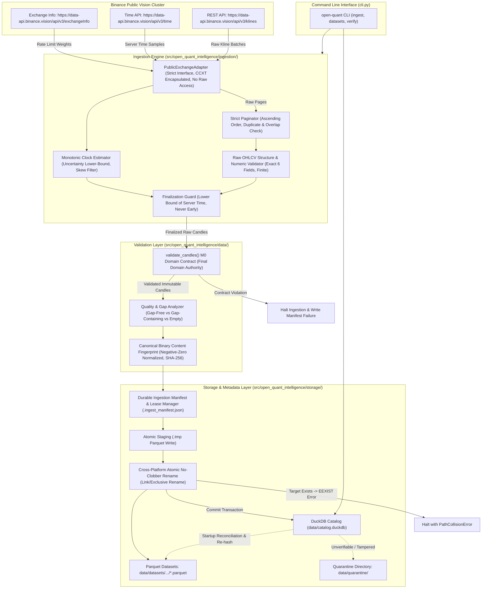

# Open Quant Intelligence V2 — Milestone M1 Architecture Proposal
## Public Market Data Ingestion and Canonical Storage Engine (Final Approved Specification)

**Document Reference:** `docs/M1_ARCHITECTURE_PROPOSAL.md`  
**Milestone:** M1 — Public Market Data Ingestion & Storage  
**Base Commit on `main`:** `02b7bcad43a2947c7ed2977e143e959559f5873d`  
**Branch:** `docs/m1-architecture-proposal`  
**Author:** AntiGravity (Implementation Engineer)  
**Technical Authority:** ChatGPT  
**Final Decision Maker:** Project Owner  
**Status:** FINAL ARCHITECTURAL SPECIFICATION ONLY (Implementation is strictly NOT authorized)  

---

## 1. Executive Summary & Purpose

Milestone M1 establishes the foundation for reproducible quantitative research in Open Quant Intelligence (OQI) by delivering an automated, deterministic historical market data ingestion and storage pipeline.

The pipeline will:
1. Collect public spot OHLCV data from Binance's dedicated public market data cluster (`https://data-api.binance.vision`) using CCXT without authentication or credentials, mediated through a strict, allowlisted public adapter interface that encapsulates CCXT.
2. Filter unfinalized candles using a conservative server-time uncertainty lower bound, and validate all candle rows through the existing M0 domain contracts (`Candle`, `MarketIdentity`, `SupportedTimeframe`).
3. Store validated datasets in Apache Parquet files using Snappy compression and integer microsecond UTC timestamp representations via cross-platform atomic no-clobber publications.
4. Maintain an append-only, crash-resilient local dataset catalog in DuckDB that tracks ingestion provenance, data quality statistics, gap analysis, EMPTY snapshot deduplication, and dual cryptographic fingerprints (canonical binary content fingerprint vs. physical Parquet SHA-256).
5. Provide user-facing CLI commands for downloading, cataloging, inspecting, and re-validating historical datasets.

This final specification resolves all review items: sub-millisecond rejection, M0 enum member alignment (`SupportedTimeframe.M1..D1`), conservative clock uncertainty bounds, allowlisted adapter encapsulation, atomic non-clobbering storage, EMPTY snapshot idempotency, six-field raw OHLCV validation, and negative-zero floating-point normalization.

---

## 2. Invariant Contracts & Strict Exclusions

### A. Preserved M0 & M0.1 Contracts
- **Python Compatibility:** Python 3.11 and 3.12 exclusively.
- **Repository Structure:** Standard `src/` layout under `src/open_quant_intelligence/`.
- **Domain Invariants:** Immutable `Candle`, `MarketIdentity`, and `SupportedTimeframe` classes remain the single source of truth.
- **Time Semantics:** Half-open interval convention `[open_time, close_time)` where `close_time = open_time + duration`.
- **Supported Timeframes:** Strictly `SupportedTimeframe.M1` ("1m"), `M5` ("5m"), `M15` ("15m"), `M30` ("30m"), `H1` ("1h"), `H4` ("4h"), and `D1` ("1d").
- **Data Integrity:** No silent auto-sorting, no forward-filling of gaps, and no row fabrication.
- **Test Integrity:** The existing 104-test M0/M0.1 unit and CLI test suite must continue passing without modification.

### B. Strict Milestone Exclusions
- **No Private API Keys or Credentials:** Ingestion uses public market data endpoints exclusively.
- **No Raw CCXT Exposure:** Raw CCXT exchange objects are never leaked outside the internal adapter boundary.
- **No Order Execution or Trading:** Zero routing, balancing, order placement, or wallet manipulation.
- **No Derivatives:** Strictly spot markets (`market_type == "spot"`). Futures, options, and perpetuals are out of scope.
- **No Strategy Logic or Backtesting:** Strategy evaluation, alpha generation, and portfolio simulation belong to M2/M3.
- **No AI/ML:** Model inference and feature training belong to M6.
- **No Real-Time Streaming:** WebSockets and orderbook tickers are excluded. M1 is historical batch OHLCV only.

---

## 3. Technology Stack & Dependency Verification

### A. Evaluation of Dependencies

| Component | Library Choice | Justification |
|---|---|---|
| **Market Data Adapter** | `ccxt>=4.4.0, <5.0.0` | Industry-standard exchange abstraction. Encapsulated behind `PublicExchangeAdapter`. Provides rate-limiting (`enableRateLimit=True`), dynamic throttle coordination, and standardized Kline parsing for Binance public vision endpoints. |
| **Analytical Catalog & Query** | `duckdb>=1.1.0, <2.0.0` | Embedded in-process analytical SQL engine. Handles metadata registration, analytical queries across local Parquet files, and relational catalog queries without requiring a client-server database daemon. |
| **Parquet Storage Engine** | Native DuckDB Parquet Engine (Primary) | DuckDB compiles native, highly performant Parquet reading and writing (`COPY ... TO ... (FORMAT PARQUET, COMPRESSION SNAPPY)`). Using DuckDB for Parquet eliminates heavy runtime coupling to PyArrow for ingestion. |
| **Optional Arrow Interop** | `pyarrow>=15.0.0, <19.0.0` (Optional `[dev]`) | Maintained as an optional development dependency for zero-copy memory testing and schema inspection, but **NOT** required for the production runtime pipeline. |

### B. CI Target Versions vs. Supported Bounds
The existing 104 tests in the repository verify M0 domain and CLI contracts; they do not exercise CCXT or DuckDB because M1 dependencies are not yet installed in the current environment. When M1 implementation begins, CI will explicitly test against pinned target versions while declaring semantic upper and lower bounds:

| Dependency | Supported Version Bounds in `pyproject.toml` | Target Pinned Version in M1 Implementation CI | Role |
|---|---|---|---|
| `ccxt` | `>=4.4.0, <5.0.0` | `4.4.52` | Production runtime |
| `duckdb` | `>=1.1.0, <2.0.0` | `1.1.3` | Production runtime |
| `pytest` | `>=8.0.0` | `8.3.3` | Test framework (`[dev]`) |
| `ruff` | `>=0.4.0` | `0.7.3` | Linter / formatter (`[dev]`) |
| `pyarrow` | `>=15.0.0, <19.0.0` | `18.0.0` | Optional verification (`[dev]`) |

```toml
[project]
dependencies = [
    "ccxt>=4.4.0,<5.0.0",
    "duckdb>=1.1.0,<2.0.0",
]

[project.optional-dependencies]
dev = [
    "pytest>=8.0.0",
    "ruff>=0.4.0",
    "pyarrow>=15.0.0,<19.0.0",
]
```

---

## 4. System Architecture & Module Boundaries

### A. Modular Structure
```text
src/open_quant_intelligence/
├── domain/                      # [M0] Immutable contracts (Candle, MarketIdentity, SupportedTimeframe)
│   ├── candle.py
│   ├── market.py
│   └── timeframe.py
├── data/                        # [M0] Validation engine
│   ├── validation.py            # [M0] Canonical candle & stream validator (final domain authority)
│   └── quality.py               # [M1 NEW] Gap analysis & data quality reporting
├── ingestion/                   # [M1 NEW] Public ingestion pipeline
│   ├── __init__.py
│   ├── adapter.py               # Strict allowlisted Binance public vision adapter (encapsulates CCXT)
│   ├── pagination.py            # Strict raw-page interval paginator with regression guards
│   ├── clock.py                 # Monotonic exchange clock offset estimator & conservative skew guard
│   ├── finalization.py          # Observation-time candle finalization filter (lower-bound based)
│   └── pipeline.py              # Orchestrator: Fetch -> Validate Raw -> Finalize -> Validate M0 -> Store
├── storage/                     # [M1 NEW] Persistence & Catalog
│   ├── __init__.py
│   ├── manifest.py              # Ingestion manifest, active lease & crash recovery record
│   ├── parquet_store.py         # Cross-platform atomic no-clobber Parquet writer & quarantine
│   ├── fingerprint.py           # Canonical binary content hashing & artifact SHA-256
│   └── catalog.py               # DuckDB catalog registration, gap recording & queries
└── cli.py                       # CLI entrypoints (validate, ingest, datasets, inspect, verify)
```

### B. Mermaid Architecture Diagram


---

## 5. Exact Timestamp Arithmetic & Request-Window Semantics

### A. Exact Integer Epoch Timedelta Arithmetic (No Floating-Point Math)
To prevent truncation, precision drift, and platform-specific IEEE-754 floating-point inaccuracies, floating-point timestamp conversion methods (`int(dt.timestamp() * 1000)`, `datetime.fromtimestamp(ms / 1000)`, and `.total_seconds() * 1000`) are **strictly prohibited**.

All conversions between Python `datetime` and integer epoch units must use exact integer arithmetic anchored to `datetime(1970, 1, 1, tzinfo=timezone.utc)`:

```python
from datetime import datetime, timedelta, timezone
from open_quant_intelligence.domain.timeframe import SupportedTimeframe

EPOCH_UTC = datetime(1970, 1, 1, tzinfo=timezone.utc)


def datetime_to_epoch_ms(dt: datetime) -> int:
    """Convert an aware UTC datetime to integer epoch milliseconds.

    Rejects naive datetimes, pre-epoch timestamps, and fractional milliseconds.
    """
    if dt.tzinfo is None or dt.utcoffset() != timedelta(0):
        raise ValueError(f"Datetime {dt} must be explicit timezone-aware UTC.")
    if dt < EPOCH_UTC:
        raise ValueError(f"Pre-epoch datetime {dt} is not supported.")

    diff = dt - EPOCH_UTC
    total_micros = diff.days * 86_400_000_000 + diff.seconds * 1_000_000 + diff.microseconds

    # Explicitly reject sub-millisecond fractions
    if total_micros % 1_000 != 0:
        raise ValueError(f"Timestamp {dt} has fractional milliseconds (microseconds: {diff.microseconds}).")

    return total_micros // 1_000


def epoch_ms_to_datetime(ms: int) -> datetime:
    """Convert integer epoch milliseconds to aware UTC datetime."""
    if not isinstance(ms, int) or isinstance(ms, bool):
        raise TypeError(f"Timestamp must be integer milliseconds, got {type(ms)}")
    if ms < 0:
        raise ValueError(f"Epoch milliseconds cannot be negative, got {ms}")

    return EPOCH_UTC + timedelta(milliseconds=ms)


def timeframe_to_duration_ms(timeframe: SupportedTimeframe) -> int:
    """Return exact integer duration milliseconds for M0 SupportedTimeframe members."""
    minutes_map: dict[SupportedTimeframe, int] = {
        SupportedTimeframe.M1: 1,
        SupportedTimeframe.M5: 5,
        SupportedTimeframe.M15: 15,
        SupportedTimeframe.M30: 30,
        SupportedTimeframe.H1: 60,
        SupportedTimeframe.H4: 240,
        SupportedTimeframe.D1: 1440,
    }
    if timeframe not in minutes_map:
        raise ValueError(f"Unsupported timeframe: {timeframe}")
    return minutes_map[timeframe] * 60_000
```

### B. Sub-Millisecond & Pre-Epoch Timestamp Policy
- **Sub-Millisecond Policy:** Microsecond fractions on input datetimes must be exact multiples of 1,000 (`total_micros % 1000 == 0`). If sub-millisecond fractions exist, input validation raises `ValueError` rather than silently rounding or truncating.
- **Pre-Epoch Policy:** Timestamps prior to `1970-01-01T00:00:00Z` ($ms < 0$) are rejected with `ValueError`. Cryptocurrency spot markets did not exist prior to 2009; pre-epoch dates indicate invalid configurations.

### C. Request-Window Semantics & Grid Alignment
The requested range is defined as the half-open interval `[since, until)`:
- A candle starting at `open_time` belongs to the dataset if and only if:
  $$\text{since} \le \text{open\_time} < \text{until}$$
- Since an interval's close time is defined by the M0 contract as $\text{close\_time} = \text{open\_time} + \Delta$, requiring $\text{open\_time} < \text{until}$ alongside grid-alignment guarantees that:
  $$\text{close\_time} \le \text{until}$$
  There is zero contradiction between interval membership and boundary enclosure.

#### Mandatory Grid Alignment Contract
For M1, `since` and `until` **must be strictly aligned to the timeframe grid** relative to `EPOCH_UTC`:
$$\text{since\_ms} \pmod{\Delta_{\text{ms}}} == 0 \quad \text{and} \quad \text{until\_ms} \pmod{\Delta_{\text{ms}}} == 0$$
If either boundary is unaligned, ingestion **rejects the request immediately** with a structured error `UnalignedBoundaryError`, reporting the exact required aligned timestamps. Silent snapping or floor/ceil rounding is prohibited.

#### Expected Interval Count Calculation
For any validated query window, the exact expected number of continuous intervals is:
$$N_{\text{expected}} = \frac{\text{until\_ms} - \text{since\_ms}}{\Delta_{\text{ms}}}$$
- If $N_{\text{expected}} \le 0$, the request is rejected with `InvalidWindowError("until must be strictly greater than since")`.
- Expected candle open times form the exact sequence:
  $$\{\text{since\_ms} + k \cdot \Delta_{\text{ms}} \mid 0 \le k < N_{\text{expected}}\}$$

---

## 6. Strict Raw-Page & OHLCV Structure Validation

### A. Strict Raw OHLCV Row Structure & Numeric Validation
Before accessing `row[0]` or any individual elements, the paginator validates the structural and numerical integrity of each Kline row:
1. **Row Container & Length Type:** The row must be an ordered sequence (`list` or `tuple`) containing **exactly 6 fields** (`len(row) == 6`). Longer or shorter tuples are rejected immediately with `MalformedKlineError`.
2. **Field Types & Content:**
   - Field `[0]` (`open_time_ms`): Must be a strictly non-negative integer (`isinstance(t, int) and not isinstance(t, bool) and t >= 0`).
   - Fields `[1]` (`open`), `[2]` (`high`), `[3]` (`low`), `[4]` (`close`), `[5]` (`volume`): Must be valid numeric values (instances of `int` or `float`, not `bool`).
3. **Finite-Value Check:** Every numeric price and volume field must be strictly finite (`math.isfinite(val) is True`). `NaN`, `+Infinity`, and `-Infinity` are rejected with `MalformedKlineError`.
4. **Basic Price Positivity & Volume Non-Negativity:**
   - Prices (`open`, `high`, `low`, `close`) must be strictly positive ($> 0$).
   - Volume must be non-negative ($\ge 0$).
5. **Preservation of M0 Domain Authority:** This ingestion-level check serves as an early filter to reject corrupted exchange wire payloads before finalization. The comprehensive domain invariants (e.g. `high >= max(open, close)`, `low <= min(open, close)`, timezone-aware UTC datetime conversions, and symbol formatting) are strictly validated by M0's `validate_candles()` as the final domain authority.

### B. Strict Raw-Page Ordering & Invariants
1. **Strict Ascending Order:** Timestamps within the page must be strictly increasing:
   $$t_{i+1} > t_i \quad \forall \, 0 \le i < \text{len}(\text{page}) - 1$$
   Decreasing or identical timestamps inside a page raise `MalformedPageError`.
2. **Cursor Compliance:** Every returned timestamp must be $\ge \text{current\_since\_ms}$. If $t_0 < \text{current\_since\_ms}$, the page contains stale or non-advancing data, triggering `PaginationRegressionError`.
3. **No Overlap with Previously Accepted Data:** If previous pages accepted timestamps $S_{\text{prev}}$, the intersection $\text{set}(t \in \text{page}) \cap S_{\text{prev}}$ must be empty. Overlaps indicate an exchange cursor regression and raise `PageOverlapError`.
4. **Full Sequence Verification:** The entire sequence of timestamps is validated against regression and duplicate sets, not merely the first and last timestamps.
5. **Maximum Timestamp Authenticity:** The paginator asserts that $\max(\text{page timestamps}) == \text{page}[-1][0]$.

### C. Cursor Advancement Invariant
The cursor must advance if and only if the page has passed all raw-page validation checks:
$$\text{current\_since\_ms} = \text{max\_raw\_open\_ms} + 1$$
- **Incomplete Candle Independence:** If the final candle on the page is in progress and excluded by the finalization guard, `current_since_ms` **still advances** based on $\text{max\_raw\_open\_ms} + 1$. Because cursor advancement is driven by the validated raw page rather than the finalized subset, tail-candle filtering can never stall the loop.

### D. Consistent Request Budget & Safety Ceiling
To prevent runaway loops when responses contain sparse or partial pages, M1 defines a consistent maximum request budget:
$$\text{budget} = \max\left(50, \, \left\lceil \frac{N_{\text{expected}}}{\text{PAGE\_LIMIT}} \right\rceil \times 3\right)$$
Where $\text{PAGE\_LIMIT} = 1000$ (Binance maximum per request). If the pagination iteration count exceeds $\text{budget}$, pagination aborts with `PaginationBudgetExceededError`.

---

## 7. Clock Authority, Uncertainty Interval & Conservative Finalization

### A. Server-Time Uncertainty Interval (Never Finalize Early)
Assuming symmetric network latency introduces risk: if response transmission is delayed, the exchange server clock may actually be further behind the client's estimate. To guarantee that **no candle is ever finalized prematurely**, M1 models server time as an **uncertainty interval** $[T_{\text{server\_min}}, T_{\text{server\_max}}]$ and uses the **conservative lower bound** for all finalization decisions.

1. **Sampling Protocol:**
   - Measure monotonic timestamps around the server-time call:
     ```python
     t_mono_before = time.monotonic_ns()
     t_server_ms = adapter.fetch_time()
     t_mono_after = time.monotonic_ns()
     ```
   - Round-trip latency is $\Delta_{\text{RTT}} = (t_{\text{mono\_after}} - t_{\text{mono\_before}}) // 1_000_000\,\text{ms}$.
2. **Uncertainty Lower Bound Formulation:**
   - The exchange timestamp `t_server_ms` was generated at some moment between $t_{\text{mono\_before}}$ and $t_{\text{mono\_after}}$.
   - In the worst-case scenario (all network delay occurred on the outbound request, so response returned instantaneously), the server clock at $t_{\text{mono\_after}}$ is at least `t_server_ms`.
   - Therefore, at any elapsed monotonic time $\Delta_{\text{mono}} = (t_{\text{mono\_now}} - t_{\text{mono\_after}}) // 1_000_000\,\text{ms}$, the **conservative lower bound of estimated server time** is:
     $$T_{\text{server\_min\_ms}} = t_{\text{server\_ms}} + \Delta_{\text{mono}}$$
     *(Zero assumed outbound delay; conservative lower bound prevents premature candle closure).*
3. **Conservative Finalization Rule:**
   A candle is finalized if and only if:
   $$T_{\text{open\_ms}} + \Delta_{\text{timeframe\_ms}} \le T_{\text{server\_min\_ms}}$$
   Because $T_{\text{server\_min\_ms}} \le T_{\text{actual\_server}}$, this strictly guarantees that the candle's close boundary has passed on the exchange.

### B. Clock Resampling, Age Ceiling & Exhaustion Policy
- **Maximum Clock Age:** The clock offset estimate has a maximum lifetime of 10 minutes (`MAX_CLOCK_AGE_SEC = 600`).
- **Resampling Protocol:** If clock age exceeds 10 minutes, or if round-trip latency during a sample exceeds 2,000 ms, the adapter attempts resampling up to `MAX_CLOCK_RESAMPLE_ATTEMPTS = 3` times.
- **Uncertainty Exhaustion Policy:** If all 3 resampling attempts exceed 2,000 ms RTT, or if $|\tau_{\text{exchange}} - \tau_{\text{local}}| > 3000\,\text{ms}$ in either direction, ingestion **halts immediately** with `UnreliableClockError`. The pipeline refuses to finalize candles when server time cannot be established with high confidence.

---

## 8. Public-Only Exchange Adapter & Endpoint Routing

### A. Strict Allowlisted Adapter Interface (`PublicExchangeAdapter`)
To prevent architectural leaks, raw CCXT objects and authenticated methods are strictly encapsulated. The ingestion engine interacts solely through a narrow, allowlisted interface:

```python
from typing import Protocol


class RawKlineRow(list):
    """Raw Kline tuple [open_time, open, high, low, close, volume]."""


class PublicExchangeAdapter(Protocol):
    """Strict allowlisted public market data interface encapsulating CCXT."""

    def fetch_ohlcv(self, symbol: str, timeframe: str, since_ms: int, limit: int = 1000) -> list[RawKlineRow]:
        """Fetch raw public OHLCV candles from Binance vision cluster."""
        ...

    def fetch_time(self) -> int:
        """Fetch public Binance server timestamp in milliseconds."""
        ...

    def get_rate_limit_weight_limit(self) -> int:
        """Return maximum IP request weight per minute from exchangeInfo."""
        ...

    def get_last_used_weight_1m(self) -> int:
        """Return the latest recorded X-MBX-USED-WEIGHT-1M header value."""
        ...
```

### B. Dedicated Public Market Data Host & Encapsulation
- **Public Market Data Host:** Configured exclusively to Binance's dedicated public cluster:
  ```text
  https://data-api.binance.vision
  ```
- **Disabling Private/Trading Methods:**
  ```python
  import ccxt


  class BinanceVisionPublicAdapter:
      def __init__(self) -> None:
          self._exchange = ccxt.binance(
              {
                  "enableRateLimit": True,
                  "options": {
                      "defaultType": "spot",
                      "adjustForTimeDifference": False,
                  },
                  "urls": {
                      "api": {
                          "public": "https://data-api.binance.vision/api/v3",
                          "v1": "https://data-api.binance.vision/api/v3",
                          "private": None,  # Disabled
                      }
                  },
              }
          )
          # Explicitly seal unnecessary methods
          self._exchange.create_order = None
          self._exchange.cancel_order = None
          self._exchange.fetch_balance = None
  ```

### C. Rate Limits from `exchangeInfo` & Header Inspection
- **Weight Limits from `exchangeInfo`:** During session initialization, the adapter calls `GET /api/v3/exchangeInfo` and parses the `rateLimits` array for `rateLimitType == "REQUEST_WEIGHT"` and `interval == "MINUTE"`. The returned `limit` (e.g. 1,200 or 6,000) is cached. `fetch_exchange_status()` is **not** used.
- **Used-Weight Header Inspection:** Every response inspects the header `X-MBX-USED-WEIGHT-1M`.
  - Used weight $\le 70\%$: Paced execution.
  - Used weight $> 70\%$: Adaptive proportional sleep $\text{sleep\_ms} = (\text{used} / \text{limit})^2 \times 500\,\text{ms}$.
  - Used weight $> 90\%$: Pauses execution until the current 60-second window expires.
- **HTTP 429:** Respects `Retry-After` header $+ 500\,\text{ms}$ jitter. Up to 3 retries.
- **HTTP 418 IP Ban:** **HALT IMMEDIATELY WITH ZERO RETRIES.** Log `CRITICAL` error.

---

## 9. Canonical Binary Content Fingerprinting & Artifact Hash

To guarantee deterministic data integrity across platforms, compilers, and DuckDB versions, M1 establishes **exactly one canonical serialization contract**.

### A. Content Fingerprint vs. Artifact SHA-256
- **Canonical Content Fingerprint (`content_fingerprint_sha256`):** Computed over a strictly normalized, length-prefixed binary stream of validated candle attributes. Invariant to OS, Parquet metadata, row-group chunking, or compression differences.
- **Parquet Artifact SHA-256 (`file_sha256`):** Standard SHA-256 cryptographic digest of the physical `.parquet` file on disk.

### B. Negative-Zero Normalization Contract
In IEEE-754 floating point arithmetic, $-0.0$ and $+0.0$ have distinct bit representations (`0x8000000000000000` vs. `0x0000000000000000`).
- **Normalization Rule:** Before binary encoding, all price and volume values are normalized:
  ```python
  def normalize_float(val: float) -> float:
      if val == 0.0:  # Matches both +0.0 and -0.0 in Python
          return 0.0
      return val
  ```
  This ensures negative zero is strictly normalized to positive zero, eliminating non-deterministic hashing variances.

### C. Canonical Binary Serialization Specification
The binary stream fed into `hashlib.sha256()` is constructed through strict little-endian binary encoding:

```text
[Header Block]
  - Magic Bytes:          ASCII "OQICCF" (6 bytes)
  - Schema Version:       UINT16_LE (2 bytes, value = 1)
  - Exchange ID:          UINT16_LE length + UTF-8 bytes (e.g. 7, "binance")
  - Market Type:          UINT16_LE length + UTF-8 bytes (e.g. 4, "spot")
  - Symbol:               UINT16_LE length + UTF-8 bytes (e.g. 8, "BTC/USDT")
  - Timeframe:            UINT16_LE length + UTF-8 bytes (e.g. 2, "1h")
  - Candle Count:         UINT64_LE (8 bytes)

[Candle Record Block] (Repeated for each candle, ordered strictly by open_time ascending)
  - Open Time Epoch ms:   INT64_LE (8 bytes)
  - Close Time Epoch ms:  INT64_LE (8 bytes)
  - Open Price:           Normalized IEEE-754 binary64 DOUBLE_LE (8 bytes)
  - High Price:           Normalized IEEE-754 binary64 DOUBLE_LE (8 bytes)
  - Low Price:            Normalized IEEE-754 binary64 DOUBLE_LE (8 bytes)
  - Close Price:          Normalized IEEE-754 binary64 DOUBLE_LE (8 bytes)
  - Base Volume:          Normalized IEEE-754 binary64 DOUBLE_LE (8 bytes)
  - Quote Volume Present: UINT8 (1 byte: 0 = NULL, 1 = Present)
    [If Present]:         Normalized IEEE-754 binary64 DOUBLE_LE (8 bytes)
  - Trade Count Present:  UINT8 (1 byte: 0 = NULL, 1 = Present)
    [If Present]:         INT64_LE (8 bytes)
```

#### Canonical Serialization Rules
1. **Validation Prerequisite:** Fingerprinting is performed **only after** candles pass full `validate_candles()` contract checks.
2. **No Silent Sorting:** Input sequence must already be sorted in strict ascending order. If $t_{i+1} \le t_i$, fingerprinter raises `UnsortedStreamError`.
3. **Normalized Float Representation:** Prices and volumes verified finite (`math.isfinite(val) is True`). IEEE-754 binary64 little-endian (`<d` in Python `struct`) provides unambiguous byte sequences.
4. **Final Digest:** `hashlib.sha256()` digest formatted as a lowercase 64-character hexadecimal string prefixed with `sha256:`.
5. **Illustrative Sample Format:** All sample hashes shown in proposals or documentation are explicitly illustrative format examples, not hardcoded verification anchors.

---

## 10. Crash Recovery, Durable Manifest & Atomic No-Clobber Publication

### A. Cross-Platform Atomic No-Clobber Publication
To uphold the invariant that **existing historical datasets are immutable and never overwritten**, M1 replaces `os.replace()` (which clobbers destination files on POSIX) with an atomic no-clobber publication operation:
- **POSIX Systems:** Uses `os.link(staging_path, target_path)` followed by `os.unlink(staging_path)`. If `target_path` already exists, `os.link()` raises `FileExistsError` (EEXIST) atomically without touching the target.
- **Windows Systems:** Uses the Win32 `MoveFileExW` API with flag `MOVEFILE_WRITE_THROUGH` and without `MOVEFILE_REPLACE_EXISTING`. If the destination exists, it raises `FileExistsError` atomically.
- **Collision Handling:** If `target_path` already exists, ingestion halts immediately with `DatasetPathCollisionError`. The staging file remains in place and is logged for administrative review. Target files are never overwritten.

### B. Ingestion Manifest Schema & Active Leases
Every ingestion job writes a durable JSON manifest file alongside staging data:
```text
data/datasets/.ingest_manifest_<ingestion_uuid>.json
```

```json
{
  "ingestion_uuid": "f47ac10b-58cc-4372-a567-0e02b2c3d479",
  "lease_owner_pid": 12844,
  "lease_expires_at_utc": "2026-11-13T17:30:00Z",
  "schema_version": 1,
  "ccxt_version": "4.4.52",
  "exchange_id": "binance",
  "market_type": "spot",
  "symbol": "BTC/USDT",
  "timeframe": "1h",
  "requested_since_utc": "2026-11-01T00:00:00Z",
  "requested_until_utc": "2026-11-05T00:00:00Z",
  "staging_file_path": "data/datasets/.../dataset_..._f47ac10b.parquet.tmp",
  "target_file_path": "data/datasets/.../dataset_..._f47ac10b.parquet",
  "record_count": 96,
  "content_fingerprint_sha256": "sha256:7f9a2b84c310d54e8b21c430aef7830182419ef8973b02196a84920485a3bb12",
  "file_sha256": "sha256:4d831b7908c84857b28ec95ef5476a8947cf839a823908dbca19273645bbef21",
  "stage": "COMMITTING_CATALOG",
  "created_at_utc": "2026-11-13T17:15:00Z",
  "updated_at_utc": "2026-11-13T17:15:04Z"
}
```

### C. Manifest Reconciliation Protocol (Commit Success vs. Unlink Failure)
If a process crashes after DuckDB commit succeeds but before `.ingest_manifest_<uuid>.json` is deleted:
1. Startup reconciliation detects the orphaned manifest.
2. Checks DuckDB catalog for `ingestion_uuid`.
3. If a record with `ingestion_status = 'COMMITTED'` already exists for that `ingestion_uuid`, the manifest is simply unlinked (transaction already durable in catalog).
4. If no record exists, reconciliation verifies the Parquet artifact and completes the commit transaction.

### D. Safe Staging Cleanup & Quarantine
- **Active Lease Protection:** Staging `.tmp` files are never deleted on age alone. Before cleaning, the reconciler checks if `lease_owner_pid` is active on the OS and `lease_expires_at_utc` is in the future.
- **Quarantine:** Unregistered, corrupted, or untracked `.parquet` files are moved to `data/quarantine/<timestamp>_<filename>` and logged in `data/quarantine_log.jsonl`.

---

## 11. Parquet Storage Model, EMPTY Deduplication & DuckDB Catalog

### A. EMPTY Snapshot Idempotency & Deduplication
When the exchange legitimately returns zero candles for a requested window (e.g. market did not exist prior to listing):
1. **Catalog Representation:**
   - `record_count = 0`, `gap_count = 0`, `missing_intervals = N_expected`.
   - `quality_status = 'EMPTY'`, `ingestion_status = 'COMMITTED'`.
   - `file_path = NULL`, `file_sha256 = NULL`, `file_size_bytes = NULL` (no physical file created).
   - `content_fingerprint_sha256 = "sha256:EMPTY"`.
2. **Deduplication Policy:**
   - If `open-quant ingest` is invoked for a range with an existing verified `EMPTY` snapshot in the catalog:
     - The CLI detects the `EMPTY` record.
     - Logs: `Verified EMPTY dataset already recorded for this range. Skipping ingestion. Use --force to re-query exchange.`
     - Exits with returncode 0 without performing network requests.
   - If `--force` is supplied, ingestion re-queries Binance vision endpoints. If still empty, it records a new timestamped `EMPTY` snapshot under the same `dataset_identity`.

### B. DuckDB Catalog Schema (DDL)
```sql
CREATE TABLE IF NOT EXISTS datasets (
    snapshot_id VARCHAR PRIMARY KEY,             -- Unique snapshot ID (e.g. 'snap_f47ac10b8e21')
    dataset_identity VARCHAR NOT NULL,           -- Deterministic key: 'binance:spot:BTC/USDT:1h:since:until'
    exchange_id VARCHAR NOT NULL,                -- 'binance'
    market_type VARCHAR NOT NULL,                -- 'spot'
    symbol VARCHAR NOT NULL,                     -- 'BTC/USDT'
    timeframe VARCHAR NOT NULL,                  -- '1h'
    requested_since TIMESTAMP WITH TIME ZONE NOT NULL,
    requested_until TIMESTAMP WITH TIME ZONE NOT NULL,
    actual_first_open TIMESTAMP WITH TIME ZONE,  -- NULL if EMPTY
    actual_last_close TIMESTAMP WITH TIME ZONE,  -- NULL if EMPTY
    expected_records BIGINT NOT NULL,            -- Total theoretical grid intervals
    record_count BIGINT NOT NULL,                -- Actual records captured (0 if EMPTY)
    gap_count INTEGER NOT NULL,                  -- Number of gap events
    missing_intervals BIGINT NOT NULL,           -- Total missing intervals across all gaps
    content_fingerprint_sha256 VARCHAR NOT NULL, -- Canonical content hash ('sha256:EMPTY' if EMPTY)
    file_sha256 VARCHAR,                         -- NULL for EMPTY datasets
    file_path VARCHAR,                           -- NULL for EMPTY datasets
    file_size_bytes BIGINT,                      -- NULL for EMPTY datasets
    ccxt_version VARCHAR NOT NULL,
    ingestion_uuid VARCHAR NOT NULL,
    ingested_at TIMESTAMP WITH TIME ZONE NOT NULL,
    ingestion_status VARCHAR NOT NULL,           -- 'COMMITTED', 'FAILED', 'ABORTED'
    quality_status VARCHAR NOT NULL              -- 'EMPTY', 'GAP_FREE', 'GAP_CONTAINING', 'CORRUPTED'
);

CREATE TABLE IF NOT EXISTS dataset_gaps (
    gap_id VARCHAR PRIMARY KEY,
    snapshot_id VARCHAR REFERENCES datasets(snapshot_id),
    expected_open TIMESTAMP WITH TIME ZONE NOT NULL,
    actual_open TIMESTAMP WITH TIME ZONE NOT NULL,
    missing_count BIGINT NOT NULL
);

CREATE INDEX IF NOT EXISTS idx_datasets_identity 
ON datasets(dataset_identity, ingested_at DESC);
```

---

## 12. CLI Proposal & User Experience

```bash
# 1. Ingest historical public data with strict grid-aligned boundaries
open-quant ingest \
  --exchange binance \
  --symbol BTC/USDT \
  --timeframe 1h \
  --since 2026-11-01T00:00:00Z \
  --until 2026-11-05T00:00:00Z \
  [--output-dir data/] \
  [--fail-on-gaps] \
  [--force]

# 2. List registered dataset snapshots
open-quant datasets list [--symbol BTC/USDT] [--timeframe 1h] [--status GAP_FREE]

# 3. Inspect dataset details, gap distributions, and provenance
open-quant datasets inspect <snapshot_id_or_fingerprint>

# 4. Verify physical Parquet integrity against catalog fingerprints
open-quant datasets verify <snapshot_id_or_fingerprint>
```

### Sample CLI Report Output (Illustrative)
```text
============================================================
Open Quant Intelligence — Historical Ingestion Report
============================================================
Snapshot ID:           snap_f47ac10b8e21
Ingestion UUID:        f47ac10b-58cc-4372-a567-0e02b2c3d479
Exchange:              binance (public vision cluster)
Symbol:                BTC/USDT | Market: spot | Timeframe: 1h
Requested Range (UTC): 2026-11-01T00:00:00Z -> 2026-11-05T00:00:00Z
Coverage Range (UTC):  2026-11-01T00:00:00Z -> 2026-11-05T00:00:00Z
Expected Intervals:    96
Recorded Intervals:    96 (0 missing)
Ingestion Status:      COMMITTED
Quality Status:        GAP_FREE
Content Fingerprint:   sha256:7f9a2b84c310d54e8b21c430aef7830182419ef8973b02196a84920485a3bb12
Parquet Artifact:      data/datasets/exchange=binance/market=spot/symbol=BTC_USDT/timeframe=1h/dataset_20261101T000000Z_20261105T000000Z_7f9a2b84_f47ac10b.parquet
Artifact SHA-256:      sha256:4d831b7908c84857b28ec95ef5476a8947cf839a823908dbca19273645bbef21
Catalog Record:        REGISTERED (catalog.duckdb)
============================================================
```

---

## 13. Deterministic Offline Testing Strategy

All automated CI test suites run **100% offline** without network access or live exchange calls.

### Required Deterministic Test Suite
1. **`test_exact_integer_epoch_conversions`**: Asserts exact integer round-tripping for aware UTC datetimes; rejects naive datetimes, pre-epoch datetimes, and fractional microsecond inputs.
2. **`test_timeframe_to_duration_ms_enum_members`**: Verifies exact duration mapping for all `SupportedTimeframe` members (`M1` through `D1`).
3. **`test_raw_ohlcv_validation_six_fields`**: Verifies rows with $<6$ or $>6$ items, non-integer timestamps, non-finite floats, or negative prices are rejected with `MalformedKlineError`.
4. **`test_conservative_clock_uncertainty_lower_bound`**: Injects varying network latency; verifies finalization strictly uses $T_{\text{server\_min\_ms}}$ and never finalizes early.
5. **`test_clock_resampling_exhaustion_halts`**: Simulates 3 consecutive high-latency clock samples; verifies ingestion halts with `UnreliableClockError`.
6. **`test_public_adapter_encapsulation`**: Verifies adapter exposes only allowlisted methods; raw CCXT object and trading methods are inaccessible.
7. **`test_atomic_no_clobber_file_exists`**: Verifies publication raises `DatasetPathCollisionError` without overwriting when target file exists.
8. **`test_empty_snapshot_deduplication`**: Verifies existing `EMPTY` snapshot causes subsequent unforced calls to exit 0 without network requests.
9. **`test_canonical_content_fingerprint_negative_zero_normalized`**: Verifies $-0.0$ and $+0.0$ in float fields yield identical content fingerprint SHA-256.
10. **`test_manifest_reconciliation_post_commit_crash`**: Simulates process crash after DuckDB commit but before manifest unlinking; asserts startup cleaner unlinks manifest without error.
11. **`test_http_418_immediate_halt`**: Verifies HTTP 418 IP ban aborts immediately with zero retries.

---

## 14. Acceptance Criteria Checklist for M1

| # | Criterion | Verification Method |
|---|---|---|
| 1 | Encapsulate CCXT in strict allowlisted `PublicExchangeAdapter` pointing to Binance vision | Adapter encapsulation unit test |
| 2 | Reject sub-millisecond timestamps, naive datetimes, and unaligned window boundaries | Parameterized unit tests |
| 3 | Use SupportedTimeframe enum members (`M1..D1`) with exact millisecond durations | Timeframe unit test |
| 4 | Validate raw OHLCV rows for exact 6 fields, finite numbers, and valid bounds | Ingestion raw row validator tests |
| 5 | Conservative clock uncertainty lower-bound finalization (never finalize early) | Clock estimator unit tests |
| 6 | Cross-platform atomic no-clobber Parquet publication | Filesystem publication collision tests |
| 7 | EMPTY snapshot idempotency and deduplication in DuckDB catalog | Catalog deduplication unit tests |
| 8 | Canonical binary content fingerprinting with negative-zero normalization | Deterministic byte-level test |
| 9 | Ingestion manifest lifecycle with active lease and orphan quarantine | Staging reconciliation tests |
| 10 | 100% offline deterministic test suite passing on Python 3.11 and 3.12 | CI workflow matrix run |

---

## 15. Risks, Trade-offs & Unresolved Decisions

1. **Exchange Historical Data Corrections:** While rare, exchanges may occasionally revise historical klines. By storing immutable snapshots indexed by `snapshot_id`, OQI ensures backtests are permanently pinned to the dataset state as observed at ingestion time.
2. **DuckDB In-Process Write Concurrency:** DuckDB supports concurrent readers but a single writer. The active ingestion manifest and CLI process lock serialize write access, preventing database lock contention.
3. **Dedicated Vision Host Availability:** `data-api.binance.vision` is specifically maintained by Binance for high-throughput public data ingestion. If unreachable, the adapter fails gracefully with clear network error classification.

---
**Milestone M1 Proposal Final Correction Complete. Awaiting Technical Lead Review & Approval.**
