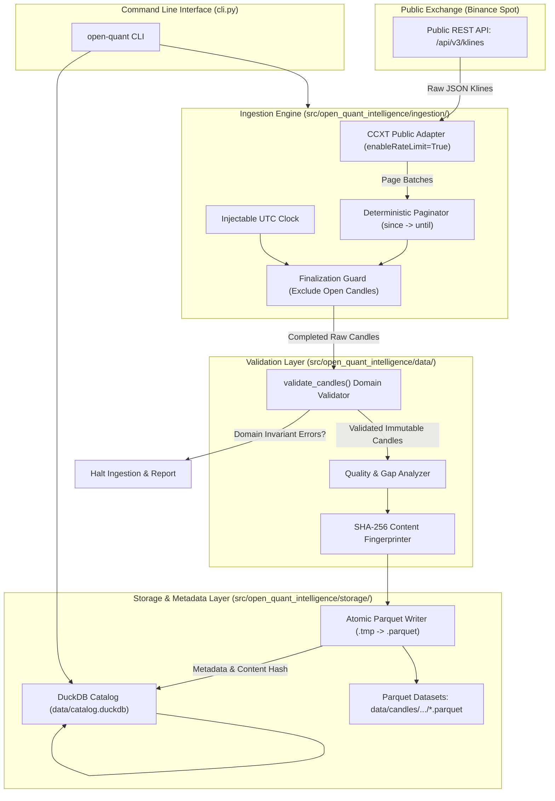

# Open Quant Intelligence V2 — Milestone M1 Architecture Proposal
## Public Market Data Ingestion and Canonical Storage Engine

**Document Reference:** `docs/M1_ARCHITECTURE_PROPOSAL.md`  
**Milestone:** M1 — Public Market Data Ingestion & Storage  
**Base Commit:** `02b7bcad43a2947c7ed2977e143e959559f5873d`  
**Author:** AntiGravity (Implementation Engineer)  
**Technical Authority:** ChatGPT  
**Final Decision Maker:** Project Owner  
**Status:** PROPOSAL / SPECIFICATION ONLY (No code changes implemented)  

---

## 1. Executive Summary & Objectives

Milestone M1 establishes the foundation for reproducible quantitative research in Open Quant Intelligence (OQI) by delivering an automated, deterministic historical market data ingestion and storage pipeline.

The pipeline will:
1. Fetch public spot OHLCV data from Binance using CCXT without authentication or credentials.
2. Filter unfinalized candles and validate rows through the existing M0 domain contracts (`Candle`, `MarketIdentity`, `SupportedTimeframe`).
3. Store validated datasets in Apache Parquet files using snappy compression and nanosecond/microsecond UTC timestamp representations.
4. Maintain a local dataset catalog in DuckDB that tracks ingestion provenance, data quality statistics, detected gaps, and immutable content fingerprints.
5. Provide user-facing CLI commands for downloading, cataloging, inspecting, and re-validating historical datasets.

This document provides the implementation-ready technical specification for M1. **No pipeline code is implemented as part of this assignment.**

---

## 2. Invariant Contracts & Strict Exclusions

### A. Preserved M0 & M0.1 Contracts
- **Python Compatibility:** Python 3.11 and 3.12 exclusively.
- **Repository Structure:** Standard `src/` layout under `src/open_quant_intelligence/`.
- **Domain Invariants:** Immutable `Candle`, `MarketIdentity`, and `SupportedTimeframe` classes remain the single source of truth.
- **Time Semantics:** Half-open interval convention `[open_time, close_time)` where `close_time = open_time + duration`.
- **Supported Timeframes:** Strictly `1m`, `5m`, `15m`, `30m`, `1h`, `4h`, `1d`.
- **Data Integrity:** No silent auto-sorting, no forward-filling of gaps, and no row fabrication.
- **Test Integrity:** The existing 104-test unit and CLI test suite must continue passing without modification.

### B. Strict Milestone Exclusions
- **No Private API Keys or Credentials:** Ingestion uses public endpoints exclusively.
- **No Order Execution or Trading:** Zero routing, balancing, order placement, or wallet manipulation.
- **No Derivatives:** Strictly spot markets (`market_type == "spot"`). Futures, options, and perpetuals are out of scope.
- **No Strategy Logic or Backtesting:** Strategy evaluation, alpha generation, and portfolio simulation belong to M2/M3.
- **No AI/ML:** Model inference and feature training belong to M6.
- **No Real-Time Streaming:** WebSockets and orderbook tickers are excluded. M1 is historical batch OHLCV only.

---

## 3. Technology Stack & Dependency Specifications

### A. Evaluation of Dependencies

| Component | Library Choice | Justification |
|---|---|---|
| **Market Data Adapter** | `ccxt>=4.4.0, <5.0.0` | Industry-standard exchange abstraction. Provides rate-limiting (`enableRateLimit=True`), automatic retry coordination, and standardized Kline parsing for Binance public endpoints. |
| **Analytical Catalog & Query** | `duckdb>=1.1.0, <2.0.0` | Embedded in-process analytical SQL engine. Handles metadata registration, analytical queries across local Parquet files, and relational catalog queries without a client-server database. |
| **Parquet Storage Engine** | Native DuckDB Parquet Reader/Writer (Primary) with optional `pyarrow>=15.0.0, <19.0.0` | DuckDB contains native, high-performance Parquet read/write capabilities (`COPY ... TO ... (FORMAT PARQUET)`). Direct DuckDB Parquet generation eliminates heavy PyArrow coupling for ingestion while keeping PyArrow optional for zero-copy memory interop. |

### B. Recommended Dependency Additions in `pyproject.toml`
```toml
[project]
dependencies = [
    "ccxt>=4.4.0,<5.0.0",
    "duckdb>=1.1.0,<2.0.0",
]

[project.optional-dependencies]
dev = [
    "pytest>=8.0.0",
    "ruff>=0.4.0",
    "pyarrow>=15.0.0,<19.0.0",
]
```

---

## 4. System Architecture & Module Boundaries

### A. Modular Structure
```text
src/open_quant_intelligence/
├── domain/                      # [M0] Immutable contracts (Candle, MarketIdentity, SupportedTimeframe)
├── data/                        # [M0] Validation engine
│   ├── validation.py            # [M0] Canonical candle & stream validator
│   └── quality.py               # [M1 NEW] Gap analysis & data quality reporting
├── ingestion/                   # [M1 NEW] Public ingestion pipeline
│   ├── __init__.py
│   ├── adapter.py               # CCXT Binance public market client wrapper
│   ├── pagination.py            # Deterministic interval paginator
│   ├── finalization.py          # Clock-aware incomplete candle filter
│   └── pipeline.py              # Orchestrator: Fetch -> Finalize -> Validate -> Fingerprint
├── storage/                     # [M1 NEW] Persistence & Catalog
│   ├── __init__.py
│   ├── parquet_store.py         # Atomic Parquet writer & reader
│   └── catalog.py               # DuckDB metadata registration and queries
└── cli.py                       # CLI entrypoints (validate, ingest, datasets, inspect)
```

### B. Mermaid Architecture Diagram


---

## 5. Historical Data Pagination Controller

CCXT provides an experimental `fetch_ohlcv_auto_pagination` helper. However, CCXT documentation explicitly marks automatic pagination as unstable. For reproducible quantitative research, M1 implements a **deterministic custom pagination controller**.

### A. Principles
1. **Explicit Half-Open Open-Time Range:** Ingestion is bounded by `[since, until)` where `since` is inclusive start and `until` is exclusive end.
2. **Strict Chronological Progress:** Every page must advance `last_open_time > previous_open_time`. If a page returns an open time `<= previous_open_time`, pagination immediately halts with `PaginationStallError`.
3. **Boundary Deduplication:** Binance `fetch_ohlcv(symbol, timeframe, since, limit)` returns records with `open_time >= since`. The next request specifies `since = last_candle_open_time + 1ms`, completely eliminating page-boundary duplicates.
4. **Exchange Limit Bounding:** Uses `limit = 1000` (Binance maximum single-request kline limit).

### B. Pagination Controller Pseudocode
```python
def paginate_ohlcv(
    adapter: PublicExchangeAdapter,
    symbol: str,
    timeframe: SupportedTimeframe,
    since_dt: datetime,
    until_dt: datetime,
    clock: InjectableClock,
) -> list[RawCandle]:
    step_delta = timeframe_to_timedelta(timeframe)
    since_ms = int(since_dt.astimezone(timezone.utc).timestamp() * 1000)
    until_ms = int(until_dt.astimezone(timezone.utc).timestamp() * 1000)
    current_since_ms = since_ms
    collected_candles = []
    prev_open_ms = -1

    while current_since_ms < until_ms:
        # Fetch page with bounded rate-limiting
        page = adapter.fetch_ohlcv(symbol, timeframe.value, since=current_since_ms, limit=1000)
        if not page:
            break  # No further exchange data available

        for raw_kline in page:
            open_ms, o, h, l, c, v = raw_kline[:6]

            # Enforce strictly forward progress
            if open_ms <= prev_open_ms:
                raise PaginationError(f"Exchange returned non-advancing timestamp: {open_ms} <= {prev_open_ms}")

            # Enforce upper bound
            if open_ms >= until_ms:
                return collected_candles

            # Check candle finalization against clock
            open_dt = datetime.fromtimestamp(open_ms / 1000, tz=timezone.utc)
            exclusive_close_dt = compute_close_time(open_dt, timeframe)
            if exclusive_close_dt > clock.now_utc():
                continue  # Drop current unfinished candle

            collected_candles.append(raw_kline)
            prev_open_ms = open_ms

        # Advance pagination pointer past the last fetched candle
        current_since_ms = prev_open_ms + 1

    return collected_candles
```

---

## 6. Candle Finalization & Boundary Semantics

A critical failure in market data ingestion is persisting an incomplete candle as historical data.

### A. Finalization Invariant
A candle starting at `open_time` is finalized if and only if:
$$\tau_{\text{clock}} \ge \text{compute\_close\_time}(\text{open\_time}, \text{timeframe})$$
Where:
- $\tau_{\text{clock}}$ is the current UTC observation time from an `InjectableClock`.
- $\text{compute\_close\_time}$ is the exclusive upper boundary instant (e.g. `10:00 UTC + 1h = 11:00 UTC`).

### B. Binance Millisecond Normalization
- Binance Kline API returns `[0]: Open time (ms)`, `[6]: Close time (ms)`.
- Binance raw close time is inclusive (`10:59:59.999Z`).
- OQI strictly requires exclusive boundary `11:00:00.000Z`.
- OQI normalizer computes `close_time = compute_close_time(open_time, timeframe)`. The raw Binance millisecond close timestamp is discarded in favor of deterministic contract boundary arithmetic.

---

## 7. Reliability, Rate-Limiting & Failure Handling

### A. Rate Limiting Strategy
Binance uses a weighted request rate limit (IP limit of 1200 weight per minute; Kline requests have a weight of 2).
1. CCXT initialized with `enableRateLimit=True`.
2. Pipeline tracks consecutive requests and enforces an adaptive backoff margin.
3. Response headers (`X-MBX-USED-WEIGHT-1M`) inspected when available.

### B. HTTP 429 & 418 Handling
- **HTTP 429 (Too Many Requests):** Temporary rate-limit backoff. Inspects `Retry-After` header. If absent, applies exponential backoff with jitter: $T_{\text{wait}} = \min(60.0, 2^{\text{attempt}} \times 1.5) + \text{jitter}$.
- **HTTP 418 (IP Ban):** Critical error. Execution immediately halts with a clean, structured `IPBannedException`. Never attempts retries against a 418.
- **Network / Transport Timeouts:** Transient `ccxt.NetworkError` retried up to 5 times.
- **Non-Retryable Errors:** `ccxt.BadSymbol`, `ccxt.ExchangeNotAvailable` (maintenance), or schema violations abort immediately.

---

## 8. Parquet Data Model & Storage Layout

### A. Immutable Snapshot vs. Upserted Mutation (Decision & Recommendation)

| Storage Model | Pros | Cons | Recommendation |
|---|---|---|---|
| **Mutable Upsert** (Single file per symbol/timeframe, modified on new ingest) | Simpler querying for small single-user cases. | Non-reproducible. Prior backtests cannot prove what data was used. Risk of file corruption on interruption. | **REJECTED** |
| **Immutable Dataset Snapshot** (Partitioned directory with content-hashed manifests) | **100% reproducible**. Write-once/read-many. Atomic writes. Prior experiments reference exact dataset fingerprint. | Requires query layer to select snapshot. | **RECOMMENDED** |

**Architectural Decision:** OQI M1 adopts **Immutable Dataset Snapshots** registered in the DuckDB catalog.

### B. Schema Specification
| Column Name | Logical Parquet Type | Physical Type | Constraints / Description |
|---|---|---|---|
| `exchange_id` | `VARCHAR` | `BYTE_ARRAY` | `binance` |
| `market_type` | `VARCHAR` | `BYTE_ARRAY` | `spot` |
| `symbol` | `VARCHAR` | `BYTE_ARRAY` | `BTC/USDT` |
| `timeframe` | `VARCHAR` | `BYTE_ARRAY` | `1h` |
| `open_time` | `TIMESTAMP_MICROS (UTC)` | `INT64` | Inclusive interval start |
| `close_time` | `TIMESTAMP_MICROS (UTC)` | `INT64` | Exclusive interval boundary |
| `open` | `DOUBLE` | `DOUBLE` | `> 0.0`, finite |
| `high` | `DOUBLE` | `DOUBLE` | `high >= max(open, close)` |
| `low` | `DOUBLE` | `DOUBLE` | `low <= min(open, close)` |
| `close` | `DOUBLE` | `DOUBLE` | `> 0.0`, finite |
| `base_volume` | `DOUBLE` | `DOUBLE` | `>= 0.0`, finite |
| `quote_volume` | `DOUBLE` (Optional) | `DOUBLE` | `>= 0.0` or `NULL` |
| `trade_count` | `INT64` (Optional) | `INT64` | `>= 0` or `NULL` |

### C. Directory Hierarchy & File Naming
```text
data/
├── catalog.duckdb                      # DuckDB catalog database
└── datasets/                           # Parquet partition root
    └── exchange=binance/
        └── market=spot/
            └── symbol=BTC_USDT/
                └── timeframe=1h/
                    └── dataset_20261101T000000Z_20261105T000000Z_<fingerprint>.parquet
```

### D. Atomic Ingestion Protocol
1. Data written to temporary file: `data/datasets/.../<filename>.tmp`.
2. File closed and flushed to disk.
3. Content SHA-256 fingerprint computed over Parquet data payload.
4. Atomic filesystem rename from `.tmp` to final `.parquet`.
5. Metadata registered in DuckDB transaction.

---

## 9. DuckDB Catalog Specification

The DuckDB catalog persists in `data/catalog.duckdb` and tracks dataset provenance and quality metrics.

### A. DDL Schema
```sql
CREATE TABLE IF NOT EXISTS datasets (
    dataset_id VARCHAR PRIMARY KEY,             -- Unique UUID or deterministic hash
    fingerprint_sha256 VARCHAR NOT NULL UNIQUE,  -- SHA-256 of Parquet payload
    exchange_id VARCHAR NOT NULL,               -- 'binance'
    market_type VARCHAR NOT NULL,               -- 'spot'
    symbol VARCHAR NOT NULL,                    -- 'BTC/USDT'
    timeframe VARCHAR NOT NULL,                 -- '1h'
    requested_since TIMESTAMP WITH TIME ZONE NOT NULL,
    requested_until TIMESTAMP WITH TIME ZONE NOT NULL,
    actual_first_open TIMESTAMP WITH TIME ZONE NOT NULL,
    actual_last_close TIMESTAMP WITH TIME ZONE NOT NULL,
    record_count BIGINT NOT NULL,
    gap_count INTEGER NOT NULL,
    missing_intervals BIGINT NOT NULL,
    file_path VARCHAR NOT NULL,
    file_size_bytes BIGINT NOT NULL,
    ccxt_version VARCHAR NOT NULL,
    ingested_at TIMESTAMP WITH TIME ZONE NOT NULL,
    status VARCHAR NOT NULL                     -- 'VALIDATED', 'FAILED'
);

CREATE TABLE IF NOT EXISTS dataset_gaps (
    gap_id VARCHAR PRIMARY KEY,
    dataset_id VARCHAR REFERENCES datasets(dataset_id),
    expected_open TIMESTAMP WITH TIME ZONE NOT NULL,
    actual_open TIMESTAMP WITH TIME ZONE NOT NULL,
    missing_count BIGINT NOT NULL
);

CREATE INDEX IF NOT EXISTS idx_datasets_query 
ON datasets(exchange_id, symbol, timeframe, actual_first_open, actual_last_close);
```

### B. Catalog Consistency & Recovery
- DuckDB writes run inside an explicit transaction: `BEGIN TRANSACTION; ... COMMIT;`.
- If an ingestion process crashes before registration, the unreferenced `.tmp` file is cleaned up on the next run, and DuckDB contains no orphaned records.

---

## 10. Data Provenance & Reproducibility

1. **Stable Content Fingerprint:** A SHA-256 digest is generated over the ordered canonical binary tuples of the dataset.
2. **Provenance Traceability:** The DuckDB catalog stores CCXT version, ingestion timestamp, requested range, and local file path.
3. **Idempotent Re-Ingestion:** If a researcher requests an identical ingestion window that has already been ingested and verified, the catalog recognizes the existing fingerprint and avoids redundant network calls unless `--force` is specified.
4. **Independent Revalidation:** A CLI command `open-quant verify-dataset <dataset_id>` reads the Parquet file back into OQI domain candles, re-runs `validate_candles()`, and checks the SHA-256 fingerprint.

---

## 11. Proposed CLI Interface

```bash
# 1. Ingest historical public data
open-quant ingest \
  --exchange binance \
  --symbol BTC/USDT \
  --timeframe 1h \
  --since 2026-11-01T00:00:00Z \
  --until 2026-11-05T00:00:00Z \
  [--output-dir data/] \
  [--fail-on-gaps]

# 2. List registered datasets
open-quant datasets list [--symbol BTC/USDT] [--timeframe 1h]

# 3. Inspect a specific dataset
open-quant datasets inspect <dataset_id_or_fingerprint>

# 4. Verify/Re-validate an existing dataset
open-quant datasets verify <dataset_id_or_fingerprint>
```

### Output Example (`open-quant ingest`)
```text
============================================================
Open Quant Intelligence — Historical Ingestion Report
============================================================
Exchange: binance | Market: spot | Symbol: BTC/USDT | Timeframe: 1h
Requested Range (UTC): 2026-11-01T00:00:00Z -> 2026-11-05T00:00:00Z
Pages Fetched: 1 | API Requests: 1 | Total Records: 96
Actual Range (UTC):    2026-11-01T00:00:00Z -> 2026-11-05T00:00:00Z
Validation Status:     PASSED (96 valid candles)
Gaps Detected:         0 gap events (0 missing intervals)
Parquet Destination:   data/datasets/exchange=binance/.../dataset_...parquet
File Fingerprint:      sha256:e3b0c44298fc1c149afbf4c8996fb92427ae41e4649b934ca495991b7852b855
DuckDB Catalog Status: Registered (ID: oqi_ds_a1b2c3d4)
============================================================
```

---

## 12. Offline Testing & Verification Strategy

All standard CI and automated test runs must execute 100% offline without hitting live Binance endpoints.

### A. Mock Exchange Client (`FakeBinanceClient`)
- An in-memory injectable exchange client implements the CCXT `fetch_ohlcv` protocol.
- Configurable failure scenarios:
  1. Synthetic continuous series.
  2. Series with single and multi-interval gaps.
  3. Series with duplicate open timestamps.
  4. Non-advancing pagination stalls.
  5. Transient network timeouts followed by recovery.
  6. HTTP 429 rate-limit responses with `Retry-After`.
  7. HTTP 418 IP ban simulation.
  8. Unfinished candle at the edge of the current clock instant.

### B. Unit & Integration Test Matrix
1. `test_pagination_advancement`: Verifies timestamps strictly increase across page boundaries.
2. `test_pagination_deduplication`: Verifies `since = last_open_ms + 1` prevents duplicate boundary candles.
3. `test_incomplete_candle_excluded`: Verifies a candle closing after `clock.now_utc()` is not persisted.
4. `test_m0_domain_validation_integration`: Verifies invalid prices/volumes from exchange are caught before persistence.
5. `test_atomic_parquet_write`: Verifies interrupted write leaves no corrupt destination files.
6. `test_duckdb_catalog_registration`: Verifies catalog schema, indexes, and gap tables are updated accurately.
7. `test_fingerprint_deterministic`: Verifies identical candle sets produce identical SHA-256 digests.
8. `test_reingestion_idempotence`: Verifies re-requesting existing range detects duplicate fingerprint.

### C. Opt-In Live Network Smoke Test
- Marked with `@pytest.mark.live_network`.
- Skipped by default in CI and local `pytest`.
- Executable manually via `pytest -m live_network` with rate-limiting and small interval range.

---

## 13. Acceptance Criteria Checklist for M1

| # | Criterion | Verification Method |
|---|---|---|
| 1 | Fetch historical BTC/USDT & ETH/USDT spot OHLCV from Binance public endpoints | Offline fake client + optional live smoke test |
| 2 | Support all 7 OQI timeframes (`1m`, `5m`, `15m`, `30m`, `1h`, `4h`, `1d`) | Timeframe parameter sweep test |
| 3 | Paginate correctly over arbitrary historical ranges | Multi-page pagination tests with synthetic boundaries |
| 4 | Exclude unfinished candles based on exclusive close boundary | Mock clock test at `T_close - 1ms` and `T_close + 1ms` |
| 5 | Validate all stored candles through M0 domain contracts | Pipeline integration test checking `Candle` creation |
| 6 | Persist data atomically in Parquet with snappy compression | Parquet metadata and round-trip inspection test |
| 7 | Register datasets in DuckDB catalog with full audit metadata | DuckDB SQL query verification |
| 8 | Produce human-readable and machine-readable data quality report | CLI report string & JSON output test |
| 9 | Identify each dataset by stable SHA-256 fingerprint | Fingerprint reproducibility assertion |
| 10 | Reopen and query stored datasets without network connection | Offline DuckDB `SELECT ... FROM read_parquet(...)` test |
| 11 | Pass deterministic test suite on Python 3.11 & 3.12 (Windows & Ubuntu) | CI workflow matrix run |

---

## 14. Risks, Trade-offs & Unresolved Decisions

1. **Exchange Historical Revisions:** Public cryptocurrency exchange klines can occasionally undergo retroactive corrections for trade breaks or index recalculations.
   * *Mitigation:* Immutable dataset snapshots capture the data as observed at time of ingestion with cryptographic content fingerprints, guaranteeing that strategy backtests run against a known, immutable version.
2. **DuckDB Concurrency:** DuckDB supports multiple readers but only a single write connection to a database file.
   * *Mitigation:* Ingestion pipelines operate sequentially and acquire an exclusive connection during catalog registration.
3. **PyArrow vs Native DuckDB Parquet:** DuckDB provides full Parquet writing and reading. Keeping PyArrow optional avoids unnecessary heavyweight compilation dependencies.

---
**Milestone M1 Proposal Complete. Awaiting Technical Lead Review & Decision.**
