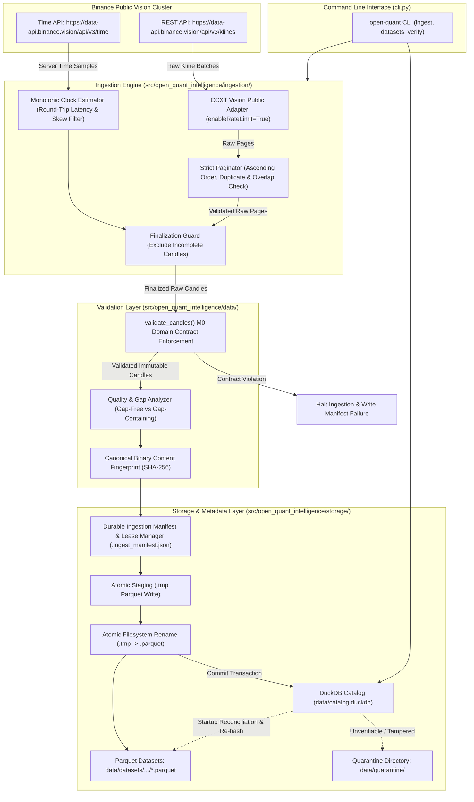

# Open Quant Intelligence V2 — Milestone M1 Architecture Proposal
## Public Market Data Ingestion and Canonical Storage Engine (Final Correction)

**Document Reference:** `docs/M1_ARCHITECTURE_PROPOSAL.md`  
**Milestone:** M1 — Public Market Data Ingestion & Storage  
**Base Commit on `main`:** `02b7bcad43a2947c7ed2977e143e959559f5873d`  
**Branch:** `docs/m1-architecture-proposal`  
**Author:** AntiGravity (Implementation Engineer)  
**Technical Authority:** ChatGPT  
**Final Decision Maker:** Project Owner  
**Status:** REVISED ARCHITECTURAL SPECIFICATION ONLY (Implementation is strictly NOT authorized)  

---

## 1. Executive Summary & Purpose

Milestone M1 establishes the foundation for reproducible quantitative research in Open Quant Intelligence (OQI) by delivering an automated, deterministic historical market data ingestion and storage pipeline.

The pipeline will:
1. Collect public spot OHLCV data from Binance's dedicated public market data cluster (`https://data-api.binance.vision`) using CCXT without authentication or credentials.
2. Filter unfinalized candles using strict exchange-anchored observation time, and validate all candle rows through the existing M0 domain contracts (`Candle`, `MarketIdentity`, `SupportedTimeframe`).
3. Store validated datasets in Apache Parquet files using Snappy compression and integer microsecond UTC timestamp representations.
4. Maintain an append-only, crash-resilient local dataset catalog in DuckDB that tracks ingestion provenance, data quality statistics, gap analysis, and dual cryptographic fingerprints (canonical content fingerprint vs. physical Parquet SHA-256).
5. Provide user-facing CLI commands for downloading, cataloging, inspecting, and re-validating historical datasets.

This revision directly resolves all items from the second technical review: exact integer timestamp arithmetic, grid-aligned request-window semantics, strict raw-page multi-attribute validation, monotonic exchange clock skew tracking, durable crash recovery manifests and active leases, Binance vision endpoint routing, binary-level canonical content fingerprinting, and DuckDB empty/quality status separation.

---

## 2. Invariant Contracts & Strict Exclusions

### A. Preserved M0 & M0.1 Contracts
- **Python Compatibility:** Python 3.11 and 3.12 exclusively.
- **Repository Structure:** Standard `src/` layout under `src/open_quant_intelligence/`.
- **Domain Invariants:** Immutable `Candle`, `MarketIdentity`, and `SupportedTimeframe` classes remain the single source of truth.
- **Time Semantics:** Half-open interval convention `[open_time, close_time)` where `close_time = open_time + duration`.
- **Supported Timeframes:** Strictly `1m`, `5m`, `15m`, `30m`, `1h`, `4h`, `1d`.
- **Data Integrity:** No silent auto-sorting, no forward-filling of gaps, and no row fabrication.
- **Test Integrity:** The existing 104-test M0/M0.1 unit and CLI test suite must continue passing without modification.

### B. Strict Milestone Exclusions
- **No Private API Keys or Credentials:** Ingestion uses public market data endpoints exclusively.
- **No Order Execution or Trading:** Zero routing, balancing, order placement, or wallet manipulation.
- **No Derivatives:** Strictly spot markets (`market_type == "spot"`). Futures, options, and perpetuals are out of scope.
- **No Strategy Logic or Backtesting:** Strategy evaluation, alpha generation, and portfolio simulation belong to M2/M3.
- **No AI/ML:** Model inference and feature training belong to M6.
- **No Real-Time Streaming:** WebSockets and orderbook tickers are excluded. M1 is historical batch OHLCV only.

---

## 3. Technology Stack & Dependency Verification

### A. Evaluation of Dependencies

| Component | Library Choice | Justification |
|---|---|---|
| **Market Data Adapter** | `ccxt>=4.4.0, <5.0.0` | Industry-standard exchange abstraction. Provides rate-limiting (`enableRateLimit=True`), dynamic throttle coordination, and standardized Kline parsing for Binance public endpoints. Reuses a single exchange instance per ingestion session. |
| **Analytical Catalog & Query** | `duckdb>=1.1.0, <2.0.0` | Embedded in-process analytical SQL engine. Handles metadata registration, analytical queries across local Parquet files, and relational catalog queries without requiring a client-server database daemon. |
| **Parquet Storage Engine** | Native DuckDB Parquet Engine (Primary) | DuckDB compiles native, highly performant Parquet reading and writing (`COPY ... TO ... (FORMAT PARQUET, COMPRESSION SNAPPY)`). Using DuckDB for Parquet eliminates heavy runtime coupling to PyArrow for ingestion. |
| **Optional Arrow Interop** | `pyarrow>=15.0.0, <19.0.0` (Optional `[dev]`) | Maintained as an optional development dependency for zero-copy memory testing and schema inspection, but **NOT** required for the production runtime pipeline. |

### B. CI Target Versions vs. Supported Bounds
The existing 104 tests in the repository verify M0 domain and CLI contracts; they do not exercise CCXT or DuckDB because M1 dependencies are not yet installed in the current environment. When M1 implementation begins, CI will explicitly test against pinned target versions while declaring semantic upper and lower bounds:

| Dependency | Supported Version Bounds in `pyproject.toml` | Target Pinned Version in M1 Implementation CI | Role |
|---|---|---|---|
| `ccxt` | `>=4.4.0, <5.0.0` | `4.4.52` | Production runtime |
| `duckdb` | `>=1.1.0, <2.0.0` | `1.1.3` | Production runtime |
| `pytest` | `>=8.0.0` | `8.3.3` | Test framework (`[dev]`) |
| `ruff` | `>=0.4.0` | `0.7.3` | Linter / formatter (`[dev]`) |
| `pyarrow` | `>=15.0.0, <19.0.0` | `18.0.0` | Optional verification (`[dev]`) |

```toml
[project]
dependencies = [
    "ccxt>=4.4.0,<5.0.0",
    "duckdb>=1.1.0,<2.0.0",
]

[project.optional-dependencies]
dev = [
    "pytest>=8.0.0",
    "ruff>=0.4.0",
    "pyarrow>=15.0.0,<19.0.0",
]
```

---

## 4. System Architecture & Module Boundaries

### A. Modular Structure
```text
src/open_quant_intelligence/
├── domain/                      # [M0] Immutable contracts (Candle, MarketIdentity, SupportedTimeframe)
├── data/                        # [M0] Validation engine
│   ├── validation.py            # [M0] Canonical candle & stream validator
│   └── quality.py               # [M1 NEW] Gap analysis & data quality reporting
├── ingestion/                   # [M1 NEW] Public ingestion pipeline
│   ├── __init__.py
│   ├── adapter.py               # CCXT Binance public vision client wrapper
│   ├── pagination.py            # Strict raw-page interval paginator with regression guards
│   ├── clock.py                 # Monotonic exchange clock offset estimator & skew guard
│   ├── finalization.py          # Observation-time candle finalization filter
│   └── pipeline.py              # Orchestrator: Fetch -> Finalize -> Validate -> Fingerprint -> Store
├── storage/                     # [M1 NEW] Persistence & Catalog
│   ├── __init__.py
│   ├── manifest.py              # Ingestion manifest, active lease & crash recovery record
│   ├── parquet_store.py         # Atomic Parquet writer, staging validator & quarantine
│   ├── fingerprint.py           # Canonical binary content hashing & artifact SHA-256
│   └── catalog.py               # DuckDB catalog registration, gap recording & queries
└── cli.py                       # CLI entrypoints (validate, ingest, datasets, inspect, verify)
```

### B. Mermaid Architecture Diagram


---

## 5. Exact Timestamp Arithmetic & Request-Window Semantics

### A. Exact Integer Epoch Timedelta Arithmetic (No Floating-Point Math)
To prevent truncation, precision drift, and platform-specific IEEE-754 floating-point inaccuracies, floating-point timestamp conversion methods (`int(dt.timestamp() * 1000)`, `datetime.fromtimestamp(ms / 1000)`, and `.total_seconds() * 1000`) are **strictly prohibited**.

All conversions between Python `datetime` and integer epoch units must use exact integer arithmetic anchored to `datetime(1970, 1, 1, tzinfo=timezone.utc)`:

```python
EPOCH_UTC = datetime(1970, 1, 1, tzinfo=timezone.utc)


def datetime_to_epoch_ms(dt: datetime) -> int:
    """Convert an aware UTC datetime to integer epoch milliseconds.

    Rejects naive datetimes and pre-epoch timestamps.
    """
    if dt.tzinfo is None or dt.utcoffset() != timedelta(0):
        raise ValueError(f"Datetime {dt} must be explicit timezone-aware UTC.")
    if dt < EPOCH_UTC:
        raise ValueError(f"Pre-epoch datetime {dt} is not supported.")

    diff = dt - EPOCH_UTC
    # Exact integer arithmetic using microseconds
    total_micros = diff.days * 86_400_000_000 + diff.seconds * 1_000_000 + diff.microseconds
    return total_micros // 1_000


def epoch_ms_to_datetime(ms: int) -> datetime:
    """Convert integer epoch milliseconds to aware UTC datetime."""
    if not isinstance(ms, int) or isinstance(ms, bool):
        raise TypeError(f"Timestamp must be integer milliseconds, got {type(ms)}")
    if ms < 0:
        raise ValueError(f"Epoch milliseconds cannot be negative, got {ms}")

    return EPOCH_UTC + timedelta(milliseconds=ms)


def timeframe_to_duration_ms(timeframe: SupportedTimeframe) -> int:
    """Return exact integer duration milliseconds for supported timeframes."""
    minutes_map = {
        SupportedTimeframe.ONE_MINUTE: 1,
        SupportedTimeframe.FIVE_MINUTES: 5,
        SupportedTimeframe.FIFTEEN_MINUTES: 15,
        SupportedTimeframe.THIRTY_MINUTES: 30,
        SupportedTimeframe.ONE_HOUR: 60,
        SupportedTimeframe.FOUR_HOURS: 240,
        SupportedTimeframe.ONE_DAY: 1440,
    }
    return minutes_map[timeframe] * 60_000
```

### B. Sub-Millisecond & Pre-Epoch Timestamp Policy
- **Sub-Millisecond Policy:** Microsecond fractions on input datetimes must be exact multiples of 1,000 ($\mu s \pmod{1000} == 0$). If sub-millisecond fractions exist, input validation raises `UnalignedTimestampError` rather than silently rounding or truncating.
- **Pre-Epoch Policy:** Timestamps prior to `1970-01-01T00:00:00Z` ($ms < 0$) are rejected with `PreEpochTimestampError`. Cryptocurrency spot markets did not exist prior to 2009; pre-epoch dates indicate invalid configurations.

### C. Request-Window Semantics & Grid Alignment
The requested range is defined as the half-open interval `[since, until)`:
- A candle starting at `open_time` belongs to the dataset if and only if:
  $$\text{since} \le \text{open\_time} < \text{until}$$
- Since an interval's close time is defined by the M0 contract as $\text{close\_time} = \text{open\_time} + \Delta$, requiring $\text{open\_time} < \text{until}$ alongside grid-alignment guarantees that:
  $$\text{close\_time} \le \text{until}$$
  There is zero contradiction between interval membership and boundary enclosure.

#### Mandatory Grid Alignment Contract
For M1, `since` and `until` **must be strictly aligned to the timeframe grid** relative to `EPOCH_UTC`:
$$\text{since\_ms} \pmod{\Delta_{\text{ms}}} == 0 \quad \text{and} \quad \text{until\_ms} \pmod{\Delta_{\text{ms}}} == 0$$
If either boundary is unaligned, ingestion **rejects the request immediately** with a structured error `UnalignedBoundaryError`, reporting the exact required aligned timestamps. Silent snapping or floor/ceil rounding is prohibited.

#### Expected Interval Count Calculation
For any validated query window, the exact expected number of continuous intervals is:
$$N_{\text{expected}} = \frac{\text{until\_ms} - \text{since\_ms}}{\Delta_{\text{ms}}}$$
- If $N_{\text{expected}} \le 0$, the request is rejected with `InvalidWindowError("until must be strictly greater than since")`.
- Expected candle open times form the exact sequence:
  $$\{\text{since\_ms} + k \cdot \Delta_{\text{ms}} \mid 0 \le k < N_{\text{expected}}\}$$

---

## 6. Strict Raw-Page Validation & Pagination Controller

### A. Raw-Page Validation Invariants
Before accepting any page of raw OHLCV rows from CCXT, the paginator must execute the following checks in order:
1. **Timestamp Type & Representation:** Every `kline[0]` must be a strictly non-negative Python integer (`isinstance(t, int) and not isinstance(t, bool)`).
2. **Strict Ascending Order:** Timestamps within the page must be strictly increasing:
   $$t_{i+1} > t_i \quad \forall \, 0 \le i < \text{len}(\text{page}) - 1$$
   Decreasing or identical timestamps inside a page raise `MalformedPageError`.
3. **Cursor Compliance:** Every returned timestamp must be $\ge \text{current\_since\_ms}$. If $t_0 < \text{current\_since\_ms}$, the page contains stale or non-advancing data, triggering `PaginationRegressionError`.
4. **No Overlap with Previously Accepted Data:** If a previous page was accepted with timestamps $S_{\text{prev}}$, the intersection $\text{set}(t \in \text{page}) \cap S_{\text{prev}}$ must be empty. Overlaps indicate an exchange cursor regression and raise `PageOverlapError`.
5. **Full Sequence Verification:** The entire sequence of timestamps is validated against regression and duplicate sets, not merely the first and last timestamps.
6. **Maximum Timestamp Authenticity:** The paginator asserts that $\max(\text{page timestamps}) == \text{page}[-1][0]$.

### B. Cursor Advancement Invariant
The cursor must advance if and only if the page has passed all raw-page validation checks:
$$\text{current\_since\_ms} = \text{max\_raw\_open\_ms} + 1$$
- **Incomplete Candle Independence:** If the final candle on the page is in progress and excluded by the finalization guard, `current_since_ms` **still advances** based on $\text{max\_raw\_open\_ms} + 1$. Because cursor advancement is driven by the validated raw page rather than the finalized subset, tail-candle filtering can never stall the loop.

### C. Consistent Request Budget & Safety Ceiling
To prevent runaway loops when responses contain sparse or partial pages, M1 defines a consistent maximum request budget:
$$\text{budget} = \max\left(50, \, \left\lceil \frac{N_{\text{expected}}}{\text{PAGE\_LIMIT}} \right\rceil \times 3\right)$$
Where $\text{PAGE\_LIMIT} = 1000$ (Binance maximum per request). If the pagination iteration count exceeds $\text{budget}$, pagination aborts with `PaginationBudgetExceededError`.

### D. Paginator Implementation Specification
```python
def paginate_ohlcv(
    adapter: PublicExchangeAdapter,
    symbol: str,
    timeframe: SupportedTimeframe,
    since_ms: int,
    until_ms: int,
    clock: MonotonicClockEstimator,
) -> list[RawKline]:
    """Deterministically paginate historical OHLCV from Binance vision public endpoints."""
    step_ms = timeframe_to_duration_ms(timeframe)
    expected_count = (until_ms - since_ms) // step_ms
    max_pages = max(50, ((expected_count + 999) // 1000) * 3)

    current_since_ms = since_ms
    collected_candles: list[RawKline] = []
    seen_timestamps: set[int] = set()
    page_count = 0

    while current_since_ms < until_ms:
        page_count += 1
        if page_count > max_pages:
            raise PaginationBudgetExceededError(f"Pagination exceeded safety budget of {max_pages} requests.")

        page = adapter.fetch_ohlcv(symbol, timeframe.value, since=current_since_ms, limit=1000)

        # 1. Empty page: Exchange has no further data in range
        if not page:
            break

        # 2. Strict type, structure, and ordering validation
        page_timestamps: list[int] = []
        for i, row in enumerate(page):
            if not isinstance(row[0], int) or isinstance(row[0], bool):
                raise MalformedPageError(f"Row {i} timestamp {row[0]!r} is not an integer.")
            t = row[0]
            if page_timestamps and t <= page_timestamps[-1]:
                raise MalformedPageError(f"Page timestamps not strictly increasing: {page_timestamps[-1]} -> {t}")
            if t < current_since_ms:
                raise PaginationRegressionError(f"Row timestamp {t} violates cursor {current_since_ms}")
            if t in seen_timestamps:
                raise PageOverlapError(f"Timestamp {t} was already accepted in a previous page.")
            page_timestamps.append(t)

        max_raw_open_ms = page_timestamps[-1]
        seen_timestamps.update(page_timestamps)

        # 3. Finalization filtering & range enclosure
        obs_time_ms = clock.get_estimated_server_time_ms()

        for raw_kline in page:
            open_ms = raw_kline[0]

            # Exclusive until check: [since, until)
            if open_ms >= until_ms:
                return collected_candles

            # Candle finalization guard: close boundary <= observed server time
            close_ms = open_ms + step_ms
            if close_ms > obs_time_ms:
                # In-progress candle; exclude from historical dataset
                continue

            collected_candles.append(raw_kline)

        # 4. Advance cursor strictly based on validated raw page
        current_since_ms = max_raw_open_ms + 1

    return collected_candles
```

---

## 7. Clock Authority, Monotonic Synchronization & Skew Mitigation

### A. The Clock-Skew Vulnerability & Correct Directionality
A naive finalization rule using unverified local system time creates two severe failure modes:
1. **Local Clock Ahead ($\tau_{\text{local}} > \tau_{\text{exchange}}$):** The client believes an interval has closed before the exchange has finished trading it. This prematurely persists incomplete candle data as historical truth.
2. **Local Clock Behind ($\tau_{\text{local}} < \tau_{\text{exchange}}$):** The client refuses to accept fully closed candles at the tail of the requested window.

### B. Monotonic Exchange-Time Offset Estimation
To eliminate dependence on the local wall clock, M1 anchors observation time to Binance exchange server time tracked via Python's monotonic clock (`time.monotonic_ns()`):

1. **Round-Trip Latency Sampling:** At session startup, the adapter samples Binance public time (`GET /api/v3/time`):
   ```python
   t_mono_before = time.monotonic_ns()
   t_server_ms = adapter.fetch_time()
   t_mono_after = time.monotonic_ns()

   round_trip_ms = (t_mono_after - t_mono_before) // 1_000_000
   one_way_delay_ms = round_trip_ms // 2
   # Estimated exchange server time at monotonic reference point t_mono_after
   t_server_estimated_ms = t_server_ms + one_way_delay_ms
   ```
2. **Current Observation Time Formula:**
   $$\tau_{\text{obs\_ms}} = t_{\text{server\_estimated\_ms}} + \frac{t_{\text{mono\_now}} - t_{\text{mono\_after}}}{1\,000\,000}$$
3. **Offset Resampling & Clock Age Ceiling:**
   - The clock offset estimate has a maximum lifetime of 10 minutes (`MAX_CLOCK_AGE_SEC = 600`).
   - If an ingestion session exceeds 10 minutes, the adapter automatically resamples server time.
4. **Latency Uncertainty & Skew Guard:**
   - If round-trip latency during clock sampling exceeds 2,000 ms, the sample is rejected and retried.
   - If the absolute discrepancy between local wall time and exchange time $|\tau_{\text{exchange}} - \tau_{\text{local}}| > 3000\,\text{ms}$, ingestion aborts immediately with `ClockSkewError("System clock skew exceeds safe threshold")`.
   - Separate offline tests must explicitly exercise:
     - `test_clock_local_ahead_aborts`: Local clock ahead by $>3$ seconds halts.
     - `test_clock_local_behind_aborts`: Local clock behind by $>3$ seconds halts.
     - `test_clock_high_latency_resamples`: Round trip latency $>2$ seconds triggers resampling.

---

## 8. Binance Vision Endpoint Configuration & Rate-Limiting

### A. Dedicated Public Market Data Host
Binance provides an isolated public market data cluster decoupled from account trading and order routing engines:
```text
https://data-api.binance.vision
```
Using this host ensures that historical ingestion traffic does not compete with matching engine queues, reduces rate-limit contention, and guarantees zero authenticated API endpoints are reachable.

### B. CCXT Public Adapter Configuration
CCXT's default Binance endpoint dictionary points to `https://api.binance.com`. In M1, the exchange adapter overrides CCXT's endpoint configuration on instantiation:

```python
import ccxt


def create_binance_public_adapter() -> ccxt.binance:
    exchange = ccxt.binance(
        {
            "enableRateLimit": True,
            "options": {
                "defaultType": "spot",
                "adjustForTimeDifference": False,  # Managed by OQI MonotonicClockEstimator
            },
            "urls": {
                "api": {
                    "public": "https://data-api.binance.vision/api/v3",
                    # Explicitly disable private/trading endpoints
                    "private": None,
                    "v1": "https://data-api.binance.vision/api/v3",
                }
            },
        }
    )
    return exchange
```

### C. Request-Weight Management & Response Headers
Binance Spot enforces rate limits based on IP request weight per minute (typically 1,200 or 6,000 weight/min):
1. **Dynamic Limit Retrieval:** At session initialization, the adapter calls `exchange.fetch_exchange_status()` or inspects `GET /api/v3/exchangeInfo` rate-limit blocks to record the current IP weight capacity.
2. **Used-Weight Header Inspection:** Every response inspects the header `X-MBX-USED-WEIGHT-1M`.
   - If used weight is $\le 70\%$ of capacity: proceed at normal paced rate.
   - If used weight is $> 70\%$ of capacity: inject an adaptive proportional delay:
     $$\text{sleep\_ms} = \left(\frac{\text{used\_weight}}{\text{max\_weight}}\right)^2 \times 500\,\text{ms}$$
   - If used weight is $> 90\%$: pause execution until the current 60-second window expires.
3. **HTTP 429 Handling:** Inspects the `Retry-After` header. If present, sleeps for the specified number of seconds $+ 500\,\text{ms}$ jitter. If absent, applies exponential backoff capped at 60 seconds. Maximum 3 retries.
4. **HTTP 418 IP Ban:** If Binance returns HTTP 418 (`DDoSProtection` / IP ban), **HALT IMMEDIATELY WITH ZERO RETRIES**. Log a `CRITICAL` error and record the ban in the ingestion manifest to protect the user's infrastructure.

---

## 9. Canonical Binary Content Fingerprinting & Artifact Hash

To guarantee deterministic data integrity across platforms, compilers, and DuckDB versions, M1 establishes **exactly one canonical serialization contract**.

### A. Content Fingerprint vs. Artifact SHA-256
- **Canonical Content Fingerprint (`content_fingerprint_sha256`):** Computed over a strictly normalized, length-prefixed binary stream of validated candle attributes. Completely invariant to OS, Parquet metadata, row-group chunking, or Snappy compression differences.
- **Parquet Artifact SHA-256 (`file_sha256`):** Standard SHA-256 cryptographic digest of the physical `.parquet` file on disk. Used for block corruption and storage verification.

### B. Canonical Binary Serialization Specification
The binary stream fed into `hashlib.sha256()` is constructed through strict little-endian binary encoding:

```text
[Header Block]
  - Magic Bytes:          ASCII "OQICCF" (6 bytes)
  - Schema Version:       UINT16_LE (2 bytes, value = 1)
  - Exchange ID:          UINT16_LE length + UTF-8 bytes (e.g. 7, "binance")
  - Market Type:          UINT16_LE length + UTF-8 bytes (e.g. 4, "spot")
  - Symbol:               UINT16_LE length + UTF-8 bytes (e.g. 8, "BTC/USDT")
  - Timeframe:            UINT16_LE length + UTF-8 bytes (e.g. 2, "1h")
  - Candle Count:         UINT64_LE (8 bytes)

[Candle Record Block] (Repeated for each candle, ordered strictly by open_time ascending)
  - Open Time Epoch ms:   INT64_LE (8 bytes)
  - Close Time Epoch ms:  INT64_LE (8 bytes)
  - Open Price:           IEEE-754 binary64 DOUBLE_LE (8 bytes)
  - High Price:           IEEE-754 binary64 DOUBLE_LE (8 bytes)
  - Low Price:            IEEE-754 binary64 DOUBLE_LE (8 bytes)
  - Close Price:          IEEE-754 binary64 DOUBLE_LE (8 bytes)
  - Base Volume:          IEEE-754 binary64 DOUBLE_LE (8 bytes)
  - Quote Volume Present: UINT8 (1 byte: 0 = NULL, 1 = Present)
    [If Present]:         IEEE-754 binary64 DOUBLE_LE (8 bytes)
  - Trade Count Present:  UINT8 (1 byte: 0 = NULL, 1 = Present)
    [If Present]:         INT64_LE (8 bytes)
```

#### Canonical Serialization Rules
1. **Validation Prerequisite:** Fingerprinting is performed **only after** candles pass full `validate_candles()` contract checks.
2. **No Silent Sorting:** The input sequence must already be sorted in strict ascending order. If $t_{i+1} \le t_i$, fingerprinter raises `UnsortedStreamError`.
3. **Normalized Float Representation:** Prices and volumes are verified finite (`math.isfinite(val) is True`). IEEE-754 binary64 little-endian (`<d` in Python `struct`) provides unambiguous byte sequences.
4. **Final Digest:** `hashlib.sha256()` digest formatted as a lowercase 64-character hexadecimal string prefixed with `sha256:`.
5. **Illustrative Sample Format:** All sample hashes shown in proposals or documentation are explicitly illustrative format examples, not hardcoded verification anchors.

---

## 10. Crash Recovery, Durable Manifest & Storage Reconciliation

### A. Ingestion Manifest & Active Leases
To prevent race conditions, orphan file confusion, and unrecoverable partial writes, every ingestion job generates a durable JSON manifest file alongside staging data:
```text
data/datasets/.ingest_manifest_<ingestion_uuid>.json
```

#### Ingestion Manifest Schema
```json
{
  "ingestion_uuid": "f47ac10b-58cc-4372-a567-0e02b2c3d479",
  "lease_owner_pid": 12844,
  "lease_expires_at_utc": "2026-11-13T17:30:00Z",
  "schema_version": 1,
  "ccxt_version": "4.4.52",
  "exchange_id": "binance",
  "market_type": "spot",
  "symbol": "BTC/USDT",
  "timeframe": "1h",
  "requested_since_utc": "2026-11-01T00:00:00Z",
  "requested_until_utc": "2026-11-05T00:00:00Z",
  "staging_file_path": "data/datasets/.../dataset_..._f47ac10b.parquet.tmp",
  "target_file_path": "data/datasets/.../dataset_..._f47ac10b.parquet",
  "record_count": 96,
  "content_fingerprint_sha256": "sha256:7f9a2b84c310d54e8b21c430aef7830182419ef8973b02196a84920485a3bb12",
  "file_sha256": "sha256:4d831b7908c84857b28ec95ef5476a8947cf839a823908dbca19273645bbef21",
  "stage": "COMMITTING_CATALOG",
  "created_at_utc": "2026-11-13T17:15:00Z",
  "updated_at_utc": "2026-11-13T17:15:04Z"
}
```

### B. Multi-Stage Ingestion State Machine
```text
[ INITIALIZING ]  --> Writes active manifest (.ingest_manifest_<uuid>.json) with PID lease
         │
         ▼
[ WRITING_TMP ]   --> Writes data to staging path: <target_name>.tmp_<uuid>
         │
         ▼
[ VERIFY_TMP ]    --> Verifies readable Parquet, row count, and matches file_sha256
         │
         ▼
[ ATOMIC_RENAME ] --> Atomic same-filesystem rename: os.replace(staging, target)
         │
         ▼
[ CATALOG_COMMIT] --> DuckDB ACID transaction: insert dataset + gaps record
         │
         ▼
[ CLEANUP ]       --> Unlinks manifest file; state is now fully durable in DuckDB
```

### C. Active Lease Protocol & Safe Staging Cleanup
- A staging `.tmp` file is **never deleted based on age alone**.
- Before cleaning any `.tmp` file, the startup reconciliation engine inspects its matching manifest:
  1. Checks if `lease_owner_pid` is currently running on the operating system.
  2. Checks if `lease_expires_at_utc` is in the past.
  3. Only if the PID is dead and the lease has expired is the staging file considered orphaned and deleted.

### D. Startup Reconciliation & Quarantine Engine
On CLI startup, OQI scans `data/datasets/`:
1. **Unregistered Valid Artifacts:** If a `.parquet` file exists without a catalog record, the engine checks for a corresponding manifest. If the file's computed `file_sha256` matches the manifest, it reads the data, recomputes `content_fingerprint_sha256`, and completes the catalog commit transaction as a recovered dataset.
2. **Unverifiable / Tampered Artifacts:** If an unregistered `.parquet` file has no manifest, is unreadable, or fails hash verification, it is **quarantined**:
   - Moved to `data/quarantine/<timestamp>_<filename>`.
   - Logged as a quarantine event in `data/quarantine_log.jsonl`.
   - Never silently deleted.

---

## 11. Parquet Storage Model & DuckDB Catalog Specification

### A. Immutable Dataset Snapshots & Collision-Safe Naming
- Every dataset file is immutable and named using a unique snapshot ID derived from the ingestion UUID:
  ```text
  data/datasets/exchange=binance/market=spot/symbol=BTC_USDT/timeframe=1h/
      dataset_20261101T000000Z_20261105T000000Z_<content_hash_8>_<ingestion_uuid_8>.parquet
  ```
- Including `<ingestion_uuid_8>` guarantees collision-safe paths on re-ingestion (`--force`).

### B. Parquet Schema Specification
| Column Name | Logical Parquet Type | Physical Type | Nullable | OQI Candle Model Field |
|---|---|---|:---:|---|
| `exchange_id` | `VARCHAR` | `BYTE_ARRAY` | No | `Candle.exchange_id` |
| `market_type` | `VARCHAR` | `BYTE_ARRAY` | No | `Candle.market_type` |
| `symbol` | `VARCHAR` | `BYTE_ARRAY` | No | `Candle.symbol` |
| `timeframe` | `VARCHAR` | `BYTE_ARRAY` | No | `Candle.timeframe` |
| `open_time` | `TIMESTAMP_MICROS (UTC)` | `INT64` | No | `Candle.open_time` |
| `close_time` | `TIMESTAMP_MICROS (UTC)` | `INT64` | No | `Candle.close_time` |
| `open` | `DOUBLE` | `DOUBLE` | No | `Candle.open` |
| `high` | `DOUBLE` | `DOUBLE` | No | `Candle.high` |
| `low` | `DOUBLE` | `DOUBLE` | No | `Candle.low` |
| `close` | `DOUBLE` | `DOUBLE` | No | `Candle.close` |
| `base_volume` | `DOUBLE` | `DOUBLE` | No | `Candle.base_volume` |
| `quote_volume` | `DOUBLE` | `DOUBLE` | **Yes** | `Candle.quote_volume` (`NULL` in M1) |
| `trade_count` | `INT64` | `INT64` | **Yes** | `Candle.trade_count` (`NULL` in M1) |

### C. DuckDB Catalog Schema (DDL)
To cleanly separate ingestion lifecycle status from data quality status and support empty datasets:
- `file_path` and `file_sha256` are **nullable** (an `EMPTY` dataset creates no Parquet file).
- `ingestion_status` (`COMMITTED`, `FAILED`, `ABORTED`) is separated from `quality_status` (`EMPTY`, `GAP_FREE`, `GAP_CONTAINING`, `CORRUPTED`).

```sql
CREATE TABLE IF NOT EXISTS datasets (
    snapshot_id VARCHAR PRIMARY KEY,             -- Unique snapshot ID (e.g. 'snap_f47ac10b8e21')
    dataset_identity VARCHAR NOT NULL,           -- Deterministic key: 'binance:spot:BTC/USDT:1h:since:until'
    exchange_id VARCHAR NOT NULL,                -- 'binance'
    market_type VARCHAR NOT NULL,                -- 'spot'
    symbol VARCHAR NOT NULL,                     -- 'BTC/USDT'
    timeframe VARCHAR NOT NULL,                  -- '1h'
    requested_since TIMESTAMP WITH TIME ZONE NOT NULL,
    requested_until TIMESTAMP WITH TIME ZONE NOT NULL,
    actual_first_open TIMESTAMP WITH TIME ZONE,  -- NULL if EMPTY
    actual_last_close TIMESTAMP WITH TIME ZONE,  -- NULL if EMPTY
    expected_records BIGINT NOT NULL,            -- Total theoretical grid intervals
    record_count BIGINT NOT NULL,                -- Actual records captured (0 if EMPTY)
    gap_count INTEGER NOT NULL,                  -- Number of gap events
    missing_intervals BIGINT NOT NULL,           -- Total missing intervals across all gaps
    content_fingerprint_sha256 VARCHAR NOT NULL, -- Canonical content hash (empty hash for EMPTY)
    file_sha256 VARCHAR,                         -- NULL for EMPTY datasets
    file_path VARCHAR,                           -- NULL for EMPTY datasets
    file_size_bytes BIGINT,                      -- NULL for EMPTY datasets
    ccxt_version VARCHAR NOT NULL,
    ingestion_uuid VARCHAR NOT NULL,
    ingested_at TIMESTAMP WITH TIME ZONE NOT NULL,
    ingestion_status VARCHAR NOT NULL,           -- 'COMMITTED', 'FAILED', 'ABORTED'
    quality_status VARCHAR NOT NULL              -- 'EMPTY', 'GAP_FREE', 'GAP_CONTAINING', 'CORRUPTED'
);

CREATE TABLE IF NOT EXISTS dataset_gaps (
    gap_id VARCHAR PRIMARY KEY,
    snapshot_id VARCHAR REFERENCES datasets(snapshot_id),
    expected_open TIMESTAMP WITH TIME ZONE NOT NULL,
    actual_open TIMESTAMP WITH TIME ZONE NOT NULL,
    missing_count BIGINT NOT NULL
);

CREATE INDEX IF NOT EXISTS idx_datasets_identity 
ON datasets(dataset_identity, ingested_at DESC);
```

### D. Idempotency, Deduplication & Re-Ingestion (`--force`)
1. **Deduplication:** When `open-quant ingest` is invoked:
   - Computes `dataset_identity`.
   - Queries DuckDB for the latest `COMMITTED` snapshot matching this identity.
   - If found, and `file_path` exists with matching `file_sha256`:
     - Ingestion exits immediately with code 0: `Dataset already committed and verified. Use --force to re-download.`
2. **Re-Ingestion (`--force`):**
   - Ingestion proceeds, generating a fresh `ingestion_uuid` and distinct `snapshot_id`.
   - Stored in a distinct Parquet file incorporating the new UUID prefix.
   - Registered in DuckDB as a new snapshot under the same `dataset_identity`. Historical snapshots remain queryable and immutable.

---

## 12. CLI Proposal & User Experience

```bash
# 1. Ingest historical public data with strict grid-aligned boundaries
open-quant ingest \
  --exchange binance \
  --symbol BTC/USDT \
  --timeframe 1h \
  --since 2026-11-01T00:00:00Z \
  --until 2026-11-05T00:00:00Z \
  [--output-dir data/] \
  [--fail-on-gaps] \
  [--force]

# 2. List registered dataset snapshots
open-quant datasets list [--symbol BTC/USDT] [--timeframe 1h] [--status GAP_FREE]

# 3. Inspect dataset details, gap distributions, and provenance
open-quant datasets inspect <snapshot_id_or_fingerprint>

# 4. Verify physical Parquet integrity against catalog fingerprints
open-quant datasets verify <snapshot_id_or_fingerprint>
```

### Sample CLI Report Output (Illustrative)
```text
============================================================
Open Quant Intelligence — Historical Ingestion Report
============================================================
Snapshot ID:           snap_f47ac10b8e21
Ingestion UUID:        f47ac10b-58cc-4372-a567-0e02b2c3d479
Exchange:              binance (public vision cluster)
Symbol:                BTC/USDT | Market: spot | Timeframe: 1h
Requested Range (UTC): 2026-11-01T00:00:00Z -> 2026-11-05T00:00:00Z
Coverage Range (UTC):  2026-11-01T00:00:00Z -> 2026-11-05T00:00:00Z
Expected Intervals:    96
Recorded Intervals:    96 (0 missing)
Ingestion Status:      COMMITTED
Quality Status:        GAP_FREE
Content Fingerprint:   sha256:7f9a2b84c310d54e8b21c430aef7830182419ef8973b02196a84920485a3bb12
Parquet Artifact:      data/datasets/exchange=binance/market=spot/symbol=BTC_USDT/timeframe=1h/dataset_20261101T000000Z_20261105T000000Z_7f9a2b84_f47ac10b.parquet
Artifact SHA-256:      sha256:4d831b7908c84857b28ec95ef5476a8947cf839a823908dbca19273645bbef21
Catalog Record:        REGISTERED (catalog.duckdb)
============================================================
```

---

## 13. Deterministic Offline Testing Strategy

All automated CI test suites run **100% offline** without network access or live exchange calls.

### Required Deterministic Test Suite
1. **`test_exact_integer_epoch_conversions`**: Asserts exact integer round-tripping for aware UTC datetimes; rejects naive datetimes, pre-epoch datetimes, and fractional microsecond inputs.
2. **`test_unaligned_request_window_rejected`**: Verifies `UnalignedBoundaryError` is raised when `since` or `until` is not aligned to the timeframe grid.
3. **`test_paginator_rejects_unsorted_page`**: Injects page with descending or identical timestamps; verifies `MalformedPageError`.
4. **`test_paginator_rejects_page_overlap`**: Injects page containing timestamps already seen; verifies `PageOverlapError`.
5. **`test_paginator_advances_cursor_past_unfinalized_tail`**: Simulates page where tail candle is in progress; verifies raw cursor advances past it.
6. **`test_paginator_safety_budget_exceeded`**: Simulates infinite sparse page responses; verifies `PaginationBudgetExceededError`.
7. **`test_clock_skew_local_ahead_aborts`**: Injects mock exchange time where local clock is $>3$ seconds ahead; verifies immediate abort with `ClockSkewError`.
8. **`test_clock_skew_local_behind_aborts`**: Injects mock exchange time where local clock is $>3$ seconds behind; verifies immediate abort with `ClockSkewError`.
9. **`test_binance_vision_public_routing`**: Verifies adapter URLs route to `https://data-api.binance.vision` and private endpoints are disabled.
10. **`test_canonical_content_fingerprint_deterministic`**: Computes binary content fingerprint across platforms; verifies byte-level equality.
11. **`test_empty_dataset_catalog_representation`**: Verifies empty exchange responses create catalog entries with `quality_status = 'EMPTY'`, `file_path = NULL`, and `file_sha256 = NULL`.
12. **`test_crash_recovery_with_active_lease`**: Verifies startup reconciler does NOT delete staging files belonging to active PIDs with unexpired leases.
13. **`test_crash_recovery_quarantine_corrupt_files`**: Simulates orphaned untracked `.parquet` files; asserts mover places them in `data/quarantine/`.
14. **`test_http_418_immediate_halt`**: Verifies HTTP 418 IP ban aborts immediately with zero retries.

---

## 14. Acceptance Criteria Checklist for M1

| # | Criterion | Verification Method |
|---|---|---|
| 1 | Connect to Binance vision public cluster with zero credentials | Adapter routing unit test |
| 2 | Reject unaligned `since` and `until` boundaries with structured error | Parameterized unit tests |
| 3 | Use exact integer epoch milliseconds throughout all calculations | Unit tests rejecting float conversion |
| 4 | Validate raw pages for strict ascending order, uniqueness, and cursor adherence | Ingestion paginator unit tests |
| 5 | Measure round-trip server latency and track clock skew monotonically | Monotonic clock estimator unit tests |
| 6 | Filter in-progress candles against exchange observation time | Finalization guard tests |
| 7 | Validate all stored candles through M0 domain contracts | Pipeline integration test |
| 8 | Persist datasets atomically with Snappy compression | Parquet round-trip test |
| 9 | Dual fingerprinting: canonical binary content hash + artifact SHA-256 | Deterministic byte-level test |
| 10 | Crash recovery via durable manifest, active lease, and quarantine | Staging reconciliation tests |
| 11 | DuckDB catalog tracks snapshots, gaps, and separates empty/quality status | Catalog DDL and SQL query tests |
| 12 | Support CLI commands (`ingest`, `datasets list`, `inspect`, `verify`) | CLI invocation and output tests |
| 13 | 100% offline deterministic test suite passing on Python 3.11 and 3.12 | CI workflow matrix run |

---

## 15. Risks, Trade-offs & Unresolved Decisions

1. **Exchange Historical Data Corrections:** While rare, exchanges may occasionally revise historical klines. By storing immutable snapshots indexed by `snapshot_id`, OQI ensures backtests are permanently pinned to the dataset state as observed at ingestion time.
2. **DuckDB In-Process Write Concurrency:** DuckDB supports concurrent readers but a single writer. The active ingestion manifest and CLI process lock serialize write access, preventing database lock contention.
3. **Dedicated Vision Host Availability:** `data-api.binance.vision` is specifically maintained by Binance for high-throughput public data ingestion. If unreachable, the adapter fails gracefully with clear network error classification.

---
**Milestone M1 Proposal Revision Complete. Awaiting Technical Lead Review & Approval.**
