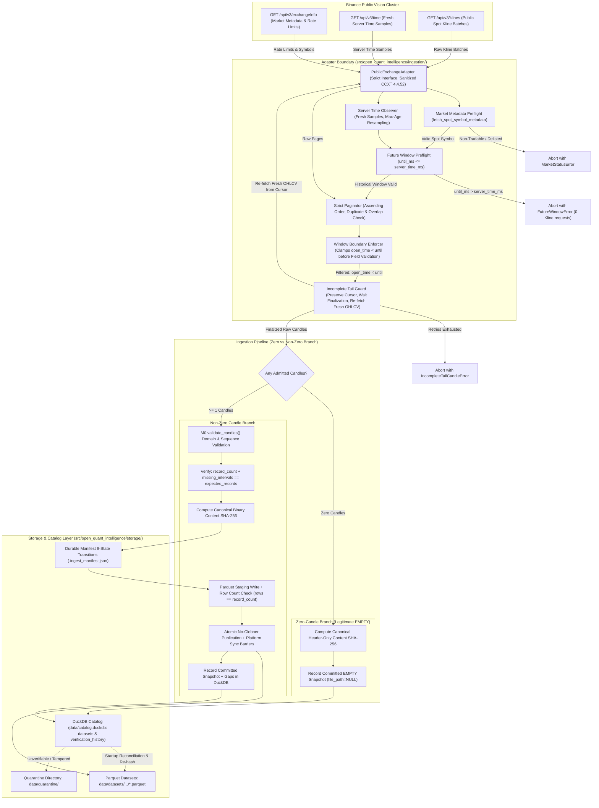

# Open Quant Intelligence V2 — Milestone M1 Architecture Proposal
## Public Market Data Ingestion and Canonical Storage Engine (Final Candidate — Awaiting Technical Approval)

**Document Reference:** `docs/M1_ARCHITECTURE_PROPOSAL.md`  
**Milestone:** M1 — Public Market Data Ingestion & Storage  
**Base Commit on `main`:** `02b7bcad43a2947c7ed2977e143e959559f5873d`  
**Branch:** `docs/m1-architecture-proposal`  
**Author:** AntiGravity (Implementation Engineer)  
**Technical Authority:** ChatGPT  
**Final Decision Maker:** Project Owner  
**Status:** FINAL CANDIDATE — AWAITING TECHNICAL APPROVAL (Implementation is strictly NOT authorized)  

---

## 1. Executive Summary & Purpose

Milestone M1 establishes the foundation for reproducible quantitative research in Open Quant Intelligence (OQI) by delivering an automated, deterministic historical market data ingestion and storage pipeline.

The pipeline will:
1. Validate Spot market tradability, listing status, base asset, and quote asset against Binance exchange metadata via a dedicated allowlisted method `fetch_spot_symbol_metadata(symbol)` before initiating ingestion, immediately rejecting unsupported, delisted, halted, or non-tradable pairs.
2. Enforce an unextrapolated exchange server-time preflight check requiring that the requested window upper boundary satisfies $until\_ms \le fresh\_server\_time\_ms$. If $until\_ms$ lies in the future, ingestion aborts immediately with `FutureWindowError` prior to issuing any Kline requests, preventing premature classification of future intervals as missing data.
3. Collect public spot OHLCV data from Binance's dedicated public market data cluster (`https://data-api.binance.vision`) using CCXT without authentication or credentials, mediated through a strict, allowlisted public adapter `PublicExchangeAdapter` that encapsulates CCXT privately, captures response headers for rate-limit monitoring, and explicitly purges all private, SAPI, futures, options, portfolio-margin, and WebSocket endpoint groups.
4. Enforce the requested half-open interval $[since, until)$ strictly before field-level validation, ensuring out-of-range rows (where $open\_time \ge until$) are discarded immediately and never cause false validation failures due to irrelevant out-of-range corruption.
5. Prevent permanent omission of incomplete in-range tail candles: when an incomplete candle is detected at the tail of the requested range, the pipeline preserves the exact open cursor, waits according to a bounded retry policy, obtains a fresh exchange server-time observation, and explicitly re-fetches fresh OHLCV data from that cursor. Only the newly re-fetched row is validated and admitted once finalized; original incomplete values are never admitted. If retries exhaust, ingestion aborts safely without committing a truncated dataset.
6. Provide an explicit zero-candle branch for legitimate EMPTY ranges that validates market identity and window boundaries, computes a canonical header-only content SHA-256 digest, and records an immutable committed EMPTY catalog entry with nullable artifact fields, without routing empty sequences into M0's sequence validator (which expects at least one candle).
7. Validate all admitted non-empty candles through the immutable M0 `Candle` domain contract and `validate_candles()` sequence validator, verifying that physical Parquet row counts match `record_count`, and that `record_count + missing_intervals == expected_records` across both `GAP_FREE` and `GAP_CONTAINING` datasets.
8. Store validated datasets in Apache Parquet files using Snappy compression via a complete, 8-state crash-recovery protocol (`INITIALIZING → STAGING → STAGED → PUBLISHING → PUBLISHED → COMMITTING_CATALOG → COMMITTED → CLEANUP`) with atomic manifest file replacements, cross-platform no-clobber publication, directory synchronization, and safe orphan-cleanup policies adhering to actual POSIX and Win32 API contracts.
9. Maintain an immutable dataset snapshot catalog in DuckDB accompanied by a dedicated `dataset_verification_history` audit table, cleanly separating immutable snapshot identities from verification audit events.
10. Provide user-facing CLI commands for downloading, cataloging, inspecting, and re-validating historical datasets.

---

## 2. Invariant Contracts & Strict Exclusions

### A. Preserved M0 & M0.1 Contracts
- **Python Compatibility:** Python 3.11 and 3.12 exclusively.
- **Repository Structure:** Standard `src/` layout under `src/open_quant_intelligence/`.
- **Domain Invariants:** Immutable `Candle`, `MarketIdentity`, and `SupportedTimeframe` classes remain the single source of truth.
- **Time Semantics:** Half-open interval convention `[open_time, close_time)` where `close_time = open_time + duration`.
- **Supported Timeframes:** Strictly `SupportedTimeframe.M1` ("1m"), `M5` ("5m"), `M15` ("15m"), `M30` ("30m"), `H1` ("1h"), `H4` ("4h"), and `D1` ("1d").
- **Data Integrity:** No silent auto-sorting, no forward-filling of gaps, and no row fabrication.
- **Test Integrity:** The existing 104-test M0/M0.1 unit and CLI test suite must continue passing without modification.

### B. Strict Milestone Exclusions
- **No Private API Keys or Credentials:** Ingestion uses public market data endpoints exclusively.
- **No Raw CCXT Exposure:** Raw CCXT exchange objects are never leaked outside the internal adapter boundary; no generic method forwarding is permitted.
- **No Extraneous Endpoints:** SAPI, futures (fapi), delivery (dapi), options (eapi), portfolio-margin (papi), and WebSockets are completely purged.
- **No Order Execution or Trading:** Zero routing, balancing, order placement, or wallet manipulation.
- **No Derivatives:** Strictly spot markets (`market_type == "spot"`). Futures, options, and perpetuals are out of scope.
- **No Strategy Logic or Backtesting:** Strategy evaluation, alpha generation, and portfolio simulation belong to M2/M3.
- **No AI/ML:** Model inference and feature training belong to M6.
- **No Real-Time Streaming:** WebSockets and orderbook tickers are excluded. M1 is historical batch OHLCV only.

---

## 3. Technology Stack & Dependency Verification

### A. Evaluation of Dependencies

| Component | Library Choice | Justification |
|---|---|---|
| **Market Data Adapter** | `ccxt>=4.4.52, <5.0.0` | Industry-standard exchange abstraction. Encapsulated behind `PublicExchangeAdapter`. Deep-merged endpoint URLs are explicitly sanitized to retain only the required Vision Spot public operations. |
| **Analytical Catalog & Query** | `duckdb>=1.1.0, <2.0.0` | Embedded in-process analytical SQL engine. Handles metadata registration, analytical queries across local Parquet files, and relational catalog queries without requiring a client-server database daemon. |
| **Parquet Storage Engine** | Native DuckDB Parquet Engine (Primary) | DuckDB compiles native, highly performant Parquet reading and writing (`COPY ... TO ... (FORMAT PARQUET, COMPRESSION SNAPPY)`). Using DuckDB for Parquet eliminates heavy runtime coupling to PyArrow for ingestion. |
| **Optional Arrow Interop** | `pyarrow>=15.0.0, <19.0.0` (Optional `[dev]`) | Maintained as an optional development dependency for zero-copy memory testing and schema inspection, but **NOT** required for the production runtime pipeline. |

### B. CI Target Versions vs. Supported Bounds
The existing 104 tests in the repository verify M0 domain and CLI contracts; they do not exercise CCXT or DuckDB because M1 dependencies are not yet installed in the current environment. When M1 implementation begins, CI will explicitly test against pinned target versions while declaring semantic upper and lower bounds:

| Dependency | Supported Version Bounds in `pyproject.toml` | Target Pinned Version in M1 Implementation CI | Role |
|---|---|---|---|
| `ccxt` | `>=4.4.52, <5.0.0` | `4.4.52` | Production runtime |
| `duckdb` | `>=1.1.0, <2.0.0` | `1.1.3` | Production runtime |
| `pytest` | `>=8.0.0` | `8.3.3` | Test framework (`[dev]`) |
| `ruff` | `>=0.4.0` | `0.7.3` | Linter / formatter (`[dev]`) |
| `pyarrow` | `>=15.0.0, <19.0.0` | `18.0.0` | Optional verification (`[dev]`) |

```toml
[project]
dependencies = [
    "ccxt>=4.4.52,<5.0.0",
    "duckdb>=1.1.0,<2.0.0",
]

[project.optional-dependencies]
dev = [
    "pytest>=8.0.0",
    "ruff>=0.4.0",
    "pyarrow>=15.0.0,<19.0.0",
]
```

---

## 4. System Architecture & Module Boundaries

### A. Modular Structure
```text
src/open_quant_intelligence/
├── domain/                      # [M0] Immutable contracts (Candle, MarketIdentity, SupportedTimeframe)
│   ├── candle.py
│   ├── market.py
│   └── timeframe.py
├── data/                        # [M0] Validation engine
│   ├── validation.py            # [M0] validate_candles() canonical sequence & Candle validator
│   └── quality.py               # [M1 NEW] Gap analysis & data quality reporting
├── ingestion/                   # [M1 NEW] Public ingestion pipeline
│   ├── __init__.py
│   ├── adapter.py               # Strict allowlisted Binance public vision adapter (encapsulates CCXT)
│   ├── preflight.py             # Pre-flight Spot market metadata & future-window verification
│   ├── pagination.py            # Strict raw-page paginator with boundary clamp and re-fetch logic
│   ├── clock.py                 # Fresh exchange server time observation & maximum-age resampler
│   └── pipeline.py              # Orchestrator: Pre-Flight -> Fetch -> Clamp -> Zero/Non-Zero Branch -> Store
├── storage/                     # [M1 NEW] Persistence & Catalog
│   ├── __init__.py
│   ├── manifest.py              # Durable manifest manager, 8-state machine transitions, active leases
│   ├── parquet_store.py         # Staging flush, Win32/POSIX sync barriers, atomic no-clobber publication
│   ├── fingerprint.py           # Canonical binary content hashing (data & empty sets) & artifact SHA-256
│   └── catalog.py               # DuckDB immutable snapshot catalog, gap recording & verification history
└── cli.py                       # CLI entrypoints (validate, ingest, datasets, inspect, verify)
```

### B. Mermaid Architecture Diagram


---

## 5. PublicExchangeAdapter Contract & Binance Vision Configuration

### A. Strict Allowlisted Adapter Interface
To prevent architectural leaks, raw CCXT objects and arbitrary methods are strictly encapsulated. The ingestion engine interacts solely through a narrow, allowlisted interface:

```python
from dataclasses import dataclass
from typing import Protocol


@dataclass(frozen=True)
class SpotSymbolMetadata:
    """Standardized metadata for Spot market validation."""

    symbol: str
    status: str
    is_spot_trading_allowed: bool
    permissions: tuple[str, ...]
    base_asset: str
    quote_asset: str


class RawKlineRow(list):
    """Raw Kline tuple [open_time, open, high, low, close, volume]."""


class PublicExchangeAdapter(Protocol):
    """Strict allowlisted public market data interface encapsulating CCXT."""

    def fetch_spot_symbol_metadata(self, symbol: str) -> SpotSymbolMetadata:
        """Fetch Spot market metadata from Binance exchangeInfo.

        Args:
            symbol: Normalized market symbol (e.g. 'BTC/USDT').

        Returns:
            SpotSymbolMetadata with symbol status, spot eligibility, base, and quote assets.

        Raises:
            MarketNotFoundError: If symbol does not exist in exchangeInfo.
            PublicAdapterNetworkError: On network or transport failures.
        """
        ...

    def fetch_ohlcv(self, symbol: str, timeframe: str, since_ms: int, limit: int = 1000) -> list[RawKlineRow]:
        """Fetch raw public OHLCV candles from Binance vision cluster.

        Captures response headers internally (X-MBX-USED-WEIGHT-1M, Retry-After).
        """
        ...

    def fetch_time(self) -> int:
        """Fetch public Binance server timestamp in milliseconds."""
        ...

    def get_rate_limit_weight_limit(self) -> int:
        """Return maximum IP request weight per minute from exchangeInfo."""
        ...

    def get_last_used_weight_1m(self) -> int:
        """Return the latest recorded X-MBX-USED-WEIGHT-1M header value."""
        ...
```

### B. CCXT 4.4.52 URL Sanitization & Header Capture
1. **URL Sanitization:** Upon initialization, the adapter deletes or purges `sapi`, `fapi`, `dapi`, `eapi`, `papi`, `ws`, and the obsolete `v1` path (which maps to `/api/v1` in CCXT 4.4.52, unnecessary for M1). It sets:
   ```python
   self._exchange.urls["api"] = {
       "public": "https://data-api.binance.vision/api/v3",
   }
   ```
2. **Internal Response Header Capture:**
   CCXT records response headers on the exchange instance (`self._exchange.last_response_headers`). After each HTTP request, the adapter captures:
   - `X-MBX-USED-WEIGHT-1M`: Parsed as an integer to update the current 1-minute window weight usage.
   - `Retry-After`: Parsed as an integer (seconds) when HTTP 429 is encountered.
3. **No Generic Method Forwarding:**
   The adapter defines explicit methods only. No `__getattr__` or `__getattribute__` forwarding exists; client code cannot reach private or unapproved CCXT methods.

### C. Rate-Limit Recovery & Backoff Policy
1. **Dynamic Limit Retrieval:** At initialization, the adapter parses `exchangeInfo.rateLimits` for `rateLimitType == "REQUEST_WEIGHT"` and `interval == "MINUTE"`. The `limit` (e.g. 1,200 or 6,000) is cached. `fetch_exchange_status()` is **not** used.
2. **Proactive Throttling via `X-MBX-USED-WEIGHT-1M`:**
   - Used weight $> 70\%$: Injects adaptive sleep $\text{sleep\_ms} = (\text{used} / \text{limit})^2 \times 500\,\text{ms}$.
   - Used weight $> 90\%$: Pauses until the 60-second window elapses.
3. **HTTP 429 Rate Limit Handling:**
   - Reads `Retry-After` header. If present, sleeps for the specified seconds $+ 500\,\text{ms}$ jitter.
   - If `Retry-After` is absent, falls back to bounded exponential backoff: $T = \min(60, 2^{\text{attempt}} \times 1.5) + \text{jitter}$.
   - Maximum 3 retries. If exhausted, aborts immediately with `RateLimitExhaustedError`. Ingestion terminates safely; pagination does not continue.
4. **HTTP 418 IP Ban:**
   - If HTTP 418 is received, **HALT IMMEDIATELY WITH ZERO RETRIES**. Log a `CRITICAL` alert and write an abort record in the manifest.

---

## 6. Pre-Flight Window Validation & Future Window Rejection

### A. Strict Request Window Validation
M1 ingests completed historical data only. Before making any Kline requests, the pipeline validates window ordering, timeframe grid alignment, and rejects future boundaries:

```python
def validate_request_window_preflight(
    since_ms: int,
    until_ms: int,
    timeframe: SupportedTimeframe,
    adapter: PublicExchangeAdapter,
) -> int:
    """Validate window ordering, grid alignment, and historical completion.
    
    Raises:
        InvalidWindowError: If until_ms <= since_ms.
        UnalignedBoundaryError: If boundaries are not grid-aligned.
        FutureWindowError: If until_ms is in the future relative to server time.
    """
    if until_ms <= since_ms:
        raise InvalidWindowError(
            f"Invalid query window: until_ms ({until_ms}) must be strictly greater than since_ms ({since_ms})."
        )
    
    step_ms = timeframe_to_duration_ms(timeframe)
    if since_ms % step_ms != 0:
        raise UnalignedBoundaryError(
            f"Requested since_ms ({since_ms}) is not aligned to {timeframe.value} grid ({step_ms}ms)."
        )
    if until_ms % step_ms != 0:
        raise UnalignedBoundaryError(
            f"Requested until_ms ({until_ms}) is not aligned to {timeframe.value} grid ({step_ms}ms)."
        )
    
    # Fresh server time preflight check
    fresh_server_time_ms = adapter.fetch_time()
    if until_ms > fresh_server_time_ms:
        raise FutureWindowError(
            f"Requested until boundary ({until_ms}ms) is in the future relative to "
            f"exchange server time ({fresh_server_time_ms}ms). M1 ingests completed historical data only."
        )
        
    return (until_ms - since_ms) // step_ms
```

### B. Prevention of Misleading Missing Candles
Rejecting future windows prior to pagination ensures the pipeline never requests incomplete future intervals, never misclassifies future intervals as missing data, and never commits misleading `GAP_CONTAINING` snapshots for time windows that have not yet elapsed on the exchange. Zero Kline requests are issued if the future check fails.

---

## 7. Exact Timestamp Arithmetic & Complete Pagination Algorithm

### A. Exact Integer Epoch Timedelta Arithmetic
Conversions between Python `datetime` and integer epoch units use exact integer arithmetic anchored to `EPOCH_UTC = datetime(1970, 1, 1, tzinfo=timezone.utc)`:

```python
from datetime import datetime, timedelta, timezone
from open_quant_intelligence.domain.timeframe import SupportedTimeframe

EPOCH_UTC = datetime(1970, 1, 1, tzinfo=timezone.utc)


def datetime_to_epoch_ms(dt: datetime) -> int:
    """Convert an aware UTC datetime to integer epoch milliseconds.

    Rejects naive datetimes, pre-epoch timestamps, and fractional milliseconds.
    """
    if dt.tzinfo is None or dt.utcoffset() != timedelta(0):
        raise ValueError(f"Datetime {dt} must be explicit timezone-aware UTC.")
    if dt < EPOCH_UTC:
        raise ValueError(f"Pre-epoch datetime {dt} is not supported.")

    diff = dt - EPOCH_UTC
    total_micros = diff.days * 86_400_000_000 + diff.seconds * 1_000_000 + diff.microseconds

    # Explicitly reject fractional milliseconds
    if total_micros % 1_000 != 0:
        raise ValueError(f"Timestamp {dt} has fractional milliseconds (microseconds: {diff.microseconds}).")

    return total_micros // 1_000


def epoch_ms_to_datetime(ms: int) -> datetime:
    """Convert integer epoch milliseconds to aware UTC datetime."""
    if not isinstance(ms, int) or isinstance(ms, bool):
        raise TypeError(f"Timestamp must be integer milliseconds, got {type(ms)}")
    if ms < 0:
        raise ValueError(f"Epoch milliseconds cannot be negative, got {ms}")

    return EPOCH_UTC + timedelta(milliseconds=ms)


def timeframe_to_duration_ms(timeframe: SupportedTimeframe) -> int:
    """Return exact integer duration milliseconds for M0 SupportedTimeframe members."""
    minutes_map: dict[SupportedTimeframe, int] = {
        SupportedTimeframe.M1: 1,
        SupportedTimeframe.M5: 5,
        SupportedTimeframe.M15: 15,
        SupportedTimeframe.M30: 30,
        SupportedTimeframe.H1: 60,
        SupportedTimeframe.H4: 240,
        SupportedTimeframe.D1: 1440,
    }
    if timeframe not in minutes_map:
        raise ValueError(f"Unsupported timeframe: {timeframe}")
    return minutes_map[timeframe] * 60_000
```

### B. Correct Pagination Validation Order & Incomplete Tail Re-Fetch Policy
```python
def paginate_ohlcv(
    adapter: PublicExchangeAdapter,
    symbol: str,
    timeframe: SupportedTimeframe,
    since_ms: int,
    until_ms: int,
    clock: ServerTimeObserver,
) -> list[RawKlineRow]:
    """Deterministically paginate historical OHLCV from Binance vision public endpoints."""
    step_ms = timeframe_to_duration_ms(timeframe)
    expected_count = (until_ms - since_ms) // step_ms
    max_pages = max(50, ((expected_count + 999) // 1000) * 3)

    current_since_ms = since_ms
    admitted_candles: list[RawKlineRow] = []
    seen_timestamps: set[int] = set()
    page_count = 0

    while current_since_ms < until_ms:
        page_count += 1
        if page_count > max_pages:
            raise PaginationBudgetExceededError(f"Pagination exceeded safety budget of {max_pages} requests.")

        # Request batch from exchange (max 1000 klines)
        page = adapter.fetch_ohlcv(symbol, timeframe.value, since_ms=current_since_ms, limit=1000)
        
        # 1. Empty page: Exchange has no further data in range
        if not page:
            break

        # 2. Extract timestamps and enforce boundary clamp BEFORE field validation
        # Out-of-range rows (open_time >= until_ms or open_time < since_ms) are discarded immediately
        in_range_rows: list[RawKlineRow] = []
        for row in page:
            if not isinstance(row, (list, tuple)) or len(row) < 1 or not isinstance(row[0], int):
                continue
            t = row[0]
            if since_ms <= t < until_ms:
                in_range_rows.append(row)

        if not in_range_rows:
            # If all returned rows were >= until_ms, pagination has reached completion
            if page[0][0] >= until_ms:
                break
            # Otherwise advance cursor past max raw timestamp
            current_since_ms = max(r[0] for r in page if isinstance(r[0], int)) + 1
            continue

        # 3. Field validation for admitted in-range rows only
        # Corrupted OHLCV fields in discarded out-of-range rows will never fail ingestion
        page_timestamps: list[int] = []
        for i, row in enumerate(in_range_rows):
            if len(row) != 6:
                raise MalformedKlineError(f"Row {i} is not a sequence of exactly 6 elements: {row!r}")
            t, o, h, l, c, v = row
            for val_name, val in [("open", o), ("high", h), ("low", l), ("close", c), ("volume", v)]:
                if not isinstance(val, (int, float)) or isinstance(val, bool) or not math.isfinite(val):
                    raise MalformedKlineError(f"Row {i} field {val_name} {val!r} is invalid.")
            if min(o, h, l, c) <= 0 or v < 0:
                raise MalformedKlineError(f"Row {i} contains invalid price/volume values.")

            if page_timestamps and t <= page_timestamps[-1]:
                raise MalformedPageError(f"Page timestamps not strictly increasing: {page_timestamps[-1]} -> {t}")
            if t in seen_timestamps:
                raise PageOverlapError(f"Timestamp {t} was already accepted in a previous page.")
            page_timestamps.append(t)

        # 4. Incomplete Tail Candle Handling: Re-fetch after finalization
        obs_server_time_ms = clock.get_fresh_server_time_ms()

        for raw_kline in in_range_rows:
            open_ms = raw_kline[0]
            close_ms = open_ms + step_ms

            if close_ms > obs_server_time_ms:
                # Candle is forming / incomplete at observation time
                # DO NOT advance cursor past it or commit truncated data
                finalized = False
                for attempt in range(3):  # MAX_TAIL_RETRIES = 3
                    time.sleep(2)
                    fresh_server_time_ms = clock.get_fresh_server_time_ms()
                    if close_ms <= fresh_server_time_ms:
                        # Re-fetch fresh OHLCV from the exact cursor to obtain finalized values
                        refetched = adapter.fetch_ohlcv(symbol, timeframe.value, since_ms=open_ms, limit=1)
                        if refetched and refetched[0][0] == open_ms:
                            refetched_row = refetched[0]
                            # Validate newly fetched row, discarding cached incomplete row
                            validate_raw_kline_fields(refetched_row)
                            admitted_candles.append(refetched_row)
                            seen_timestamps.add(open_ms)
                            current_since_ms = open_ms + 1
                            finalized = True
                            break
                if not finalized:
                    raise IncompleteTailCandleError(
                        f"Candle at open_time {open_ms}ms remained forming after retries. Aborting ingestion."
                    )
            else:
                admitted_candles.append(raw_kline)
                seen_timestamps.add(open_ms)
                current_since_ms = open_ms + 1

    return admitted_candles
```

---

## 8. Dual Pipeline Branching: Legitimate EMPTY vs. Non-Empty Datasets

### A. Clean Resolution of M0 Compatibility for EMPTY Datasets
M0's `validate_candles()` explicitly requires at least one candle and returns `is_valid=False` with `issue_type="EMPTY_DATASET"` if given an empty sequence. M1 resolves this without changing M0 by introducing an explicit **pipeline branch**:

```text
Admitted Candles Count:
  ├── 0 Candles  ──> Zero-Candle Branch (Legitimate EMPTY Snapshot)
  └── >= 1 Candle ──> Non-Empty Branch (M0 Candle & Sequence Validation)
```

### B. Zero-Candle Branch (Legitimate EMPTY)
When zero candles are admitted for a valid query window:
1. **Validation:** Confirms market identity is valid and window satisfies $\text{since\_ms} < \text{until\_ms}$ with grid alignment.
2. **No Row Fabrication:** Zero rows are passed to M0; no dummy candles are created.
3. **No Artifact Creation:** No Parquet file is written; `file_path = NULL`, `file_sha256 = NULL`, `file_size_bytes = NULL`.
4. **Canonical Header-Only Content Fingerprint:** Computes SHA-256 over the canonical `[Header Block]` with `Candle Count = 0`:
   $$\text{content\_fingerprint\_sha256} = \text{sha256}(\text{Header Block})$$
5. **Catalog Registration:** Commits a snapshot with `quality_status = 'EMPTY'`, `ingestion_status = 'COMMITTED'`, `record_count = 0`, `gap_count = 0`, `missing_intervals = N_expected`. This is an authorized successful outcome, not an error.

### C. Non-Empty Branch & Physical Row-Count Verification
When $\ge 1$ candles are admitted:
1. **M0 Domain Contract Enforcement:** Every raw row is converted to an immutable M0 `Candle` instance, enforcing all domain invariants (price positivity, high/low bounding, UTC timestamps).
2. **M0 Sequence Validation:** Calls `validate_candles(candle_instances)` to validate chronological ordering ($t_{i+1} > t_i$), absence of duplicates, alignment to the timeframe grid, and detect gap events.
3. **Physical Row-Count & Gap Consistency Invariant:**
   Before staging Parquet data, the pipeline asserts:
   $$\text{record\_count} + \text{missing\_intervals} == \text{expected\_records}$$
   - **GAP_FREE Datasets:** $\text{missing\_intervals} == 0 \implies \text{record\_count} == \text{expected\_records}$.
   - **GAP_CONTAINING Datasets:** $\text{record\_count} < \text{expected\_records}$, but the physical Parquet file must contain **exactly `record_count` rows**.
   - If `record_count + missing_intervals != expected_records`, ingestion halts with `InconsistentGapStatisticsError`.
4. **Staging File Verification:**
   After writing the staging Parquet file, DuckDB executes:
   ```sql
   SELECT count(*) FROM read_parquet('staging_path.parquet.tmp')
   ```
   The returned count must **strictly equal `record_count`**. If unequal, ingestion halts with `StagingRowMismatchError`.

---

## 9. Canonical Binary Content Fingerprinting & Negative-Zero Normalization

To guarantee deterministic data integrity across platforms, compilers, and DuckDB versions, M1 establishes **exactly one canonical serialization contract**.

### A. Negative-Zero Normalization
In IEEE-754 arithmetic, $-0.0$ and $+0.0$ have different bit representations (`0x8000000000000000` vs `0x0000000000000000`). All float values are normalized before serialization:
```python
def normalize_float(val: float) -> float:
    return 0.0 if val == 0.0 else val
```

### B. Canonical Binary Serialization Specification
```text
[Header Block]
  - Magic Bytes:          ASCII "OQICCF" (6 bytes)
  - Schema Version:       UINT16_LE (2 bytes, value = 1)
  - Exchange ID:          UINT16_LE length + UTF-8 bytes (e.g. 7, "binance")
  - Market Type:          UINT16_LE length + UTF-8 bytes (e.g. 4, "spot")
  - Symbol:               UINT16_LE length + UTF-8 bytes (e.g. 8, "BTC/USDT")
  - Timeframe:            UINT16_LE length + UTF-8 bytes (e.g. 2, "1h")
  - Requested Since ms:   INT64_LE (8 bytes)
  - Requested Until ms:   INT64_LE (8 bytes)
  - Candle Count:         UINT64_LE (8 bytes, 0 for EMPTY datasets)

[Candle Record Block] (Included if Candle Count > 0, ordered strictly by open_time ascending)
  - Open Time Epoch ms:   INT64_LE (8 bytes)
  - Close Time Epoch ms:  INT64_LE (8 bytes)
  - Open Price:           Normalized IEEE-754 binary64 DOUBLE_LE (8 bytes)
  - High Price:           Normalized IEEE-754 binary64 DOUBLE_LE (8 bytes)
  - Low Price:            Normalized IEEE-754 binary64 DOUBLE_LE (8 bytes)
  - Close Price:          Normalized IEEE-754 binary64 DOUBLE_LE (8 bytes)
  - Base Volume:          Normalized IEEE-754 binary64 DOUBLE_LE (8 bytes)
  - Quote Volume Present: UINT8 (1 byte: 0 = NULL, 1 = Present)
    [If Present]:         Normalized IEEE-754 binary64 DOUBLE_LE (8 bytes)
  - Trade Count Present:  UINT8 (1 byte: 0 = NULL, 1 = Present)
    [If Present]:         INT64_LE (8 bytes)
```

---

## 10. Complete Storage Durability, Win32/POSIX APIs & Crash Recovery

### A. Windows Storage Durability Protocol (Win32 API Contracts)
To guarantee data integrity on Windows, the storage engine adheres strictly to documented Win32 contracts:

1. **Staging File Creation & Flush:**
   - Staging files are opened using `CreateFileW` with `FILE_FLAG_WRITE_THROUGH` (or standard Python `open()` followed by `FlushFileBuffers(handle)`).
   - Python executes `f.flush()` followed by `os.fsync(f.fileno())` (which invokes `FlushFileBuffers` internally on Windows) to commit staging data to non-volatile disk blocks.
2. **Same-Volume No-Clobber Publication:**
   - Staging files are allocated on the exact same filesystem volume as the target directory (`data/datasets/`).
   - Publication is performed via `MoveFileExW(staging_path, target_path, MOVEFILE_WRITE_THROUGH)`.
   - **Crucially:** `MOVEFILE_REPLACE_EXISTING` is **OMITTED**. If `target_path` already exists, `MoveFileExW` fails atomically and sets `GetLastError() == ERROR_ALREADY_EXISTS`, raising `FileExistsError` in Python without modifying the destination.
3. **Manifest Temporary Replacement:**
   - Manifest state transitions write to a temporary manifest file (`.ingest_manifest_<uuid>.json.tmp`), flushed via `FlushFileBuffers`.
   - Manifest replacement intentionally uses atomic replacement: `MoveFileExW(tmp_path, manifest_path, MOVEFILE_REPLACE_EXISTING | MOVEFILE_WRITE_THROUGH)` (or `os.replace()`), ensuring the active manifest is updated atomically without clobbering datasets.
4. **Hardware & Filesystem Limitations:**
   - On Windows, `FlushFileBuffers` flushes filesystem driver cache to disk controller cache; consumer drives with volatile write caching enabled may acknowledge flushes before magnetic/NAND writes complete unless battery-backed.
   - Windows NTFS does not expose directory file descriptors for directory-level `fsync`; `MOVEFILE_WRITE_THROUGH` commits directory metadata changes directly.

### B. POSIX Storage Durability Protocol
1. Staging file is flushed and committed via `os.fsync(fd)`.
2. Manifest updates write to `.tmp`, execute `os.fsync(fd)`, atomically replace via `os.replace()`, and call `os.fsync(dir_fd)` on the parent directory.
3. Publication executes `os.link(staging, target)` followed by `os.unlink(staging)`. If target exists, `os.link()` raises `FileExistsError` atomically.
4. Directory synchronization executes `os.fsync(dir_fd)` on the dataset parent directory.

### C. Manifest 8-State Machine & Comprehensive Crash-Recovery Table

$$\text{INITIALIZING} \to \text{STAGING} \to \text{STAGED} \to \text{PUBLISHING} \to \text{PUBLISHED} \to \text{COMMITTING\_CATALOG} \to \text{COMMITTED} \to \text{CLEANUP}$$

| Crash Point | Filesystem State | Catalog State | Manifest State | Startup Reconciliation Recovery Action |
|---|---|---|---|---|
| **1. Before initial manifest is durable** | Partial `.tmp` or no files | No record | No manifest | Orphan `.tmp` without manifest: checked against active process lockfile and age threshold ($>1\,\text{hour}$); if unowned and expired, deleted as garbage. |
| **2. After manifest temp flush, before replacement** | `.tmp` manifest exists; no main manifest | No record | No main manifest | Reconciler cleans up orphaned `.tmp` manifest and associated staging file. |
| **3. During staging write** | Incomplete staging `.tmp` file | No record | `INITIALIZING` or `STAGING` | Reconciler inspects manifest lease: if PID dead and lease expired, deletes staging `.tmp` and unlinks manifest. |
| **4. After staging verified, before publication** | Staging `.tmp` verified; target does not exist | No record | `STAGED` | Reconciler verifies staging `.tmp` hash. If valid, resumes publication $\to$ advances manifest $\to$ commits catalog. If invalid, deletes `.tmp` and manifest. |
| **5. Crash after publication link, before staging unlink** | Both staging `.tmp` and target `.parquet` exist | No record | `PUBLISHING` | Reconciler checks target `.parquet`: if hash matches manifest, unlinks redundant staging `.tmp`, advances manifest to `PUBLISHED`, and proceeds to catalog commit. |
| **6. Crash after publication, before catalog commit** | Target `.parquet` exists; staging unlinked | No record | `PUBLISHED` or `COMMITTING_CATALOG` | Reconciler verifies target `.parquet` against manifest hash: if valid, executes DuckDB commit transaction $\to$ advances manifest to `COMMITTED`. If target hash mismatches, quarantines target file. |
| **7. After DuckDB commit, before manifest unlink** | Target `.parquet` exists | Committed record exists | `COMMITTED` or `COMMITTING_CATALOG` | Reconciler observes transaction already committed in DuckDB for `ingestion_uuid`; safely unlinks orphaned manifest. |
| **8. During cleanup (staging/manifest unlink)** | Target `.parquet` exists | Committed record exists | Residual manifest or `.tmp` | Reconciler verifies catalog commit, removes residual manifest or `.tmp`. Idempotent. |

---

## 11. Immutable Dataset Snapshots & Verification History

### A. Immutable Snapshot Catalog Schema (DDL)
To eliminate persistence contradictions, snapshot records in `datasets` are **strictly immutable**. Subsequent physical file verification audits or corruption discoveries are appended to a dedicated `dataset_verification_history` table:

```sql
CREATE TABLE IF NOT EXISTS datasets (
    snapshot_id VARCHAR PRIMARY KEY,             -- Unique snapshot ID (e.g. 'snap_f47ac10b8e21')
    dataset_identity VARCHAR NOT NULL,           -- Deterministic key: 'binance:spot:BTC/USDT:1h:since:until'
    exchange_id VARCHAR NOT NULL,                -- 'binance'
    market_type VARCHAR NOT NULL,                -- 'spot'
    symbol VARCHAR NOT NULL,                     -- 'BTC/USDT'
    timeframe VARCHAR NOT NULL,                  -- '1h'
    requested_since TIMESTAMP WITH TIME ZONE NOT NULL,
    requested_until TIMESTAMP WITH TIME ZONE NOT NULL,
    actual_first_open TIMESTAMP WITH TIME ZONE,  -- NULL if EMPTY
    actual_last_close TIMESTAMP WITH TIME ZONE,  -- NULL if EMPTY
    expected_records BIGINT NOT NULL,            -- Total theoretical grid intervals
    record_count BIGINT NOT NULL,                -- Actual records captured (0 if EMPTY)
    gap_count INTEGER NOT NULL,                  -- Number of gap events
    missing_intervals BIGINT NOT NULL,           -- Total missing intervals across all gaps
    content_fingerprint_sha256 VARCHAR NOT NULL, -- Canonical content hash (Header-only digest if EMPTY)
    file_sha256 VARCHAR,                         -- NULL for EMPTY datasets
    file_path VARCHAR,                           -- NULL for EMPTY datasets
    file_size_bytes BIGINT,                      -- NULL for EMPTY datasets
    ccxt_version VARCHAR NOT NULL,
    ingestion_uuid VARCHAR NOT NULL,
    ingested_at TIMESTAMP WITH TIME ZONE NOT NULL,
    ingestion_status VARCHAR NOT NULL,           -- 'COMMITTED', 'FAILED', 'ABORTED'
    quality_status VARCHAR NOT NULL              -- 'EMPTY', 'GAP_FREE', 'GAP_CONTAINING'
);

CREATE TABLE IF NOT EXISTS dataset_gaps (
    gap_id VARCHAR PRIMARY KEY,
    snapshot_id VARCHAR REFERENCES datasets(snapshot_id),
    expected_open TIMESTAMP WITH TIME ZONE NOT NULL,
    actual_open TIMESTAMP WITH TIME ZONE NOT NULL,
    missing_count BIGINT NOT NULL
);

-- Dedicated verification audit log; preserves immutability of datasets table
CREATE TABLE IF NOT EXISTS dataset_verification_history (
    verification_id VARCHAR PRIMARY KEY,
    snapshot_id VARCHAR REFERENCES datasets(snapshot_id),
    verified_at TIMESTAMP WITH TIME ZONE NOT NULL,
    verification_result VARCHAR NOT NULL,        -- 'VERIFIED', 'CORRUPTED', 'MISSING_FILE'
    computed_file_sha256 VARCHAR,
    error_message VARCHAR
);

CREATE INDEX IF NOT EXISTS idx_datasets_identity 
ON datasets(dataset_identity, ingested_at DESC);
```

### B. EMPTY Snapshot Deduplication & Re-Ingestion (`--force`)
1. **Deduplication:** When `open-quant ingest` is invoked:
   - Queries DuckDB for the latest `COMMITTED` snapshot matching `dataset_identity`.
   - If a verified `EMPTY` snapshot exists (`quality_status = 'EMPTY'`), the CLI skips exchange queries, logs: `Verified EMPTY dataset already recorded for this range. Skipping ingestion. Use --force to re-query exchange.`, and exits with returncode 0.
2. **Re-Ingestion (`--force`):**
   - Re-queries Binance vision endpoints.
   - If still empty, records a new immutable `EMPTY` snapshot with a fresh `snapshot_id` and updated `ingested_at` timestamp. Historical records remain immutable.

---

## 12. CLI Proposal & User Experience

```bash
# 1. Ingest historical public data with strict grid-aligned boundaries
open-quant ingest \
  --exchange binance \
  --symbol BTC/USDT \
  --timeframe 1h \
  --since 2026-11-01T00:00:00Z \
  --until 2026-11-05T00:00:00Z \
  [--output-dir data/] \
  [--fail-on-gaps] \
  [--force]

# 2. List registered dataset snapshots
open-quant datasets list [--symbol BTC/USDT] [--timeframe 1h] [--status GAP_FREE]

# 3. Inspect dataset details, gap distributions, and provenance
open-quant datasets inspect <snapshot_id_or_fingerprint>

# 4. Verify physical Parquet integrity against catalog fingerprints
open-quant datasets verify <snapshot_id_or_fingerprint>
```

### Sample CLI Report Output (Illustrative)
```text
============================================================
Open Quant Intelligence — Historical Ingestion Report
============================================================
Snapshot ID:           snap_f47ac10b8e21
Ingestion UUID:        f47ac10b-58cc-4372-a567-0e02b2c3d479
Exchange:              binance (public vision cluster)
Symbol:                BTC/USDT | Market: spot | Timeframe: 1h
Requested Range (UTC): 2026-11-01T00:00:00Z -> 2026-11-05T00:00:00Z
Coverage Range (UTC):  2026-11-01T00:00:00Z -> 2026-11-05T00:00:00Z
Expected Intervals:    96
Recorded Intervals:    96 (0 missing)
Ingestion Status:      COMMITTED
Quality Status:        GAP_FREE
Content Fingerprint:   sha256:7f9a2b84c310d54e8b21c430aef7830182419ef8973b02196a84920485a3bb12
Parquet Artifact:      data/datasets/exchange=binance/market=spot/symbol=BTC_USDT/timeframe=1h/dataset_20261101T000000Z_20261105T000000Z_7f9a2b84_f47ac10b.parquet
Artifact SHA-256:      sha256:4d831b7908c84857b28ec95ef5476a8947cf839a823908dbca19273645bbef21
Catalog Record:        REGISTERED (catalog.duckdb)
============================================================
```

---

## 13. Deterministic Offline Testing Strategy

All automated CI test suites run **100% offline** without network access or live exchange calls.

### Required Deterministic Test Suite
1. **`test_adapter_spot_symbol_metadata_contract`**: Asserts `fetch_spot_symbol_metadata` returns valid `SpotSymbolMetadata`, verifies symbol status and spot permissions, and rejects delisted or halted pairs with `MarketStatusError`.
2. **`test_future_window_rejected_zero_requests`**: Asserts requesting `until_ms > server_time_ms` raises `FutureWindowError` and issues zero Kline queries.
3. **`test_out_of_range_row_corruption_ignored`**: Injects an exchange page containing rows beyond `until` with malformed OHLCV fields; asserts out-of-range rows are discarded before validation and do not cause ingestion failure.
4. **`test_incomplete_tail_candle_refetch_after_finalization`**: Injects forming candle at tail; asserts paginator pauses, verifies cursor remains unchanged, re-fetches fresh OHLCV upon finalization, and admits updated values while discarding initial incomplete values.
5. **`test_incomplete_tail_retry_exhaustion_aborts`**: Injects candle remaining incomplete across all 3 retries; asserts ingestion aborts with `IncompleteTailCandleError` without committing dataset.
6. **`test_invalid_and_unaligned_request_windows`**: Asserts `until_ms <= since_ms` raises `InvalidWindowError`, and unaligned `since` or `until` raises `UnalignedBoundaryError`.
7. **`test_parquet_row_count_matches_record_count_gap_free`**: Asserts physical Parquet rows strictly equal `record_count` and `record_count == expected_records`.
8. **`test_parquet_row_count_matches_record_count_gap_containing`**: Asserts physical Parquet rows strictly equal `record_count`, `record_count < expected_records`, and `record_count + missing_intervals == expected_records`.
9. **`test_empty_dataset_path_committed_without_file`**: Asserts zero admitted candles bypass M0 sequence validator, publish no Parquet file, compute canonical header-only SHA-256, and register a committed EMPTY snapshot.
10. **`test_crash_recovery_all_transitions_idempotent`**: Exercises all 8 transitions in the crash-recovery table using mock crashes; asserts reconciliation leaves catalog and files consistent.
11. **`test_binance_http_429_backoff_and_exhaustion`**: Injects HTTP 429 with and without `Retry-After`; asserts backoff respects header and aborts when retries exhaust.
12. **`test_binance_http_418_immediate_halt`**: Injects HTTP 418; asserts immediate termination with zero retries.
13. **`test_ccxt_url_sanitization_effective_keys`**: Asserts adapter retains only public Vision URLs; all SAPI, fapi, dapi, eapi, papi, and WS entries are purged.
14. **`test_win32_no_clobber_publication_flag`**: Verifies Windows publication uses `MOVEFILE_WRITE_THROUGH` without `MOVEFILE_REPLACE_EXISTING`, raising `DatasetPathCollisionError` on destination collision.

---

## 14. Acceptance Criteria Checklist for M1

| # | Criterion | Verification Method |
|---|---|---|
| 1 | Allowlisted `fetch_spot_symbol_metadata` contract rejecting delisted or non-tradable pairs | Pre-flight unit tests |
| 2 | Reject future request windows ($until\_ms > server\_time\_ms$) with zero Kline requests | Pre-flight window unit tests |
| 3 | Purge all SAPI, futures, options, and private CCXT 4.4.52 URL groups | Effective URL inspection unit test |
| 4 | Upper-bound clamp $[since, until)$ before field validation (out-of-range corruption ignored) | Pagination boundary unit test |
| 5 | Incomplete in-range tail candle guarded: re-fetches fresh OHLCV upon finalization, aborts on retry exhaustion | Tail guard unit tests |
| 6 | Clean zero-candle branch committing EMPTY snapshots without Parquet files | Empty-path unit tests |
| 7 | Parquet physical rows strictly match `record_count`, with `record_count + missing == expected` | Staging verification unit tests |
| 8 | Cross-platform atomic no-clobber publication adhering to Win32 and POSIX API contracts | Storage publication unit tests |
| 9 | Complete 8-state crash-recovery transition protocol with durable manifests | Crash-recovery reconciliation tests |
| 10 | Immutable snapshot catalog with dedicated verification audit history | DuckDB catalog DDL & audit tests |
| 11 | 100% offline deterministic test suite passing on Python 3.11 and 3.12 | CI workflow matrix run |

---

## 15. Risks, Trade-offs & Unresolved Decisions

1. **Exchange Historical Data Corrections:** While rare, exchanges may occasionally revise historical klines. By storing immutable snapshots indexed by `snapshot_id`, OQI ensures backtests are permanently pinned to the dataset state as observed at ingestion time.
2. **Incomplete Tail Abort vs Truncation:** Aborting ingestion when a requested tail candle is still forming prioritizes exact window coverage over partial downloads. Users requesting recent data must wait until the interval completes.
3. **DuckDB In-Process Concurrency:** DuckDB supports concurrent readers but a single writer. The active ingestion manifest and CLI process lock serialize write access, preventing database lock contention.

---
**Milestone M1 Proposal Revision Complete. FINAL CANDIDATE — AWAITING TECHNICAL APPROVAL.**
