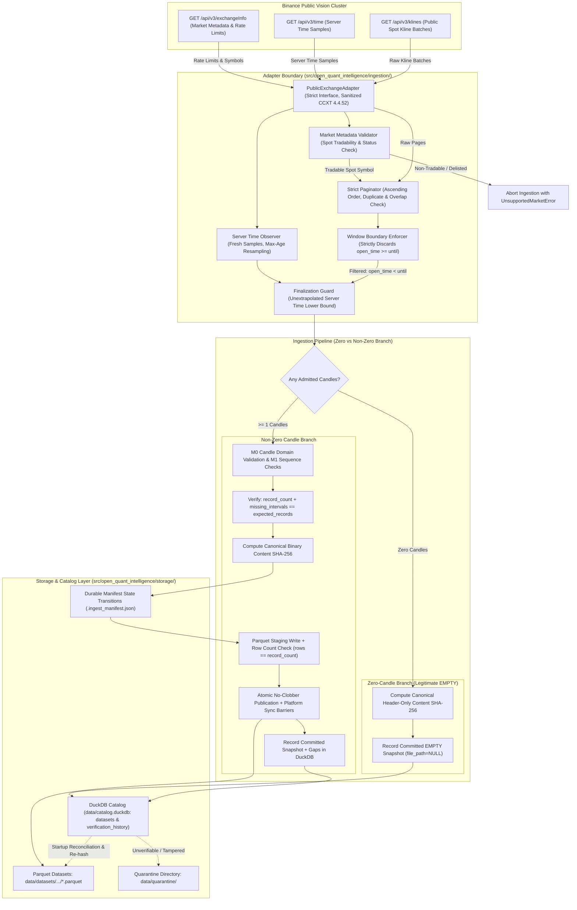

# Open Quant Intelligence V2 — Milestone M1 Architecture Proposal
## Public Market Data Ingestion and Canonical Storage Engine (Final Candidate — Awaiting Technical Approval)

**Document Reference:** `docs/M1_ARCHITECTURE_PROPOSAL.md`  
**Milestone:** M1 — Public Market Data Ingestion & Storage  
**Base Commit on `main`:** `02b7bcad43a2947c7ed2977e143e959559f5873d`  
**Branch:** `docs/m1-architecture-proposal`  
**Author:** AntiGravity (Implementation Engineer)  
**Technical Authority:** ChatGPT  
**Final Decision Maker:** Project Owner  
**Status:** FINAL CANDIDATE — AWAITING TECHNICAL APPROVAL (Implementation is strictly NOT authorized)  

---

## 1. Executive Summary & Purpose

Milestone M1 establishes the foundation for reproducible quantitative research in Open Quant Intelligence (OQI) by delivering an automated, deterministic historical market data ingestion and storage pipeline.

The pipeline will:
1. Validate Spot market tradability and active status against Binance exchange metadata (`GET /api/v3/exchangeInfo`) before initiating ingestion, immediately rejecting unsupported, delisted, or non-tradable pairs.
2. Collect public spot OHLCV data from Binance's dedicated public market data cluster (`https://data-api.binance.vision`) using CCXT without authentication or credentials, mediated through a strict, allowlisted public adapter that encapsulates CCXT and explicitly purges all private, SAPI, futures, options, portfolio-margin, and WebSocket endpoint groups.
3. Enforce the requested half-open interval $[since, until)$ strictly at the ingestion boundary, guaranteeing candles with $open\_time \ge until$ never enter finalization, validation, fingerprinting, or storage.
4. Filter unfinalized candles using unextrapolated, fresh server-time observations without local monotonic drift extrapolation, guaranteeing no candle is finalized early relative to exchange time.
5. Provide an explicit zero-candle branch for legitimate EMPTY ranges that validates market identity and window boundaries, computes a canonical header-only content SHA-256 digest, and records an immutable committed EMPTY catalog entry with nullable artifact fields, without routing empty sequences into M0's sequence validator (which expects at least one candle).
6. Validate all admitted non-empty candles through the immutable M0 `Candle` domain contract and sequence rules, verifying that physical Parquet row counts match `record_count`, and that `record_count + missing_intervals == expected_records` across both `GAP_FREE` and `GAP_CONTAINING` datasets.
7. Store validated datasets in Apache Parquet files using Snappy compression via a complete crash-recovery protocol incorporating durable manifest state transitions, atomic temp-file creation, cross-platform no-clobber publication, and platform-specific sync barriers (`os.fsync` and directory barriers on POSIX; `FlushFileBuffers` and write-through on Windows).
8. Maintain an immutable dataset snapshot catalog in DuckDB accompanied by a dedicated verification history table, cleanly separating immutable snapshot identities from mutable or temporal verification audit events.
9. Provide user-facing CLI commands for downloading, cataloging, inspecting, and re-validating historical datasets.

---

## 2. Invariant Contracts & Strict Exclusions

### A. Preserved M0 & M0.1 Contracts
- **Python Compatibility:** Python 3.11 and 3.12 exclusively.
- **Repository Structure:** Standard `src/` layout under `src/open_quant_intelligence/`.
- **Domain Invariants:** Immutable `Candle`, `MarketIdentity`, and `SupportedTimeframe` classes remain the single source of truth.
- **Time Semantics:** Half-open interval convention `[open_time, close_time)` where `close_time = open_time + duration`.
- **Supported Timeframes:** Strictly `SupportedTimeframe.M1` ("1m"), `M5` ("5m"), `M15` ("15m"), `M30` ("30m"), `H1` ("1h"), `H4` ("4h"), and `D1` ("1d").
- **Data Integrity:** No silent auto-sorting, no forward-filling of gaps, and no row fabrication.
- **Test Integrity:** The existing 104-test M0/M0.1 unit and CLI test suite must continue passing without modification.

### B. Strict Milestone Exclusions
- **No Private API Keys or Credentials:** Ingestion uses public market data endpoints exclusively.
- **No Raw CCXT Exposure:** Raw CCXT exchange objects are never leaked outside the internal adapter boundary; no generic method forwarding is permitted.
- **No Extraneous Endpoints:** SAPI, futures (fapi), delivery (dapi), options (eapi), portfolio-margin (papi), and WebSockets are completely purged.
- **No Order Execution or Trading:** Zero routing, balancing, order placement, or wallet manipulation.
- **No Derivatives:** Strictly spot markets (`market_type == "spot"`). Futures, options, and perpetuals are out of scope.
- **No Strategy Logic or Backtesting:** Strategy evaluation, alpha generation, and portfolio simulation belong to M2/M3.
- **No AI/ML:** Model inference and feature training belong to M6.
- **No Real-Time Streaming:** WebSockets and orderbook tickers are excluded. M1 is historical batch OHLCV only.

---

## 3. Technology Stack & Dependency Verification

### A. Evaluation of Dependencies

| Component | Library Choice | Justification |
|---|---|---|
| **Market Data Adapter** | `ccxt>=4.4.52, <5.0.0` | Industry-standard exchange abstraction. Encapsulated behind `PublicExchangeAdapter`. Deep-merged endpoint URLs are explicitly sanitized to retain only the required Vision Spot public operations. |
| **Analytical Catalog & Query** | `duckdb>=1.1.0, <2.0.0` | Embedded in-process analytical SQL engine. Handles metadata registration, analytical queries across local Parquet files, and relational catalog queries without requiring a client-server database daemon. |
| **Parquet Storage Engine** | Native DuckDB Parquet Engine (Primary) | DuckDB compiles native, highly performant Parquet reading and writing (`COPY ... TO ... (FORMAT PARQUET, COMPRESSION SNAPPY)`). Using DuckDB for Parquet eliminates heavy runtime coupling to PyArrow for ingestion. |
| **Optional Arrow Interop** | `pyarrow>=15.0.0, <19.0.0` (Optional `[dev]`) | Maintained as an optional development dependency for zero-copy memory testing and schema inspection, but **NOT** required for the production runtime pipeline. |

### B. CI Target Versions vs. Supported Bounds
The existing 104 tests in the repository verify M0 domain and CLI contracts; they do not exercise CCXT or DuckDB because M1 dependencies are not yet installed in the current environment. When M1 implementation begins, CI will explicitly test against pinned target versions while declaring semantic upper and lower bounds:

| Dependency | Supported Version Bounds in `pyproject.toml` | Target Pinned Version in M1 Implementation CI | Role |
|---|---|---|---|
| `ccxt` | `>=4.4.52, <5.0.0` | `4.4.52` | Production runtime |
| `duckdb` | `>=1.1.0, <2.0.0` | `1.1.3` | Production runtime |
| `pytest` | `>=8.0.0` | `8.3.3` | Test framework (`[dev]`) |
| `ruff` | `>=0.4.0` | `0.7.3` | Linter / formatter (`[dev]`) |
| `pyarrow` | `>=15.0.0, <19.0.0` | `18.0.0` | Optional verification (`[dev]`) |

```toml
[project]
dependencies = [
    "ccxt>=4.4.52,<5.0.0",
    "duckdb>=1.1.0,<2.0.0",
]

[project.optional-dependencies]
dev = [
    "pytest>=8.0.0",
    "ruff>=0.4.0",
    "pyarrow>=15.0.0,<19.0.0",
]
```

---

## 4. System Architecture & Module Boundaries

### A. Modular Structure
```text
src/open_quant_intelligence/
├── domain/                      # [M0] Immutable contracts (Candle, MarketIdentity, SupportedTimeframe)
│   ├── candle.py
│   ├── market.py
│   └── timeframe.py
├── data/                        # [M0] Validation engine
│   ├── validation.py            # [M0] Canonical candle & stream validator (final domain authority for Candle models)
│   └── quality.py               # [M1 NEW] Gap analysis & data quality reporting
├── ingestion/                   # [M1 NEW] Public ingestion pipeline
│   ├── __init__.py
│   ├── adapter.py               # Strict allowlisted Binance public vision adapter (encapsulates sanitized CCXT)
│   ├── market_check.py          # Pre-flight Spot market metadata & tradability verification
│   ├── pagination.py            # Strict raw-page interval paginator with [since, until) boundary clamp
│   ├── clock.py                 # Fresh exchange server time observation & maximum-age resampler
│   ├── finalization.py          # Observation-time candle finalization filter (unextrapolated lower bound)
│   └── pipeline.py              # Orchestrator: Pre-Flight -> Fetch -> Clamp -> Zero/Non-Zero Branch -> Store
├── storage/                     # [M1 NEW] Persistence & Catalog
│   ├── __init__.py
│   ├── manifest.py              # Durable manifest manager, atomic update transitions, active leases
│   ├── parquet_store.py         # Staging flush, platform sync barriers, atomic no-clobber publication
│   ├── fingerprint.py           # Canonical binary content hashing (data & empty sets) & artifact SHA-256
│   └── catalog.py               # DuckDB immutable snapshot catalog, gap recording & verification history
└── cli.py                       # CLI entrypoints (validate, ingest, datasets, inspect, verify)
```

### B. Mermaid Architecture Diagram


---

## 5. Pre-Flight Market Metadata Check & Binance Vision Configuration

### A. Pre-Flight Spot Tradability Check
Before making Kline queries, the adapter calls `GET /api/v3/exchangeInfo`:
1. The symbol must exist in `exchangeInfo["symbols"]`.
2. `status` must strictly be `"TRADING"`. If `"HALT"`, `"BREAK"`, or delisted, abort with `MarketStatusError`.
3. `isSpotTradingAllowed` must be `True`.
4. `permissions` or `permissionSets` must contain `"SPOT"`.
5. Non-tradable or non-spot pairs abort immediately with structured exit code 1.

### B. CCXT 4.4.52 URL Sanitization & Allowlisted Interface
CCXT's default constructor deep-merges extensive default URL dictionaries across private and derivative APIs. To prevent accidental leakage or invocation of unapproved endpoints:

1. **Remove Extraneous Keys:** The adapter deletes or purges `sapi`, `fapi`, `dapi`, `eapi`, `papi`, `ws`, and the obsolete `v1` path (in CCXT 4.4.52, Binance `v1` points to `/api/v1`, which is unnecessary for M1).
2. **Retain Strictly Required Keys:**
   ```python
   sanitized_api = {
       "public": "https://data-api.binance.vision/api/v3",
   }
   ```
3. **Strict Interface Encapsulation:** The raw CCXT object is encapsulated privately within `PublicExchangeAdapter`. No `__getattr__` or method forwarding is permitted. Only four public methods are exposed:
   - `fetch_ohlcv(symbol, timeframe, since_ms, limit)`
   - `fetch_time()`
   - `get_rate_limit_weight_limit()`
   - `get_last_used_weight_1m()`

### C. Rate-Limit Recovery & Backoff Policy
1. **Dynamic Limit Retrieval:** At initialization, the adapter parses `exchangeInfo.rateLimits` for `rateLimitType == "REQUEST_WEIGHT"` and `interval == "MINUTE"`. The `limit` (e.g. 1,200 or 6,000) is cached. `fetch_exchange_status()` is **not** used.
2. **Proactive Throttling via `X-MBX-USED-WEIGHT-1M`:**
   - Every response inspects `X-MBX-USED-WEIGHT-1M`.
   - Used weight $> 70\%$: Injects adaptive sleep $\text{sleep\_ms} = (\text{used} / \text{limit})^2 \times 500\,\text{ms}$.
   - Used weight $> 90\%$: Pauses until the 60-second window elapses.
3. **HTTP 429 Rate Limit Handling:**
   - Reads `Retry-After` header. If present, sleeps for the specified seconds $+ 500\,\text{ms}$ jitter.
   - If `Retry-After` is absent, falls back to bounded exponential backoff: $T = \min(60, 2^{\text{attempt}} \times 1.5) + \text{jitter}$.
   - Maximum 3 retries. If exhausted, aborts immediately with `RateLimitExhaustedError`. Ingestion terminates safely; pagination does not continue.
4. **HTTP 418 IP Ban:**
   - If HTTP 418 is received, **HALT IMMEDIATELY WITH ZERO RETRIES**. Log a `CRITICAL` alert and write an abort record in the manifest.

---

## 6. Exact Timestamp Arithmetic & Complete Pagination Algorithm

### A. Exact Integer Epoch Timedelta Arithmetic
Conversions between Python `datetime` and integer epoch units use exact integer arithmetic anchored to `EPOCH_UTC = datetime(1970, 1, 1, tzinfo=timezone.utc)`:

```python
from datetime import datetime, timedelta, timezone
from open_quant_intelligence.domain.timeframe import SupportedTimeframe

EPOCH_UTC = datetime(1970, 1, 1, tzinfo=timezone.utc)


def datetime_to_epoch_ms(dt: datetime) -> int:
    """Convert an aware UTC datetime to integer epoch milliseconds.

    Rejects naive datetimes, pre-epoch timestamps, and fractional milliseconds.
    """
    if dt.tzinfo is None or dt.utcoffset() != timedelta(0):
        raise ValueError(f"Datetime {dt} must be explicit timezone-aware UTC.")
    if dt < EPOCH_UTC:
        raise ValueError(f"Pre-epoch datetime {dt} is not supported.")

    diff = dt - EPOCH_UTC
    total_micros = diff.days * 86_400_000_000 + diff.seconds * 1_000_000 + diff.microseconds

    # Explicitly reject fractional milliseconds
    if total_micros % 1_000 != 0:
        raise ValueError(f"Timestamp {dt} has fractional milliseconds (microseconds: {diff.microseconds}).")

    return total_micros // 1_000


def epoch_ms_to_datetime(ms: int) -> datetime:
    """Convert integer epoch milliseconds to aware UTC datetime."""
    if not isinstance(ms, int) or isinstance(ms, bool):
        raise TypeError(f"Timestamp must be integer milliseconds, got {type(ms)}")
    if ms < 0:
        raise ValueError(f"Epoch milliseconds cannot be negative, got {ms}")

    return EPOCH_UTC + timedelta(milliseconds=ms)


def timeframe_to_duration_ms(timeframe: SupportedTimeframe) -> int:
    """Return exact integer duration milliseconds for M0 SupportedTimeframe members."""
    minutes_map: dict[SupportedTimeframe, int] = {
        SupportedTimeframe.M1: 1,
        SupportedTimeframe.M5: 5,
        SupportedTimeframe.M15: 15,
        SupportedTimeframe.M30: 30,
        SupportedTimeframe.H1: 60,
        SupportedTimeframe.H4: 240,
        SupportedTimeframe.D1: 1440,
    }
    if timeframe not in minutes_map:
        raise ValueError(f"Unsupported timeframe: {timeframe}")
    return minutes_map[timeframe] * 60_000
```

### B. Complete Pagination Algorithm Specification
```python
def paginate_ohlcv(
    adapter: PublicExchangeAdapter,
    symbol: str,
    timeframe: SupportedTimeframe,
    since_ms: int,
    until_ms: int,
    clock: ServerTimeObserver,
) -> list[RawKlineRow]:
    """Deterministically paginate historical OHLCV from Binance vision public endpoints."""
    step_ms = timeframe_to_duration_ms(timeframe)
    expected_count = (until_ms - since_ms) // step_ms
    max_pages = max(50, ((expected_count + 999) // 1000) * 3)

    current_since_ms = since_ms
    admitted_candles: list[RawKlineRow] = []
    seen_timestamps: set[int] = set()
    page_count = 0

    while current_since_ms < until_ms:
        page_count += 1
        if page_count > max_pages:
            raise PaginationBudgetExceededError(f"Pagination exceeded safety budget of {max_pages} requests.")

        # Request batch from exchange (max 1000 klines)
        page = adapter.fetch_ohlcv(symbol, timeframe.value, since_ms=current_since_ms, limit=1000)

        # 1. Empty page: Exchange has no further data in range
        if not page:
            break

        # 2. Strict row type, exact 6-field structure, and numeric sanity
        page_timestamps: list[int] = []
        for i, row in enumerate(page):
            if not isinstance(row, (list, tuple)) or len(row) != 6:
                raise MalformedKlineError(f"Row {i} is not a sequence of exactly 6 elements: {row!r}")
            t, o, h, l, c, v = row
            if not isinstance(t, int) or isinstance(t, bool) or t < 0:
                raise MalformedKlineError(f"Row {i} timestamp {t!r} is not a non-negative integer.")
            for val_name, val in [("open", o), ("high", h), ("low", l), ("close", c), ("volume", v)]:
                if not isinstance(val, (int, float)) or isinstance(val, bool):
                    raise MalformedKlineError(f"Row {i} field {val_name} {val!r} is not numeric.")
                if not math.isfinite(val):
                    raise MalformedKlineError(f"Row {i} field {val_name} {val!r} is not finite.")
            if min(o, h, l, c) <= 0:
                raise MalformedKlineError(
                    f"Row {i} contains non-positive price: open={o}, high={h}, low={l}, close={c}"
                )
            if v < 0:
                raise MalformedKlineError(f"Row {i} contains negative volume: {v}")

            # Strict ascending timestamp verification within the page
            if page_timestamps and t <= page_timestamps[-1]:
                raise MalformedPageError(f"Page timestamps not strictly increasing: {page_timestamps[-1]} -> {t}")
            if t < current_since_ms:
                raise PaginationRegressionError(f"Row timestamp {t} violates cursor {current_since_ms}")
            if t in seen_timestamps:
                raise PageOverlapError(f"Timestamp {t} was already accepted in a previous page.")
            page_timestamps.append(t)

        max_raw_open_ms = page_timestamps[-1]
        seen_timestamps.update(page_timestamps)

        # 3. Fresh unextrapolated server time observation
        obs_server_time_ms = clock.get_fresh_server_time_ms()

        # 4. Ingestion boundary clamp [since, until) and candle finalization
        for raw_kline in page:
            open_ms = raw_kline[0]

            # Strict upper-bound clamp: discard any candle where open_time >= until
            if open_ms >= until_ms:
                continue
            if open_ms < since_ms:
                continue

            # Finalization guard: close boundary must not exceed observed exchange time
            close_ms = open_ms + step_ms
            if close_ms > obs_server_time_ms:
                # In-progress candle at the tail; skip admission
                continue

            admitted_candles.append(raw_kline)

        # 5. Advance cursor monotonically based on validated raw page maximum
        current_since_ms = max_raw_open_ms + 1

    return admitted_candles
```

---

## 7. Clock Authority & Unextrapolated Observation Lower Bound

### A. Delayed Finalization as Safe Engineering Trade-off
Extrapolating server time using local monotonic time assumes that local oscillator drift is universally bounded across all hardware environments. To remove this assumption, M1 adopts a **strictly unextrapolated observation model**:
- The pipeline queries Binance server time (`GET /api/v3/time`).
- The returned `t_server_ms` is treated as a conservative lower bound of current exchange time at the moment the response arrives.
- **No extrapolation:** Local monotonic time is **never** added to extrapolate future server time.
- **Trade-off:** If an observation is several seconds old, a newly completed candle might not be finalized until the next refresh. This trade-off is intentionally accepted: **delayed finalization is strictly preferred over premature finalization.**

### B. Freshness & Resampling Protocol
1. **Observation Lifetime:** Server time samples expire after `MAX_CLOCK_AGE_SEC = 60` seconds.
2. **Fresh Resampling:** Before evaluating tail candle finalization, if the cached server time is older than 60 seconds, the adapter fetches a fresh timestamp.
3. **Latency & Skew Safeguards:**
   - If round-trip latency during clock fetching exceeds 2,000 ms, the sample is retried up to 3 times.
   - If all 3 attempts fail, or if $|\tau_{\text{exchange}} - \tau_{\text{local}}| > 3,000\,\text{ms}$, ingestion aborts with `UnreliableClockError`.
   - **Exchange Accuracy Assumption:** The pipeline assumes the Binance exchange server clock is internally synchronized via NTP and does not step backward during the session.

---

## 8. Dual Pipeline Branching: Legitimate EMPTY vs. Non-Empty Datasets

### A. Clean Resolution of M0 Compatibility for EMPTY Datasets
M0's `validate_candles()` and `validate_candle_stream()` explicitly require at least one candle and return `is_valid=False` with `issue_type="EMPTY_DATASET"` if given an empty sequence. M1 resolves this without changing M0 by introducing an explicit **pipeline branch**:

```text
Admitted Candles Count:
  ├── 0 Candles  ──> Zero-Candle Branch (Legitimate EMPTY Snapshot)
  └── >= 1 Candle ──> Non-Empty Branch (M0 Candle & Sequence Validation)
```

### B. Zero-Candle Branch (Legitimate EMPTY)
When zero candles are admitted for a valid query window:
1. **Validation:** Confirms market identity is valid and window satisfies $\text{since\_ms} < \text{until\_ms}$ with grid alignment.
2. **No Row Fabrication:** Zero rows are passed to M0; no dummy candles are created.
3. **No Artifact Creation:** No Parquet file is written; `file_path = NULL`, `file_sha256 = NULL`, `file_size_bytes = NULL`.
4. **Canonical Header-Only Content Fingerprint:** Computes SHA-256 over the canonical `[Header Block]` with `Candle Count = 0`:
   $$\text{content\_fingerprint\_sha256} = \text{sha256}(\text{Header Block})$$
5. **Catalog Registration:** Commits a snapshot with `quality_status = 'EMPTY'`, `ingestion_status = 'COMMITTED'`, `record_count = 0`, `gap_count = 0`, `missing_intervals = N_expected`. This is an authorized successful outcome, not an error.

### C. Non-Empty Branch & Physical Row-Count Verification
When $\ge 1$ candles are admitted:
1. **M0 Domain Contract Enforcement:** Every raw row is converted to an immutable M0 `Candle` instance, enforcing all domain invariants (price positivity, high/low bounding, UTC timestamps).
2. **M1 Sequence Validation:** Validates chronological ordering ($t_{i+1} > t_i$), absence of duplicates, alignment to the timeframe grid, and detects gap events.
3. **Physical Row-Count & Gap Consistency Invariant:**
   Before staging Parquet data, the pipeline asserts:
   $$\text{record\_count} + \text{missing\_intervals} == \text{expected\_records}$$
   - **GAP_FREE Datasets:** $\text{missing\_intervals} == 0 \implies \text{record\_count} == \text{expected\_records}$.
   - **GAP_CONTAINING Datasets:** $\text{record\_count} < \text{expected\_records}$, but the physical Parquet file must contain **exactly `record_count` rows**.
   - If `record_count + missing_intervals != expected_records`, ingestion halts with `InconsistentGapStatisticsError`.
4. **Staging File Verification:**
   After writing the staging Parquet file, DuckDB executes:
   ```sql
   SELECT count(*) FROM read_parquet('staging_path.parquet.tmp')
   ```
   The returned count must **strictly equal `record_count`**. If unequal, ingestion halts with `StagingRowMismatchError`.

---

## 9. Canonical Binary Content Fingerprinting & Negative-Zero Normalization

To guarantee deterministic data integrity across platforms, compilers, and DuckDB versions, M1 establishes **exactly one canonical serialization contract**.

### A. Negative-Zero Normalization
In IEEE-754 arithmetic, $-0.0$ and $+0.0$ have different bit representations (`0x8000000000000000` vs `0x0000000000000000`). All float values are normalized before serialization:
```python
def normalize_float(val: float) -> float:
    return 0.0 if val == 0.0 else val
```

### B. Canonical Binary Serialization Specification
```text
[Header Block]
  - Magic Bytes:          ASCII "OQICCF" (6 bytes)
  - Schema Version:       UINT16_LE (2 bytes, value = 1)
  - Exchange ID:          UINT16_LE length + UTF-8 bytes (e.g. 7, "binance")
  - Market Type:          UINT16_LE length + UTF-8 bytes (e.g. 4, "spot")
  - Symbol:               UINT16_LE length + UTF-8 bytes (e.g. 8, "BTC/USDT")
  - Timeframe:            UINT16_LE length + UTF-8 bytes (e.g. 2, "1h")
  - Requested Since ms:   INT64_LE (8 bytes)
  - Requested Until ms:   INT64_LE (8 bytes)
  - Candle Count:         UINT64_LE (8 bytes, 0 for EMPTY datasets)

[Candle Record Block] (Included if Candle Count > 0, ordered strictly by open_time ascending)
  - Open Time Epoch ms:   INT64_LE (8 bytes)
  - Close Time Epoch ms:  INT64_LE (8 bytes)
  - Open Price:           Normalized IEEE-754 binary64 DOUBLE_LE (8 bytes)
  - High Price:           Normalized IEEE-754 binary64 DOUBLE_LE (8 bytes)
  - Low Price:            Normalized IEEE-754 binary64 DOUBLE_LE (8 bytes)
  - Close Price:          Normalized IEEE-754 binary64 DOUBLE_LE (8 bytes)
  - Base Volume:          Normalized IEEE-754 binary64 DOUBLE_LE (8 bytes)
  - Quote Volume Present: UINT8 (1 byte: 0 = NULL, 1 = Present)
    [If Present]:         Normalized IEEE-754 binary64 DOUBLE_LE (8 bytes)
  - Trade Count Present:  UINT8 (1 byte: 0 = NULL, 1 = Present)
    [If Present]:         INT64_LE (8 bytes)
```

---

## 10. Complete Storage Durability, Sync Barriers & Crash Recovery

### A. Durable Staging, Publication & Sync Barriers
To ensure filesystem durability across operating systems:
1. **POSIX Systems:**
   - Staging file is flushed and committed via `os.fsync(fd)`.
   - Manifest updates write to `.ingest_manifest_<uuid>.tmp`, execute `os.fsync()`, and perform `os.replace()` to ensure atomic manifest durability.
   - Atomic no-clobber publication executes `os.link(staging, target)` followed by `os.unlink(staging)`.
   - A directory barrier `os.fsync(dir_fd)` is executed on the parent directory to commit the directory entry.
2. **Windows Systems:**
   - Staging file is flushed via Win32 `FlushFileBuffers(handle)` with write-through semantics.
   - Manifest updates write to a temporary file and atomically replace the previous manifest.
   - Publication uses Win32 `MoveFileExW` without `MOVEFILE_REPLACE_EXISTING`, raising `FileExistsError` if the destination exists.
   - Note: Windows directory entry updates are committed via filesystem write-through; native POSIX directory file descriptors are not available.
3. **Collision Invariant:** If `target_path` already exists, ingestion halts with `DatasetPathCollisionError`. Existing target files are never overwritten.

### B. Durable Ingestion Manifest Schema
```json
{
  "ingestion_uuid": "f47ac10b-58cc-4372-a567-0e02b2c3d479",
  "lease_owner_pid": 12844,
  "lease_expires_at_utc": "2026-11-13T17:30:00Z",
  "schema_version": 1,
  "ccxt_version": "4.4.52",
  "exchange_id": "binance",
  "market_type": "spot",
  "symbol": "BTC/USDT",
  "timeframe": "1h",
  "requested_since_utc": "2026-11-01T00:00:00Z",
  "requested_until_utc": "2026-11-05T00:00:00Z",
  "staging_file_path": "data/datasets/.../dataset_..._f47ac10b.parquet.tmp",
  "target_file_path": "data/datasets/.../dataset_..._f47ac10b.parquet",
  "expected_records": 96,
  "record_count": 96,
  "missing_intervals": 0,
  "content_fingerprint_sha256": "sha256:7f9a2b84c310d54e8b21c430aef7830182419ef8973b02196a84920485a3bb12",
  "file_sha256": "sha256:4d831b7908c84857b28ec95ef5476a8947cf839a823908dbca19273645bbef21",
  "stage": "COMMITTING_CATALOG",
  "created_at_utc": "2026-11-13T17:15:00Z",
  "updated_at_utc": "2026-11-13T17:15:04Z"
}
```

### C. Comprehensive Crash-Recovery State Transition Table

| Crash Point | Filesystem State | Catalog State | Manifest State | Startup Reconciliation Recovery Action |
|---|---|---|---|---|
| **1. Before initial manifest is durable** | Partial `.tmp` or no files | No record | No manifest | Unreferenced `.tmp` without manifest: if unleased or expired, deleted as stale garbage. |
| **2. After manifest durable, before staging completion** | `.tmp` file incomplete | No record | `INITIALIZING` or `STAGING` | Reconciler checks lease: if PID dead and lease expired, deletes staging `.tmp` and unlinks manifest. |
| **3. After staging durable, before publication** | `.tmp` complete & verified | No record | `STAGED` | Reconciler verifies staging `.tmp` hash. If valid, completes publication $\to$ updates manifest $\to$ commits catalog. If invalid, deletes `.tmp` and manifest. |
| **4. After publication, before manifest update** | Target `.parquet` exists; `.tmp` unlinked | No record | `STAGED` | Reconciler checks target `.parquet`: if `file_sha256` matches manifest, advances manifest to `PUBLISHED` and commits catalog. |
| **5. After PUBLISHED, before DuckDB commit** | Target `.parquet` exists | No record | `COMMITTING_CATALOG` | Reconciler executes DuckDB commit transaction $\to$ unlinks manifest. |
| **6. After DuckDB commit, before manifest unlinking** | Target `.parquet` exists | Committed record exists | `COMMITTING_CATALOG` | Reconciler checks DuckDB: `ingestion_uuid` is already `COMMITTED`; safely unlinks orphaned manifest. |
| **7. During cleanup (staging/manifest unlink)** | Target `.parquet` exists | Committed record exists | Stale manifest or `.tmp` | Reconciler verifies catalog commit, cleans up residual files. Recovery is completely idempotent. |

---

## 11. Immutable Dataset Snapshots & Verification History

### A. Immutable Snapshot Catalog Schema (DDL)
To eliminate persistence contradictions, snapshot records in `datasets` are **strictly immutable**. Subsequent physical file verification audits or corruption discoveries are appended to a dedicated `dataset_verification_history` table:

```sql
CREATE TABLE IF NOT EXISTS datasets (
    snapshot_id VARCHAR PRIMARY KEY,             -- Unique snapshot ID (e.g. 'snap_f47ac10b8e21')
    dataset_identity VARCHAR NOT NULL,           -- Deterministic key: 'binance:spot:BTC/USDT:1h:since:until'
    exchange_id VARCHAR NOT NULL,                -- 'binance'
    market_type VARCHAR NOT NULL,                -- 'spot'
    symbol VARCHAR NOT NULL,                     -- 'BTC/USDT'
    timeframe VARCHAR NOT NULL,                  -- '1h'
    requested_since TIMESTAMP WITH TIME ZONE NOT NULL,
    requested_until TIMESTAMP WITH TIME ZONE NOT NULL,
    actual_first_open TIMESTAMP WITH TIME ZONE,  -- NULL if EMPTY
    actual_last_close TIMESTAMP WITH TIME ZONE,  -- NULL if EMPTY
    expected_records BIGINT NOT NULL,            -- Total theoretical grid intervals
    record_count BIGINT NOT NULL,                -- Actual records captured (0 if EMPTY)
    gap_count INTEGER NOT NULL,                  -- Number of gap events
    missing_intervals BIGINT NOT NULL,           -- Total missing intervals across all gaps
    content_fingerprint_sha256 VARCHAR NOT NULL, -- Canonical content hash (Header-only digest if EMPTY)
    file_sha256 VARCHAR,                         -- NULL for EMPTY datasets
    file_path VARCHAR,                           -- NULL for EMPTY datasets
    file_size_bytes BIGINT,                      -- NULL for EMPTY datasets
    ccxt_version VARCHAR NOT NULL,
    ingestion_uuid VARCHAR NOT NULL,
    ingested_at TIMESTAMP WITH TIME ZONE NOT NULL,
    ingestion_status VARCHAR NOT NULL,           -- 'COMMITTED', 'FAILED', 'ABORTED'
    quality_status VARCHAR NOT NULL              -- 'EMPTY', 'GAP_FREE', 'GAP_CONTAINING'
);

CREATE TABLE IF NOT EXISTS dataset_gaps (
    gap_id VARCHAR PRIMARY KEY,
    snapshot_id VARCHAR REFERENCES datasets(snapshot_id),
    expected_open TIMESTAMP WITH TIME ZONE NOT NULL,
    actual_open TIMESTAMP WITH TIME ZONE NOT NULL,
    missing_count BIGINT NOT NULL
);

-- Dedicated verification audit log; preserves immutability of datasets table
CREATE TABLE IF NOT EXISTS dataset_verification_history (
    verification_id VARCHAR PRIMARY KEY,
    snapshot_id VARCHAR REFERENCES datasets(snapshot_id),
    verified_at TIMESTAMP WITH TIME ZONE NOT NULL,
    verification_result VARCHAR NOT NULL,        -- 'VERIFIED', 'CORRUPTED', 'MISSING_FILE'
    computed_file_sha256 VARCHAR,
    error_message VARCHAR
);

CREATE INDEX IF NOT EXISTS idx_datasets_identity 
ON datasets(dataset_identity, ingested_at DESC);
```

### B. EMPTY Snapshot Deduplication & Re-Ingestion (`--force`)
1. **Deduplication:** When `open-quant ingest` is invoked:
   - Queries DuckDB for the latest `COMMITTED` snapshot matching `dataset_identity`.
   - If a verified `EMPTY` snapshot exists (`quality_status = 'EMPTY'`), the CLI skips exchange queries, logs: `Verified EMPTY dataset already recorded for this range. Skipping ingestion. Use --force to re-query exchange.`, and exits with returncode 0.
2. **Re-Ingestion (`--force`):**
   - Re-queries Binance vision endpoints.
   - If still empty, records a new immutable `EMPTY` snapshot with a fresh `snapshot_id` and updated `ingested_at` timestamp. Historical records remain immutable.

---

## 12. CLI Proposal & User Experience

```bash
# 1. Ingest historical public data with strict grid-aligned boundaries
open-quant ingest \
  --exchange binance \
  --symbol BTC/USDT \
  --timeframe 1h \
  --since 2026-11-01T00:00:00Z \
  --until 2026-11-05T00:00:00Z \
  [--output-dir data/] \
  [--fail-on-gaps] \
  [--force]

# 2. List registered dataset snapshots
open-quant datasets list [--symbol BTC/USDT] [--timeframe 1h] [--status GAP_FREE]

# 3. Inspect dataset details, gap distributions, and provenance
open-quant datasets inspect <snapshot_id_or_fingerprint>

# 4. Verify physical Parquet integrity against catalog fingerprints
open-quant datasets verify <snapshot_id_or_fingerprint>
```

### Sample CLI Report Output (Illustrative)
```text
============================================================
Open Quant Intelligence — Historical Ingestion Report
============================================================
Snapshot ID:           snap_f47ac10b8e21
Ingestion UUID:        f47ac10b-58cc-4372-a567-0e02b2c3d479
Exchange:              binance (public vision cluster)
Symbol:                BTC/USDT | Market: spot | Timeframe: 1h
Requested Range (UTC): 2026-11-01T00:00:00Z -> 2026-11-05T00:00:00Z
Coverage Range (UTC):  2026-11-01T00:00:00Z -> 2026-11-05T00:00:00Z
Expected Intervals:    96
Recorded Intervals:    96 (0 missing)
Ingestion Status:      COMMITTED
Quality Status:        GAP_FREE
Content Fingerprint:   sha256:7f9a2b84c310d54e8b21c430aef7830182419ef8973b02196a84920485a3bb12
Parquet Artifact:      data/datasets/exchange=binance/market=spot/symbol=BTC_USDT/timeframe=1h/dataset_20261101T000000Z_20261105T000000Z_7f9a2b84_f47ac10b.parquet
Artifact SHA-256:      sha256:4d831b7908c84857b28ec95ef5476a8947cf839a823908dbca19273645bbef21
Catalog Record:        REGISTERED (catalog.duckdb)
============================================================
```

---

## 13. Deterministic Offline Testing Strategy

All automated CI test suites run **100% offline** without network access or live exchange calls.

### Required Deterministic Test Suite
1. **`test_parquet_row_count_matches_record_count_gap_free`**: Asserts physical Parquet rows strictly equal `record_count` and `record_count == expected_records`.
2. **`test_parquet_row_count_matches_record_count_gap_containing`**: Asserts physical Parquet rows strictly equal `record_count`, `record_count < expected_records`, and `record_count + missing_intervals == expected_records`.
3. **`test_empty_dataset_path_committed_without_file`**: Asserts zero admitted candles bypass M0 sequence validator, publish no Parquet file, compute canonical header-only SHA-256, and register a committed EMPTY snapshot.
4. **`test_crash_recovery_transitions_idempotent`**: Exercises all 7 transitions in the crash-recovery table using mock crashes; asserts reconciliation leaves catalog and files consistent.
5. **`test_clock_unextrapolated_observation_freshness`**: Injects stale server-time samples ($>60\,\text{s}$); verifies adapter resamples before finalization and never finalizes early.
6. **`test_binance_http_429_backoff_and_exhaustion`**: Injects HTTP 429 with and without `Retry-After`; asserts backoff respects header and aborts when retries exhaust.
7. **`test_binance_http_418_immediate_halt`**: Injects HTTP 418; asserts immediate termination with zero retries.
8. **`test_ccxt_url_sanitization_effective_keys`**: Asserts adapter retains only public Vision URLs; all SAPI, fapi, dapi, eapi, papi, and WS entries are purged.
9. **`test_paginator_boundary_clamp_discards_future_rows`**: Injects responses extending beyond `until`; asserts records with $open\_time \ge until$ are discarded at the boundary.
10. **`test_preflight_market_check_tradable_spot`**: Asserts non-tradable or delisted pairs raise `MarketStatusError`.

---

## 14. Acceptance Criteria Checklist for M1

| # | Criterion | Verification Method |
|---|---|---|
| 1 | Pre-flight Spot market metadata check rejecting delisted or non-tradable pairs | Pre-flight unit tests |
| 2 | Purge all SAPI, futures, options, and private CCXT 4.4.52 URL groups | Effective URL inspection unit test |
| 3 | Strict $[since, until)$ window boundary clamp discarding $open\_time \ge until$ | Pagination boundary unit test |
| 4 | Conservative unextrapolated clock observation finalization (never finalize early) | Clock estimator unit tests |
| 5 | Clean zero-candle branch committing EMPTY snapshots without Parquet files | Empty-path unit tests |
| 6 | Parquet physical rows strictly match `record_count`, with `record_count + missing == expected` | Staging verification unit tests |
| 7 | Cross-platform atomic no-clobber publication with platform sync barriers | Storage publication unit tests |
| 8 | Complete 7-state crash-recovery transition protocol with durable manifests | Crash-recovery reconciliation tests |
| 9 | Immutable snapshot catalog with dedicated verification audit history | DuckDB catalog DDL & audit tests |
| 10 | 100% offline deterministic test suite passing on Python 3.11 and 3.12 | CI workflow matrix run |

---

## 15. Risks, Trade-offs & Unresolved Decisions

1. **Exchange Historical Data Corrections:** While rare, exchanges may occasionally revise historical klines. By storing immutable snapshots indexed by `snapshot_id`, OQI ensures backtests are permanently pinned to the dataset state as observed at ingestion time.
2. **Delayed Finalization vs Extrapolation:** Using unextrapolated exchange timestamps avoids unverified local clock drift assumptions at the minor cost of delaying finalization of the latest candle until refreshed. This trade-off prioritizes quantitative data integrity over freshness.
3. **DuckDB In-Process Concurrency:** DuckDB supports concurrent readers but a single writer. The active ingestion manifest and CLI process lock serialize write access, preventing database lock contention.

---
**Milestone M1 Proposal Revision Complete. FINAL CANDIDATE — AWAITING TECHNICAL APPROVAL.**
