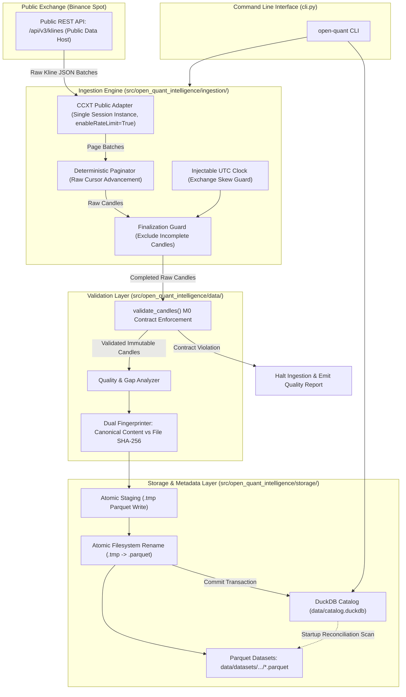

# Open Quant Intelligence V2 — Milestone M1 Architecture Proposal
## Public Market Data Ingestion and Canonical Storage Engine (Revised)

**Document Reference:** `docs/M1_ARCHITECTURE_PROPOSAL.md`  
**Milestone:** M1 — Public Market Data Ingestion & Storage  
**Base Commit on `main`:** `02b7bcad43a2947c7ed2977e143e959559f5873d`  
**Branch:** `docs/m1-architecture-proposal`  
**Author:** AntiGravity (Implementation Engineer)  
**Technical Authority:** ChatGPT  
**Final Decision Maker:** Project Owner  
**Status:** REVISED ARCHITECTURAL SPECIFICATION ONLY (Implementation is strictly NOT authorized)  

---

## 1. Executive Summary & Purpose

Milestone M1 establishes the foundation for reproducible quantitative research in Open Quant Intelligence (OQI) by delivering an automated, deterministic historical market data ingestion and storage pipeline.

The pipeline will:
1. Collect public spot OHLCV data from Binance using CCXT without authentication or credentials.
2. Filter unfinalized candles and validate rows through the existing M0 domain contracts (`Candle`, `MarketIdentity`, `SupportedTimeframe`).
3. Store validated datasets in Apache Parquet files using snappy compression and microsecond UTC timestamp representations.
4. Maintain a local dataset catalog in DuckDB that tracks ingestion provenance, data quality statistics, detected gaps, and canonical content fingerprints.
5. Provide user-facing CLI commands for downloading, cataloging, inspecting, and re-validating historical datasets.

This revised specification directly resolves all ten findings identified during independent technical review, establishing rigorous pagination invariants, crash-recovery state machines, dual fingerprinting (content vs artifact), dynamic rate-limit throttling, clock-skew mitigation, and schema mapping.

---

## 2. Invariant Contracts & Strict Exclusions

### A. Preserved M0 & M0.1 Contracts
- **Python Compatibility:** Python 3.11 and 3.12 exclusively.
- **Repository Structure:** Standard `src/` layout under `src/open_quant_intelligence/`.
- **Domain Invariants:** Immutable `Candle`, `MarketIdentity`, and `SupportedTimeframe` classes remain the single source of truth.
- **Time Semantics:** Half-open interval convention `[open_time, close_time)` where `close_time = open_time + duration`.
- **Supported Timeframes:** Strictly `1m`, `5m`, `15m`, `30m`, `1h`, `4h`, `1d`.
- **Data Integrity:** No silent auto-sorting, no forward-filling of gaps, and no row fabrication.
- **Test Integrity:** The existing 104-test unit and CLI test suite must continue passing without modification.

### B. Strict Milestone Exclusions
- **No Private API Keys or Credentials:** Ingestion uses public endpoints exclusively.
- **No Order Execution or Trading:** Zero routing, balancing, order placement, or wallet manipulation.
- **No Derivatives:** Strictly spot markets (`market_type == "spot"`). Futures, options, and perpetuals are out of scope.
- **No Strategy Logic or Backtesting:** Strategy evaluation, alpha generation, and portfolio simulation belong to M2/M3.
- **No AI/ML:** Model inference and feature training belong to M6.
- **No Real-Time Streaming:** WebSockets and orderbook tickers are excluded. M1 is historical batch OHLCV only.

---

## 3. Technology Stack & Dependency Verification

### A. Evaluation of Dependencies

| Component | Library Choice | Justification |
|---|---|---|
| **Market Data Adapter** | `ccxt>=4.4.0, <5.0.0` | Industry-standard exchange abstraction. Provides rate-limiting (`enableRateLimit=True`), dynamic throttle coordination, and standardized Kline parsing for Binance public endpoints. Reuses a single exchange instance per ingestion session. |
| **Analytical Catalog & Query** | `duckdb>=1.1.0, <2.0.0` | Embedded in-process analytical SQL engine. Handles metadata registration, analytical queries across local Parquet files, and relational catalog queries without requiring a client-server database daemon. |
| **Parquet Storage Engine** | Native DuckDB Parquet Engine (Primary) | DuckDB compiles native, highly performant Parquet reading and writing (`COPY ... TO ... (FORMAT PARQUET, COMPRESSION SNAPPY)`). Using DuckDB for Parquet eliminates heavy runtime coupling to PyArrow for ingestion. |
| **Optional Arrow Interop** | `pyarrow>=15.0.0, <19.0.0` (Optional `[dev]`) | Maintained as an optional development dependency for zero-copy memory testing and schema inspection, but **NOT** required for the production runtime pipeline. |

### B. Recommended Dependency Additions in `pyproject.toml`
```toml
[project]
dependencies = [
    "ccxt>=4.4.0,<5.0.0",
    "duckdb>=1.1.0,<2.0.0",
]

[project.optional-dependencies]
dev = [
    "pytest>=8.0.0",
    "ruff>=0.4.0",
    "pyarrow>=15.0.0,<19.0.0",
]
```

Both `ccxt` (4.4+) and `duckdb` (1.1+) have pre-compiled binary wheels available for CPython 3.11 and 3.12 across Windows (x86_64) and Linux (x86_64/aarch64).

---

## 4. System Architecture & Module Boundaries

### A. Modular Structure
```text
src/open_quant_intelligence/
├── domain/                      # [M0] Immutable contracts (Candle, MarketIdentity, SupportedTimeframe)
├── data/                        # [M0] Validation engine
│   ├── validation.py            # [M0] Canonical candle & stream validator
│   └── quality.py               # [M1 NEW] Gap analysis & data quality reporting
├── ingestion/                   # [M1 NEW] Public ingestion pipeline
│   ├── __init__.py
│   ├── adapter.py               # CCXT Binance public market client wrapper
│   ├── pagination.py            # Deterministic interval paginator with loop/stall detection
│   ├── finalization.py          # Clock-aware incomplete candle filter with skew guard
│   └── pipeline.py              # Orchestrator: Fetch -> Finalize -> Validate -> Fingerprint -> Store
├── storage/                     # [M1 NEW] Persistence & Catalog
│   ├── __init__.py
│   ├── parquet_store.py         # Atomic Parquet writer, reader & staging recovery
│   ├── fingerprint.py           # Canonical content hashing & artifact SHA-256
│   └── catalog.py               # DuckDB metadata registration, reconciliation & queries
└── cli.py                       # CLI entrypoints (validate, ingest, datasets, inspect)
```

### B. Mermaid Architecture Diagram


---

## 5. Historical Data Pagination Controller

CCXT provides an experimental `fetch_ohlcv_auto_pagination` helper, but its documentation explicitly warns that automatic pagination is unstable. For reproducible quantitative research, M1 implements a **deterministic custom pagination controller**.

### A. Timestamp Representation & Alignment
- **Exact Integer Milliseconds:** All exchange request timestamps use integer milliseconds computed via `int(dt.timestamp() * 1000)`. Floating-point arithmetic on timestamps is strictly forbidden.
- **Sub-Millisecond Policy:** Any timestamp with microsecond fractions truncated by exchange milliseconds is handled by flooring to integer milliseconds for CCXT queries.
- **Unaligned Input Semantics:**
  - `since`: The candle open time must satisfy `open_time >= since`. If `since` is not aligned to the timeframe grid, the first returned candle is the first interval whose open time is $\ge since$.
  - `until`: The candle open time must satisfy `open_time < until` (exclusive upper bound). If `until` falls mid-interval, the incomplete interval is excluded.

### B. Cursor Advancement Invariant & Termination Guarantees
1. **Raw Cursor Advancement:** The pagination cursor `current_since_ms` must advance based on the **last raw candle timestamp fetched** on the page (`max_raw_open_ms + 1`), **NOT** the last finalized candle accepted. Excluding an unfinished candle at the tail must never prevent cursor advancement.
2. **Strictly Increasing Progress:** Every page must return records such that `max_raw_open_ms >= current_since_ms`. If a page returns timestamps prior to `current_since_ms`, a `PaginationRegressionError` is raised.
3. **Repeated Page Detection:** If two consecutive pages return the identical set of timestamps, pagination halts with `RepeatedPageError`.
4. **Empty Page Termination:** An empty page response indicates no further data exists on the exchange for the requested window; pagination terminates normally.
5. **Empty Historical Range:** If the initial request yields zero candles (e.g. market did not exist prior to listing), the paginator returns an empty sequence, which the pipeline logs as an empty dataset without crashing.
6. **Maximum Request Bounds:** To prevent unbounded execution during unexpected exchange loops, a hard ceiling `max_pages = ceil(total_intervals / limit) * 2 + 50` is enforced.

### C. Corrected Pagination Algorithm Pseudocode
```python
def paginate_ohlcv(
    adapter: PublicExchangeAdapter,
    symbol: str,
    timeframe: SupportedTimeframe,
    since_dt: datetime,
    until_dt: datetime,
    clock: InjectableClock,
    max_pages: int = 10000,
) -> list[RawCandle]:
    """Deterministically paginate historical OHLCV from Binance public endpoints."""
    # Exact integer millisecond conversion
    since_ms = int(since_dt.astimezone(timezone.utc).timestamp() * 1000)
    until_ms = int(until_dt.astimezone(timezone.utc).timestamp() * 1000)
    step_ms = int(timeframe_to_timedelta(timeframe).total_seconds() * 1000)

    current_since_ms = since_ms
    collected_candles: list[RawCandle] = []
    prev_first_open_ms: int | None = None
    page_count = 0

    while current_since_ms < until_ms:
        page_count += 1
        if page_count > max_pages:
            raise PaginationError(f"Pagination exceeded safety limit of {max_pages} requests.")

        # Request batch from exchange (max 1000 klines)
        page = adapter.fetch_ohlcv(symbol, timeframe.value, since=current_since_ms, limit=1000)
        
        # 1. Empty page: Exchange has no further data in range
        if not page:
            break

        first_open_ms = page[0][0]
        max_raw_open_ms = page[-1][0]

        # 2. Repeated page detection: identical page returned
        if prev_first_open_ms is not None and first_open_ms == prev_first_open_ms:
            raise PaginationError(f"Exchange returned repeated page starting at timestamp {first_open_ms}ms.")
        prev_first_open_ms = first_open_ms

        # 3. Non-advancing / regression check
        if max_raw_open_ms < current_since_ms:
            raise PaginationError(
                f"Exchange pagination regression: max raw open {max_raw_open_ms}ms < cursor {current_since_ms}ms"
            )

        # 4. Ingest and filter candles in page
        for raw_kline in page:
            open_ms = raw_kline[0]

            # Enforce upper bound (exclusive until)
            if open_ms >= until_ms:
                # Reached or exceeded upper boundary; cursor advanced, return immediately
                return collected_candles

            # Check finalization against clock (exclusive close boundary <= current clock)
            open_dt = datetime.fromtimestamp(open_ms / 1000, tz=timezone.utc)
            exclusive_close_dt = compute_close_time(open_dt, timeframe)
            
            if exclusive_close_dt > clock.now_utc():
                # Unfinished candle; skip persistence, but raw cursor will still advance past it
                continue

            collected_candles.append(raw_kline)

        # 5. Advance cursor based strictly on the last RAW candle fetched, regardless of finalization
        current_since_ms = max_raw_open_ms + 1

    return collected_candles
```

---

## 6. Candle Finalization, Time Semantics & Clock Skew

A quantitative research pipeline must guarantee that in-progress, unfinalized candles never enter historical dataset stores.

### A. Finalization Invariant
A candle starting at `open_time` is finalized if and only if:
$$\tau_{\text{clock}} \ge \text{compute\_close\_time}(\text{open\_time}, \text{timeframe})$$
Where:
- $\tau_{\text{clock}}$ is the current UTC observation time from `InjectableClock`.
- $\text{compute\_close\_time}$ is the exclusive upper boundary instant ($T_{\text{open}} + \Delta_{\text{timeframe}}$).

### B. Time Source, Skew Mitigation & Exchange Time Sync
1. **Clock Source:** Production defaults to system UTC wall clock (`datetime.now(timezone.utc)`). Testing injects an explicit mock clock (`MockClock`).
2. **Exchange Server Time Sync:** At session startup, the adapter queries Binance public time (`GET /api/v3/time`).
3. **Local Clock Skew Detection:** The pipeline computes:
   $$\delta_{\text{skew}} = \tau_{\text{exchange}} - \tau_{\text{local}}$$
   If $|\delta_{\text{skew}}| > 2000\,\text{ms}$, ingestion logs a prominent warning. If $\delta_{\text{skew}} > 5000\,\text{ms}$ (local clock lagging server time), ingestion aborts with `ClockSkewError` to prevent premature candle finalization.

### C. Inclusive vs. Exclusive Timestamp Disambiguation
- **Binance Kline Payload:** Returns `[0]: Open time (ms)`, `[6]: Close time (ms)`.
- **Binance Semantics:** Field `[6]` is the *inclusive* final millisecond of the kline interval (e.g. `10:59:59.999Z` for an hourly candle).
- **OQI Contract Semantics:** OQI strictly requires the *exclusive* upper boundary ($11:00:00.000\text{Z}$).
- **Normalizer Enforcement:** The pipeline completely discards Binance field `[6]` upon ingestion. OQI's `compute_close_time(open_time, timeframe)` deterministically sets `close_time = open_time + duration`.

---

## 7. Reliability, Rate-Limiting & Error Taxonomy

### A. Binance Public Endpoint Strategy
- **Public Market Data Host:** Configures CCXT to connect strictly to public market data endpoints (`https://api.binance.com`).
- **No Credentials:** API key and secret remain `None`. Authenticated private endpoints are completely disabled.
- **Instance Reuse:** A single CCXT exchange client instance is constructed per ingestion session to preserve rate-limiting state across pagination pages.

### B. Dynamic Rate-Limit Throttling
- The pipeline does not hardcode an assumed 1,200 weight/minute limit.
- CCXT's built-in token-bucket rate limiter (`enableRateLimit=True`) governs baseline inter-request spacing.
- The adapter inspects the response header `X-MBX-USED-WEIGHT-1M`. If used weight exceeds 80% of limit, an adaptive throttle introduces an extra delay proportional to remaining capacity.

### C. Comprehensive Error Classification & Retry Taxonomy

| Error Type | CCXT / System Exception | Ingestion Action | Retry Policy | Logging Level |
|---|---|---|---|---|
| **Rate Limit Warning** | HTTP 429 (`RateLimitExceeded`) | Backoff | Inspect `Retry-After`. If missing, exponential backoff: $T = \min(60, 2^{\text{attempt}} \times 1.5) + \text{jitter}$. Up to 3 retries. | `WARNING` |
| **IP Ban** | HTTP 418 (`DDoSProtection`) | **HALT IMMEDIATELY** | **Zero retries.** Immediate abort with `IPBannedException`. | `CRITICAL` |
| **Transient Network** | `NetworkError`, `RequestTimeout` | Retry | Exponential backoff (1s, 2s, 4s, 8s, 16s). Max 5 retries. | `WARNING` |
| **Exchange Maintenance** | `ExchangeNotAvailable`, HTTP 502/503 | Retry | Linear backoff (5s, 10s, 15s). Max 3 retries. | `WARNING` |
| **Invalid Request / Symbol** | `BadSymbol`, `BadRequest` | **ABORT** | **Zero retries.** Invalid pair or parameter. | `ERROR` |
| **Data Contract Violation** | `InvalidCandleError`, `InvalidMarketError` | **ABORT** | **Zero retries.** Corrupt data received from exchange. | `ERROR` |
| **Retry Exhaustion** | Any retryable error exceeding max attempts | **ABORT** | Ingestion halts; staging files deleted. Error logged to catalog. | `ERROR` |

---

## 8. Parquet Data Model, Schema Clarification & Storage Layout

### A. Immutable Dataset Snapshots vs. Mutable Upsert
- **Decision:** OQI M1 adopts **Immutable Dataset Snapshots**.
- **Rationale:** Financial research and backtesting require verifiable reproducibility. If an ingestion job mutates existing files in place, historical backtests cannot be audited against the exact data seen at the time of execution. Immutable snapshots allow backtests to pin an exact content fingerprint.

### B. Parquet Schema & Field Clarification
CCXT's unified `fetch_ohlcv` returns `[open_time_ms, open, high, low, close, volume]`. It does **not** include quote volume or trade count.
- In M1, `quote_volume` and `trade_count` are specified as optional nullable fields and stored as `NULL` in Parquet.
- The pipeline will NOT add an unverified secondary endpoint query to scrape quote volume; schema fidelity with public OHLCV is strictly preserved.

| Column Name | Logical Parquet Type | Physical Type | Nullable | OQI Candle Model Field |
|---|---|---|:---:|---|
| `exchange_id` | `VARCHAR` | `BYTE_ARRAY` | No | `Candle.exchange_id` |
| `market_type` | `VARCHAR` | `BYTE_ARRAY` | No | `Candle.market_type` |
| `symbol` | `VARCHAR` | `BYTE_ARRAY` | No | `Candle.symbol` |
| `timeframe` | `VARCHAR` | `BYTE_ARRAY` | No | `Candle.timeframe` |
| `open_time` | `TIMESTAMP_MICROS (UTC)` | `INT64` | No | `Candle.open_time` |
| `close_time` | `TIMESTAMP_MICROS (UTC)` | `INT64` | No | `Candle.close_time` |
| `open` | `DOUBLE` | `DOUBLE` | No | `Candle.open` |
| `high` | `DOUBLE` | `DOUBLE` | No | `Candle.high` |
| `low` | `DOUBLE` | `DOUBLE` | No | `Candle.low` |
| `close` | `DOUBLE` | `DOUBLE` | No | `Candle.close` |
| `base_volume` | `DOUBLE` | `DOUBLE` | No | `Candle.base_volume` |
| `quote_volume` | `DOUBLE` | `DOUBLE` | **Yes** | `Candle.quote_volume` (`NULL` in M1) |
| `trade_count` | `INT64` | `INT64` | **Yes** | `Candle.trade_count` (`NULL` in M1) |

### C. Partitioning & Directory Layout
```text
data/
├── catalog.duckdb                      # DuckDB catalog database
└── datasets/                           # Canonical Parquet store
    └── exchange=binance/
        └── market=spot/
            └── symbol=BTC_USDT/
                └── timeframe=1h/
                    └── dataset_20261101T000000Z_20261105T000000Z_<fingerprint_prefix>.parquet
```

---

## 9. Fingerprint Architecture: Content vs. Artifact

To guarantee absolute scientific reproducibility, M1 cleanly separates **Canonical Content Fingerprints** from **Parquet Artifact Hashes**.

### A. Why Two Hashes Are Required
- Different operating systems, Parquet writer versions, compression library builds, or writer metadata timestamps can yield different Parquet binary files for the identical set of market candles.
- Therefore, a file-level SHA-256 alone is insufficient to prove semantic data equivalence across platforms.

### B. Dual Fingerprint Definitions
1. **Canonical Content Fingerprint (`content_fingerprint_sha256`):**
   - Independent of file format, compression, or metadata.
   - Computed over a deterministic, stable binary encoding of the normalized candle stream.
   - Two separate downloads yielding the same validated candle data will produce the **identical content fingerprint**, even if compressed on different OS platforms.
2. **Artifact SHA-256 (`file_sha256`):**
   - Cryptographic hash of the physical `.parquet` file on disk.
   - Used for storage corruption detection and filesystem integrity verification.

### C. Canonical Serialization Specification
To compute `content_fingerprint_sha256`, validated candles are formatted as UTF-8 canonical lines, joined with newline `\n`, and fed into SHA-256:
```text
SCHEMA_VERSION:1
EXCHANGE:binance
MARKET:spot
SYMBOL:BTC/USDT
TIMEFRAME:1h
CANDLES:
<open_time_iso8601>,<close_time_iso8601>,<open_str>,<high_str>,<low_str>,<close_str>,<base_volume_str>
...
```
- Numeric strings are formatted with full precision (`f"{val:.8f}"` stripped of trailing zeros, or `repr(val)` normalized).
- Sorted strictly by `open_time` ascending.

---

## 10. Crash Recovery, Atomic Storage & Startup Reconciliation

An unhandled SIGKILL, machine reboot, or disk exhaustion during ingestion must never corrupt existing datasets or leave the catalog in an inconsistent state.

### A. Lifecycle State Machine
```text
[ INGESTION_STARTED ]
         │
         ▼
[ WRITE_STAGING ]  --> writes to data/datasets/.../<name>.tmp_<pid>
         │
         ▼
[ VERIFY_STAGING ] --> opens .tmp in DuckDB, verifies row count and readable Parquet
         │
         ▼
[ ATOMIC_RENAME ]  --> rename(.tmp, .parquet)
         │
         ▼
[ CATALOG_COMMIT ] --> DuckDB transaction: INSERT INTO datasets ... status='COMMITTED'
         │
         ▼
[ COMPLETED ]
```

### B. Crash Transitions & Failure Handling

| Failure Point | State on Disk | Catalog State | Recovery Protocol |
|---|---|---|---|
| **Crash during fetch / write** | Staging `.tmp` file exists (partial) | No catalog record | Startup cleaner deletes all `.tmp` files older than 1 hour. |
| **Crash during rename** | Staging `.tmp` file exists (complete) | No catalog record | Startup cleaner deletes orphaned `.tmp` files. |
| **Crash between rename and catalog commit** | Final `.parquet` file exists | No catalog record | **Startup Reconciliation:** Discovers uncataloged `.parquet` file, reads metadata, computes fingerprint, and registers in catalog as recovered dataset. |
| **Disk corruption of Parquet file** | Corrupted `.parquet` on disk | Catalog record exists | **Dataset Verification Command:** CLI `open-quant datasets verify <id>` detects hash mismatch or unreadable Parquet, updating catalog status to `'CORRUPTED'`. |

---

## 11. DuckDB Catalog Specification & Idempotency Policy

### A. Catalog DDL
```sql
CREATE TABLE IF NOT EXISTS datasets (
    dataset_id VARCHAR PRIMARY KEY,             -- Stable UUID or deterministic string
    content_fingerprint_sha256 VARCHAR NOT NULL, -- Canonical content hash
    file_sha256 VARCHAR NOT NULL,               -- Physical Parquet file SHA-256
    exchange_id VARCHAR NOT NULL,               -- 'binance'
    market_type VARCHAR NOT NULL,               -- 'spot'
    symbol VARCHAR NOT NULL,                    -- 'BTC/USDT'
    timeframe VARCHAR NOT NULL,                 -- '1h'
    requested_since TIMESTAMP WITH TIME ZONE NOT NULL,
    requested_until TIMESTAMP WITH TIME ZONE NOT NULL,
    actual_first_open TIMESTAMP WITH TIME ZONE,
    actual_last_close TIMESTAMP WITH TIME ZONE,
    record_count BIGINT NOT NULL,
    gap_count INTEGER NOT NULL,
    missing_intervals BIGINT NOT NULL,
    file_path VARCHAR NOT NULL,
    file_size_bytes BIGINT NOT NULL,
    ccxt_version VARCHAR NOT NULL,
    ingested_at TIMESTAMP WITH TIME ZONE NOT NULL,
    status VARCHAR NOT NULL                     -- 'COMMITTED', 'EMPTY', 'CORRUPTED', 'FAILED'
);

CREATE TABLE IF NOT EXISTS dataset_gaps (
    gap_id VARCHAR PRIMARY KEY,
    dataset_id VARCHAR REFERENCES datasets(dataset_id),
    expected_open TIMESTAMP WITH TIME ZONE NOT NULL,
    actual_open TIMESTAMP WITH TIME ZONE NOT NULL,
    missing_count BIGINT NOT NULL
);

CREATE INDEX IF NOT EXISTS idx_datasets_lookup 
ON datasets(exchange_id, symbol, timeframe, requested_since, requested_until);
```

### B. Catalog Statuses
- `'COMMITTED'`: Successfully ingested, validated through M0 contracts, stored in Parquet, and registered.
- `'EMPTY'`: The exchange legitimately had zero trades/klines for the requested window (e.g. pre-listing). Record count is 0; no Parquet file is created.
- `'CORRUPTED'`: A previously committed Parquet file failed file hash verification or became unreadable on disk.
- `'FAILED'`: Ingestion failed due to unrecoverable exchange error or contract violation.

### C. Idempotency & Re-Ingestion Policy
- If `open-quant ingest` is invoked with identical `(exchange_id, symbol, timeframe, since, until)` and a `'COMMITTED'` record already exists in the catalog:
  - The pipeline checks if the Parquet file exists and matches its `file_sha256`.
  - If valid, ingestion logs: `Dataset already ingested and verified. Use --force to re-download.` and exits with code 0 without making exchange requests.
  - If `--force` is passed, ingestion proceeds, creates a new timestamped snapshot, and registers it.

---

## 12. CLI Proposal & User Experience

```bash
# 1. Ingest historical public data
open-quant ingest \
  --exchange binance \
  --symbol BTC/USDT \
  --timeframe 1h \
  --since 2026-11-01T00:00:00Z \
  --until 2026-11-05T00:00:00Z \
  [--output-dir data/] \
  [--fail-on-gaps] \
  [--force]

# 2. List registered datasets
open-quant datasets list [--symbol BTC/USDT] [--timeframe 1h]

# 3. Inspect dataset details, gaps, and provenance
open-quant datasets inspect <dataset_id_or_fingerprint>

# 4. Verify physical Parquet integrity against catalog fingerprint
open-quant datasets verify <dataset_id_or_fingerprint>
```

### Sample CLI Report Output
```text
============================================================
Open Quant Intelligence — Historical Ingestion Report
============================================================
Dataset ID:            oqi_ds_9f83a21b4e05
Exchange:              binance | Market: spot
Symbol:                BTC/USDT | Timeframe: 1h
Requested Window (UTC): 2026-11-01T00:00:00Z -> 2026-11-05T00:00:00Z
Actual Coverage (UTC): 2026-11-01T00:00:00Z -> 2026-11-05T00:00:00Z
Pages Fetched:         1 | Total Records: 96
Validation Status:     PASSED (96 valid candles)
Gaps Detected:         0 gap events (0 missing intervals)
Content Fingerprint:   sha256:7f9a2b84c310d54e8b21c430aef7830182419ef8973b02196a84920485a3bb12
Artifact File:         data/datasets/exchange=binance/market=spot/symbol=BTC_USDT/timeframe=1h/dataset_20261101T000000Z_20261105T000000Z_7f9a2b84.parquet
Artifact SHA-256:      sha256:4d831b7908c84857b28ec95ef5476a8947cf839a823908dbca19273645bbef21
Catalog Status:        COMMITTED
============================================================
```

---

## 13. Deterministic Offline Testing Strategy

All automated CI runs execute **100% offline** using an injectable mock exchange client (`FakeBinanceClient`).

### Required Deterministic Test Suite
1. **`test_pagination_cursor_advances_on_unfinalized_candle`**: Verifies that when the last candle on a page is unfinalized and excluded, `current_since_ms` still advances past it, preventing infinite loops.
2. **`test_pagination_repeated_page_detection`**: Verifies `RepeatedPageError` is raised if exchange returns identical timestamps consecutively.
3. **`test_pagination_exact_integer_timestamps`**: Asserts timestamp conversions never produce floating-point truncation errors.
4. **`test_empty_historical_range`**: Verifies empty exchange responses cleanly register catalog status `'EMPTY'` without crashing.
5. **`test_crash_recovery_orphaned_tmp`**: Simulates process termination leaving `.tmp` files; asserts startup cleaner removes them.
6. **`test_crash_recovery_unregistered_parquet`**: Simulates crash between file rename and catalog commit; asserts startup reconciler recovers dataset.
7. **`test_content_fingerprint_stability`**: Verifies identical candle sets produce identical `content_fingerprint_sha256` across different platforms.
8. **`test_content_fingerprint_divergence`**: Verifies changing a single price, volume, or timestamp yields a different content fingerprint.
9. **`test_http_418_immediate_halt`**: Verifies HTTP 418 IP ban aborts immediately with zero retry attempts.
10. **`test_http_429_bounded_backoff`**: Verifies HTTP 429 respects `Retry-After` header and halts on retry exhaustion.
11. **`test_candle_finalization_boundary`**: Mock clock tested at `T_close - 1ms` (excluded) and `T_close` (included).

### Opt-In Live Smoke Test
A single test file `tests/integration/test_binance_live_smoke.py` is configured with `@pytest.mark.live_network` and skipped by default. It can be run manually by developers to verify live Binance endpoint availability over a tiny 3-candle range.

---

## 14. Acceptance Criteria Checklist for M1

| # | Criterion | Verification Method |
|---|---|---|
| 1 | Fetch historical BTC/USDT & ETH/USDT spot OHLCV from Binance public endpoints | Offline fake client + optional live smoke test |
| 2 | Support all 7 OQI timeframes (`1m`, `5m`, `15m`, `30m`, `1h`, `4h`, `1d`) | Parameterized test across all enum values |
| 3 | Paginate correctly over arbitrary historical ranges with raw cursor advancement | Synthetic multi-page pagination tests |
| 4 | Exclude unfinished candles based on exclusive close boundary | Mock clock test at $T_{\text{close}} - 1\,\text{ms}$ and $T_{\text{close}}$ |
| 5 | Validate all stored candles through M0 domain contracts | Pipeline integration test checking `Candle` creation |
| 6 | Persist data atomically in Parquet with snappy compression | Parquet metadata and round-trip inspection test |
| 7 | Register datasets in DuckDB catalog with full audit metadata | DuckDB SQL query verification |
| 8 | Produce human-readable and machine-readable data quality report | CLI report string & JSON output test |
| 9 | Dual fingerprinting: stable content fingerprint + artifact SHA-256 | Deterministic canonical serialization test |
| 10 | Reopen and query stored datasets without network connection | Offline DuckDB `SELECT ... FROM read_parquet(...)` test |
| 11 | Pass deterministic test suite on Python 3.11 & 3.12 (Windows & Ubuntu) | CI workflow matrix run |

---

## 15. Risks, Trade-offs & Unresolved Decisions

1. **Exchange Historical Revisions:** While rare, exchanges may occasionally revise kline data. Immutable dataset snapshots protect research reproducibility by versioning data as observed at ingestion time.
2. **DuckDB In-Process Concurrency:** DuckDB allows multiple readers but single-writer concurrency. The CLI ingestion lock ensures sequential database access during catalog updates.
3. **PyArrow Dependency Omission:** Native DuckDB Parquet write/read eliminates the need for PyArrow as a mandatory production dependency, reducing binary packaging complexity.

---
**Milestone M1 Proposal Revision Complete. Awaiting Technical Lead Review & Approval.**
