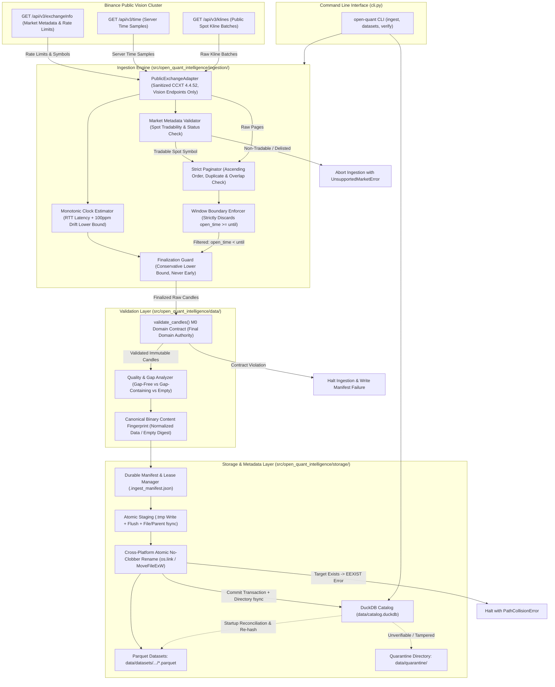

# Open Quant Intelligence V2 — Milestone M1 Architecture Proposal
## Public Market Data Ingestion and Canonical Storage Engine (Final Candidate — Awaiting Technical Approval)

**Document Reference:** `docs/M1_ARCHITECTURE_PROPOSAL.md`  
**Milestone:** M1 — Public Market Data Ingestion & Storage  
**Base Commit on `main`:** `02b7bcad43a2947c7ed2977e143e959559f5873d`  
**Branch:** `docs/m1-architecture-proposal`  
**Author:** AntiGravity (Implementation Engineer)  
**Technical Authority:** ChatGPT  
**Final Decision Maker:** Project Owner  
**Status:** FINAL CANDIDATE — AWAITING TECHNICAL APPROVAL (Implementation is strictly NOT authorized)  

---

## 1. Executive Summary & Purpose

Milestone M1 establishes the foundation for reproducible quantitative research in Open Quant Intelligence (OQI) by delivering an automated, deterministic historical market data ingestion and storage pipeline.

The pipeline will:
1. Validate Spot market tradability and active status against Binance exchange metadata (`GET /api/v3/exchangeInfo`) before initiating ingestion, immediately rejecting unsupported, delisted, or non-tradable pairs.
2. Collect public spot OHLCV data from Binance's dedicated public market data cluster (`https://data-api.binance.vision`) using CCXT without authentication or credentials, mediated through a strict, allowlisted public adapter that explicitly strips all private, SAPI, futures, options, portfolio-margin, and WebSocket endpoint groups.
3. Enforce the requested half-open interval $[since, until)$ strictly at the ingestion boundary, guaranteeing candles with $open\_time \ge until$ never enter validation, fingerprinting, or storage.
4. Filter unfinalized candles using a conservative server-time uncertainty lower bound adjusted for worst-case hardware clock-rate drift ($\rho_{\max} = 100\,\text{ppm}$), guaranteeing no candle is ever finalized prematurely.
5. Validate all admitted candles through the existing M0 domain contracts (`Candle`, `MarketIdentity`, `SupportedTimeframe`).
6. Store validated datasets in Apache Parquet files using Snappy compression and integer microsecond UTC timestamp representations via cross-platform atomic no-clobber publications with synchronous directory `fsync` barriers.
7. Maintain an append-only, crash-resilient local dataset catalog in DuckDB that tracks ingestion provenance, data quality statistics, gap analysis, EMPTY snapshot deduplication, and dual cryptographic fingerprints (including full canonical header SHA-256 digests for zero-candle datasets vs. physical Parquet SHA-256).
8. Provide user-facing CLI commands for downloading, cataloging, inspecting, and re-validating historical datasets.

---

## 2. Invariant Contracts & Strict Exclusions

### A. Preserved M0 & M0.1 Contracts
- **Python Compatibility:** Python 3.11 and 3.12 exclusively.
- **Repository Structure:** Standard `src/` layout under `src/open_quant_intelligence/`.
- **Domain Invariants:** Immutable `Candle`, `MarketIdentity`, and `SupportedTimeframe` classes remain the single source of truth.
- **Time Semantics:** Half-open interval convention `[open_time, close_time)` where `close_time = open_time + duration`.
- **Supported Timeframes:** Strictly `SupportedTimeframe.M1` ("1m"), `M5` ("5m"), `M15` ("15m"), `M30` ("30m"), `H1` ("1h"), `H4` ("4h"), and `D1` ("1d").
- **Data Integrity:** No silent auto-sorting, no forward-filling of gaps, and no row fabrication.
- **Test Integrity:** The existing 104-test M0/M0.1 unit and CLI test suite must continue passing without modification.

### B. Strict Milestone Exclusions
- **No Private API Keys or Credentials:** Ingestion uses public market data endpoints exclusively.
- **No Raw CCXT Exposure:** Raw CCXT exchange objects are never leaked outside the internal adapter boundary.
- **No Extraneous Endpoints:** SAPI, futures (fapi), delivery (dapi), options (eapi), portfolio-margin (papi), and WebSockets are stripped.
- **No Order Execution or Trading:** Zero routing, balancing, order placement, or wallet manipulation.
- **No Derivatives:** Strictly spot markets (`market_type == "spot"`). Futures, options, and perpetuals are out of scope.
- **No Strategy Logic or Backtesting:** Strategy evaluation, alpha generation, and portfolio simulation belong to M2/M3.
- **No AI/ML:** Model inference and feature training belong to M6.
- **No Real-Time Streaming:** WebSockets and orderbook tickers are excluded. M1 is historical batch OHLCV only.

---

## 3. Technology Stack & Dependency Verification

### A. Evaluation of Dependencies

| Component | Library Choice | Justification |
|---|---|---|
| **Market Data Adapter** | `ccxt>=4.4.52, <5.0.0` | Industry-standard exchange abstraction. Encapsulated behind `PublicExchangeAdapter`. Deep-merged endpoint URLs are explicitly sanitized to retain only Vision Spot public operations. |
| **Analytical Catalog & Query** | `duckdb>=1.1.0, <2.0.0` | Embedded in-process analytical SQL engine. Handles metadata registration, analytical queries across local Parquet files, and relational catalog queries without requiring a client-server database daemon. |
| **Parquet Storage Engine** | Native DuckDB Parquet Engine (Primary) | DuckDB compiles native, highly performant Parquet reading and writing (`COPY ... TO ... (FORMAT PARQUET, COMPRESSION SNAPPY)`). Using DuckDB for Parquet eliminates heavy runtime coupling to PyArrow for ingestion. |
| **Optional Arrow Interop** | `pyarrow>=15.0.0, <19.0.0` (Optional `[dev]`) | Maintained as an optional development dependency for zero-copy memory testing and schema inspection, but **NOT** required for the production runtime pipeline. |

### B. CI Target Versions vs. Supported Bounds
The existing 104 tests in the repository verify M0 domain and CLI contracts; they do not exercise CCXT or DuckDB because M1 dependencies are not yet installed in the current environment. When M1 implementation begins, CI will explicitly test against pinned target versions while declaring semantic upper and lower bounds:

| Dependency | Supported Version Bounds in `pyproject.toml` | Target Pinned Version in M1 Implementation CI | Role |
|---|---|---|---|
| `ccxt` | `>=4.4.52, <5.0.0` | `4.4.52` | Production runtime |
| `duckdb` | `>=1.1.0, <2.0.0` | `1.1.3` | Production runtime |
| `pytest` | `>=8.0.0` | `8.3.3` | Test framework (`[dev]`) |
| `ruff` | `>=0.4.0` | `0.7.3` | Linter / formatter (`[dev]`) |
| `pyarrow` | `>=15.0.0, <19.0.0` | `18.0.0` | Optional verification (`[dev]`) |

```toml
[project]
dependencies = [
    "ccxt>=4.4.52,<5.0.0",
    "duckdb>=1.1.0,<2.0.0",
]

[project.optional-dependencies]
dev = [
    "pytest>=8.0.0",
    "ruff>=0.4.0",
    "pyarrow>=15.0.0,<19.0.0",
]
```

---

## 4. System Architecture & Module Boundaries

### A. Modular Structure
```text
src/open_quant_intelligence/
├── domain/                      # [M0] Immutable contracts (Candle, MarketIdentity, SupportedTimeframe)
│   ├── candle.py
│   ├── market.py
│   └── timeframe.py
├── data/                        # [M0] Validation engine
│   ├── validation.py            # [M0] Canonical candle & stream validator (final domain authority)
│   └── quality.py               # [M1 NEW] Gap analysis & data quality reporting
├── ingestion/                   # [M1 NEW] Public ingestion pipeline
│   ├── __init__.py
│   ├── adapter.py               # Strict allowlisted Binance public vision adapter (encapsulates sanitized CCXT)
│   ├── market_check.py          # Pre-flight Spot market metadata & tradability verification
│   ├── pagination.py            # Strict raw-page interval paginator with [since, until) boundary clamp
│   ├── clock.py                 # Monotonic clock offset estimator with drift allowance (rho_max = 100ppm)
│   ├── finalization.py          # Observation-time candle finalization filter (drift-compensated lower bound)
│   └── pipeline.py              # Orchestrator: Pre-Flight -> Fetch -> Boundary Clamp -> Finalize -> Validate -> Store
├── storage/                     # [M1 NEW] Persistence & Catalog
│   ├── __init__.py
│   ├── manifest.py              # Ingestion manifest, active lease & crash recovery record
│   ├── parquet_store.py         # Staging flush, fsync barriers, cross-platform atomic no-clobber publication
│   ├── fingerprint.py           # Canonical binary content hashing (data & empty sets) & artifact SHA-256
│   └── catalog.py               # DuckDB catalog registration, gap recording & queries
└── cli.py                       # CLI entrypoints (validate, ingest, datasets, inspect, verify)
```

### B. Mermaid Architecture Diagram


---

## 5. Pre-Flight Allowlisted Spot Market Metadata Check

To prevent failed pagination loops and corrupted ingestion attempts on non-existent, delisted, or non-tradable pairs, M1 mandates an **allowlisted Spot market metadata pre-flight check** prior to issuing historical Kline requests:

### A. Pre-Flight Validation Rules
1. **Metadata Ingestion:** At session startup, the adapter inspects the response from `GET /api/v3/exchangeInfo`.
2. **Symbol Existence & Tradability Check:**
   - The symbol must exist in `exchangeInfo["symbols"]`.
   - `status` must be `"TRADING"`. If `"HALT"`, `"BREAK"`, or delisted, ingestion aborts immediately with `MarketStatusError(f"Symbol {symbol} is currently not trading (status: {status})")`.
   - `isSpotTradingAllowed` must be `True`.
   - `permissions` or `permissionSets` must explicitly contain `"SPOT"`.
   - Quotes and base assets must match M0 `MarketIdentity` expectations (e.g. `base="BTC"`, `quote="USDT"`).
3. **Structured Failure:** If the symbol is unsupported, delisted, or restricted to non-spot permissions, the CLI aborts with exit code 1 and outputs a structured diagnostic report without fetching candles.

---

## 6. CCXT 4.4.52 URL Sanitization & Effective Configuration

### B. CCXT Deep-Merge Vulnerability
CCXT's constructor deep-merges user-supplied URL dictionaries over extensive internal default dictionaries. If only `urls["api"]["public"]` is overridden, CCXT 4.4.52 retains internal routing entries for:
- SAPI (`api["sapi"]`)
- Futures USD-M (`api["fapi"]`, `fapiPublic`, `fapiPrivate`)
- Delivery COIN-M (`api["dapi"]`, `dapiPublic`, `dapiPrivate`)
- Options (`api["eapi"]`)
- Portfolio Margin (`api["papi"]`)
- WebSockets (`urls["ws"]`)

### C. Explicit Endpoint Group Stripping
To guarantee zero accidental routing to non-Vision, private, or derivative APIs, the adapter explicitly sanitizes CCXT's effective URL table after construction:

```python
import ccxt


class BinanceVisionPublicAdapter:
    """Strict allowlisted public adapter encapsulating sanitized CCXT 4.4.52."""

    def __init__(self) -> None:
        self._exchange = ccxt.binance(
            {
                "enableRateLimit": True,
                "options": {
                    "defaultType": "spot",
                    "adjustForTimeDifference": False,
                },
                "urls": {
                    "api": {
                        "public": "https://data-api.binance.vision/api/v3",
                        "v1": "https://data-api.binance.vision/api/v3",
                    }
                },
            }
        )

        # Explicitly purge all unnecessary SAPI, futures, options, and private API groups
        sanitized_api = {
            "public": "https://data-api.binance.vision/api/v3",
            "v1": "https://data-api.binance.vision/api/v3",
        }
        self._exchange.urls["api"] = sanitized_api

        # Purge WebSocket entries
        if "ws" in self._exchange.urls:
            self._exchange.urls["ws"] = {}

        # Seal all authenticated and trading methods
        self._exchange.create_order = None
        self._exchange.cancel_order = None
        self._exchange.fetch_balance = None
        self._exchange.fetch_orders = None
```

An offline test `test_ccxt_effective_url_configuration` verifies that inspecting `adapter._exchange.urls["api"]` contains **only** the allowlisted public Vision URLs.

---

## 7. Exact Timestamp Arithmetic & Strict Window Boundary Enforcement

### A. Exact Integer Epoch Timedelta Arithmetic (No Floating-Point Math)
All conversions between Python `datetime` and integer epoch units must use exact integer arithmetic anchored to `EPOCH_UTC = datetime(1970, 1, 1, tzinfo=timezone.utc)`:

```python
from datetime import datetime, timedelta, timezone
from open_quant_intelligence.domain.timeframe import SupportedTimeframe

EPOCH_UTC = datetime(1970, 1, 1, tzinfo=timezone.utc)


def datetime_to_epoch_ms(dt: datetime) -> int:
    """Convert an aware UTC datetime to integer epoch milliseconds.

    Rejects naive datetimes, pre-epoch timestamps, and fractional milliseconds.
    """
    if dt.tzinfo is None or dt.utcoffset() != timedelta(0):
        raise ValueError(f"Datetime {dt} must be explicit timezone-aware UTC.")
    if dt < EPOCH_UTC:
        raise ValueError(f"Pre-epoch datetime {dt} is not supported.")

    diff = dt - EPOCH_UTC
    total_micros = diff.days * 86_400_000_000 + diff.seconds * 1_000_000 + diff.microseconds

    # Explicitly reject sub-millisecond fractions
    if total_micros % 1_000 != 0:
        raise ValueError(f"Timestamp {dt} has fractional milliseconds (microseconds: {diff.microseconds}).")

    return total_micros // 1_000


def epoch_ms_to_datetime(ms: int) -> datetime:
    """Convert integer epoch milliseconds to aware UTC datetime."""
    if not isinstance(ms, int) or isinstance(ms, bool):
        raise TypeError(f"Timestamp must be integer milliseconds, got {type(ms)}")
    if ms < 0:
        raise ValueError(f"Epoch milliseconds cannot be negative, got {ms}")

    return EPOCH_UTC + timedelta(milliseconds=ms)


def timeframe_to_duration_ms(timeframe: SupportedTimeframe) -> int:
    """Return exact integer duration milliseconds for M0 SupportedTimeframe members."""
    minutes_map: dict[SupportedTimeframe, int] = {
        SupportedTimeframe.M1: 1,
        SupportedTimeframe.M5: 5,
        SupportedTimeframe.M15: 15,
        SupportedTimeframe.M30: 30,
        SupportedTimeframe.H1: 60,
        SupportedTimeframe.H4: 240,
        SupportedTimeframe.D1: 1440,
    }
    if timeframe not in minutes_map:
        raise ValueError(f"Unsupported timeframe: {timeframe}")
    return minutes_map[timeframe] * 60_000
```

### B. Ingestion Boundary Window Enforcement: $[since, until)$
Binance kline queries accept `startTime` (`since`) and `endTime`. However, exchanges frequently return the full 1,000-candle page or boundary candles exceeding the requested window.
- **Strict Boundary Clamp:** At the raw ingestion collection boundary, before candles are passed to finalization, domain validation, fingerprinting, or storage:
  $$\text{Admitted Candles} = \{k \in \text{page} \mid \text{since\_ms} \le k[0] < \text{until\_ms}\}$$
- Any candle with $open\_time \ge until\_ms$ is **strictly discarded at the ingestion boundary**. It must never enter validation, fingerprinting, or Parquet storage.
- An offline test `test_paginator_enforces_upper_bound_clamp` injects exchange pages containing rows where $open\_time \ge until$ and asserts they are excluded from the dataset.

---

## 8. Conservative Clock Uncertainty & Worst-Case Drift Mitigation

### A. Clock-Rate Drift Vulnerability ($\rho$)
Hardware monotonic clocks drift relative to true astronomical time due to temperature and crystal tolerances (typical maximum oscillator drift is $\rho_{\max} = 100\,\text{ppm}$, or $\approx 100\,\mu\text{s}/\text{sec}$). Extrapolating server time over a 10-minute session ($600\,\text{sec}$) introduces up to:
$$\delta_{\text{drift}} = 600 \times 100 \times 10^{-6}\,\text{sec} = 60\,\text{ms}$$
If local monotonic time ticks faster than server time, a naive estimate would overestimate server time and finalize a candle up to 60 ms early.

### B. Drift-Compensated Conservative Lower Bound
To guarantee that **no candle is ever finalized prematurely under any network asymmetry or clock drift**, M1 defines the conservative lower bound of server time:
$$T_{\text{server\_min\_ms}} = t_{\text{server\_ms}} + \Delta_{\text{mono\_ms}} \times (1 - \rho_{\max})$$
Where:
- $t_{\text{server\_ms}}$ is the raw timestamp returned by `GET /api/v3/time`.
- $\Delta_{\text{mono\_ms}} = (t_{\text{mono\_now}} - t_{\text{mono\_after}}) // 1_000_000$ is the elapsed monotonic time since response reception.
- $\rho_{\max} = 0.0001$ ($100\,\text{ppm}$ worst-case drift allowance).
- Assumed outbound network latency is conservatively taken as zero.

### C. Candle Finalization Invariant
A candle is finalized if and only if:
$$T_{\text{open\_ms}} + \Delta_{\text{timeframe\_ms}} \le T_{\text{server\_min\_ms}}$$
Because $T_{\text{server\_min\_ms}} \le T_{\text{actual\_server}}$ under worst-case drift and zero network delay, premature candle closure is mathematically impossible.

### D. Resampling & Uncertainty Exhaustion Policy
- `MAX_CLOCK_AGE_SEC = 600` (10 minutes).
- If sample round-trip latency $>2,000\,\text{ms}$, the adapter resamples up to 3 times.
- If all 3 resampling attempts fail or $|\tau_{\text{exchange}} - \tau_{\text{local}}| > 3,000\,\text{ms}$, ingestion aborts with `UnreliableClockError`.

---

## 9. Canonical Binary Content Fingerprinting (Data & EMPTY Sets)

To guarantee deterministic data integrity across platforms, compilers, and DuckDB versions, M1 establishes **exactly one canonical serialization contract**.

### A. Negative-Zero Normalization
In IEEE-754 floating point arithmetic, $-0.0$ and $+0.0$ have distinct bit representations (`0x8000000000000000` vs. `0x0000000000000000`). All price and volume floats are normalized before serialization:
```python
def normalize_float(val: float) -> float:
    return 0.0 if val == 0.0 else val
```

### B. Canonical Binary Serialization Specification
```text
[Header Block]
  - Magic Bytes:          ASCII "OQICCF" (6 bytes)
  - Schema Version:       UINT16_LE (2 bytes, value = 1)
  - Exchange ID:          UINT16_LE length + UTF-8 bytes (e.g. 7, "binance")
  - Market Type:          UINT16_LE length + UTF-8 bytes (e.g. 4, "spot")
  - Symbol:               UINT16_LE length + UTF-8 bytes (e.g. 8, "BTC/USDT")
  - Timeframe:            UINT16_LE length + UTF-8 bytes (e.g. 2, "1h")
  - Requested Since ms:   INT64_LE (8 bytes)
  - Requested Until ms:   INT64_LE (8 bytes)
  - Candle Count:         UINT64_LE (8 bytes, 0 for EMPTY datasets)

[Candle Record Block] (Included if Candle Count > 0, ordered strictly by open_time ascending)
  - Open Time Epoch ms:   INT64_LE (8 bytes)
  - Close Time Epoch ms:  INT64_LE (8 bytes)
  - Open Price:           Normalized IEEE-754 binary64 DOUBLE_LE (8 bytes)
  - High Price:           Normalized IEEE-754 binary64 DOUBLE_LE (8 bytes)
  - Low Price:            Normalized IEEE-754 binary64 DOUBLE_LE (8 bytes)
  - Close Price:          Normalized IEEE-754 binary64 DOUBLE_LE (8 bytes)
  - Base Volume:          Normalized IEEE-754 binary64 DOUBLE_LE (8 bytes)
  - Quote Volume Present: UINT8 (1 byte: 0 = NULL, 1 = Present)
    [If Present]:         Normalized IEEE-754 binary64 DOUBLE_LE (8 bytes)
  - Trade Count Present:  UINT8 (1 byte: 0 = NULL, 1 = Present)
    [If Present]:         INT64_LE (8 bytes)
```

### C. EMPTY Dataset Canonical Fingerprint
For an EMPTY dataset (zero candles returned):
- The `[Header Block]` is serialized with `Candle Count = 0`, incorporating `schema_version`, `exchange_id`, `market_type`, `symbol`, `timeframe`, `requested_since_ms`, and `requested_until_ms`.
- The `[Candle Record Block]` is omitted.
- The SHA-256 digest of this canonical header stream is computed:
  $$\text{content\_fingerprint\_sha256} = \text{sha256}(\text{Header Block})$$
- **Properties:**
  - Replaces arbitrary sentinel strings (such as `"sha256:EMPTY"`) with true cryptographic digests.
  - Distinct market identities or query windows produce distinct empty digests.
  - Identical empty ranges produce stable, reproducible digests across platforms.

---

## 10. Complete Storage Durability, Fsync Barriers & Atomic Publication

### A. Staging Verification & File Flush
Before initiating publication or manifest state transitions:
1. The writer flushes DuckDB Parquet buffers to disk.
2. An explicit file-descriptor `os.fsync(fd)` is executed to commit file blocks to physical non-volatile storage.
3. The staging file is reopened and verified: DuckDB executes `SELECT count(*) FROM read_parquet(staging_path)` and verifies row count matches `expected_records`.
4. Cryptographic checksum `file_sha256` is calculated over the flushed staging file.

### B. Cross-Platform Atomic No-Clobber Publication
To uphold the invariant that **existing historical datasets are immutable and never overwritten**:
- **POSIX Systems:** Uses `os.link(staging_path, target_path)` followed by `os.unlink(staging_path)`. If `target_path` exists, `os.link()` raises `FileExistsError` (EEXIST) atomically without touching the target.
- **Windows Systems:** Uses Win32 `MoveFileExW` with `MOVEFILE_WRITE_THROUGH` and without `MOVEFILE_REPLACE_EXISTING`. If destination exists, it raises `FileExistsError` atomically.
- **Directory Fsync:** On POSIX, `os.fsync()` is executed on the parent directory file descriptor after rename to ensure directory entry durability.
- **Collision Handling:** If `target_path` exists, ingestion halts immediately with `DatasetPathCollisionError`. Target files are never overwritten.

### C. Ingestion Manifest Schema & Lifecycle Transitions
```json
{
  "ingestion_uuid": "f47ac10b-58cc-4372-a567-0e02b2c3d479",
  "lease_owner_pid": 12844,
  "lease_expires_at_utc": "2026-11-13T17:30:00Z",
  "schema_version": 1,
  "ccxt_version": "4.4.52",
  "exchange_id": "binance",
  "market_type": "spot",
  "symbol": "BTC/USDT",
  "timeframe": "1h",
  "requested_since_utc": "2026-11-01T00:00:00Z",
  "requested_until_utc": "2026-11-05T00:00:00Z",
  "staging_file_path": "data/datasets/.../dataset_..._f47ac10b.parquet.tmp",
  "target_file_path": "data/datasets/.../dataset_..._f47ac10b.parquet",
  "record_count": 96,
  "content_fingerprint_sha256": "sha256:7f9a2b84c310d54e8b21c430aef7830182419ef8973b02196a84920485a3bb12",
  "file_sha256": "sha256:4d831b7908c84857b28ec95ef5476a8947cf839a823908dbca19273645bbef21",
  "stage": "COMMITTING_CATALOG",
  "created_at_utc": "2026-11-13T17:15:00Z",
  "updated_at_utc": "2026-11-13T17:15:04Z"
}
```

#### Durability Sequence
1. Write staging `.parquet.tmp` and flush via `os.fsync()`.
2. Write manifest `.ingest_manifest_<uuid>.json` (`stage = "STAGED"`).
3. Execute atomic no-clobber rename to target `.parquet`.
4. Update manifest (`stage = "COMMITTING_CATALOG"`).
5. Execute DuckDB transaction (`INSERT INTO datasets ...`).
6. Unlink manifest file.

If a crash occurs between step 5 and 6, startup reconciliation finds the orphaned manifest, observes the transaction already committed in DuckDB, and safely unlinks the manifest.

---

## 11. DuckDB Catalog Specification & EMPTY Idempotency

### A. Catalog DDL
```sql
CREATE TABLE IF NOT EXISTS datasets (
    snapshot_id VARCHAR PRIMARY KEY,             -- Unique snapshot ID (e.g. 'snap_f47ac10b8e21')
    dataset_identity VARCHAR NOT NULL,           -- Deterministic key: 'binance:spot:BTC/USDT:1h:since:until'
    exchange_id VARCHAR NOT NULL,                -- 'binance'
    market_type VARCHAR NOT NULL,                -- 'spot'
    symbol VARCHAR NOT NULL,                     -- 'BTC/USDT'
    timeframe VARCHAR NOT NULL,                  -- '1h'
    requested_since TIMESTAMP WITH TIME ZONE NOT NULL,
    requested_until TIMESTAMP WITH TIME ZONE NOT NULL,
    actual_first_open TIMESTAMP WITH TIME ZONE,  -- NULL if EMPTY
    actual_last_close TIMESTAMP WITH TIME ZONE,  -- NULL if EMPTY
    expected_records BIGINT NOT NULL,            -- Total theoretical grid intervals
    record_count BIGINT NOT NULL,                -- Actual records captured (0 if EMPTY)
    gap_count INTEGER NOT NULL,                  -- Number of gap events
    missing_intervals BIGINT NOT NULL,           -- Total missing intervals across all gaps
    content_fingerprint_sha256 VARCHAR NOT NULL, -- Canonical content hash (Header-only digest if EMPTY)
    file_sha256 VARCHAR,                         -- NULL for EMPTY datasets
    file_path VARCHAR,                           -- NULL for EMPTY datasets
    file_size_bytes BIGINT,                      -- NULL for EMPTY datasets
    ccxt_version VARCHAR NOT NULL,
    ingestion_uuid VARCHAR NOT NULL,
    ingested_at TIMESTAMP WITH TIME ZONE NOT NULL,
    ingestion_status VARCHAR NOT NULL,           -- 'COMMITTED', 'FAILED', 'ABORTED'
    quality_status VARCHAR NOT NULL              -- 'EMPTY', 'GAP_FREE', 'GAP_CONTAINING', 'CORRUPTED'
);

CREATE TABLE IF NOT EXISTS dataset_gaps (
    gap_id VARCHAR PRIMARY KEY,
    snapshot_id VARCHAR REFERENCES datasets(snapshot_id),
    expected_open TIMESTAMP WITH TIME ZONE NOT NULL,
    actual_open TIMESTAMP WITH TIME ZONE NOT NULL,
    missing_count BIGINT NOT NULL
);

CREATE INDEX IF NOT EXISTS idx_datasets_identity 
ON datasets(dataset_identity, ingested_at DESC);
```

### B. EMPTY Snapshot Deduplication & Re-Ingestion (`--force`)
1. **Deduplication:** When `open-quant ingest` is invoked:
   - Queries DuckDB for the latest `COMMITTED` snapshot matching `dataset_identity`.
   - If a verified `EMPTY` snapshot exists (`quality_status = 'EMPTY'`), the CLI skips exchange queries, logs: `Verified EMPTY dataset already recorded for this range. Skipping ingestion. Use --force to re-query exchange.`, and exits with returncode 0.
2. **Re-Ingestion (`--force`):**
   - Re-queries Binance vision endpoints.
   - If still empty, records a new timestamped `EMPTY` snapshot with a fresh `snapshot_id` and updated `ingested_at` timestamp. Historical records remain immutable.

---

## 12. CLI Proposal & User Experience

```bash
# 1. Ingest historical public data with strict grid-aligned boundaries
open-quant ingest \
  --exchange binance \
  --symbol BTC/USDT \
  --timeframe 1h \
  --since 2026-11-01T00:00:00Z \
  --until 2026-11-05T00:00:00Z \
  [--output-dir data/] \
  [--fail-on-gaps] \
  [--force]

# 2. List registered dataset snapshots
open-quant datasets list [--symbol BTC/USDT] [--timeframe 1h] [--status GAP_FREE]

# 3. Inspect dataset details, gap distributions, and provenance
open-quant datasets inspect <snapshot_id_or_fingerprint>

# 4. Verify physical Parquet integrity against catalog fingerprints
open-quant datasets verify <snapshot_id_or_fingerprint>
```

### Sample CLI Report Output (Illustrative)
```text
============================================================
Open Quant Intelligence — Historical Ingestion Report
============================================================
Snapshot ID:           snap_f47ac10b8e21
Ingestion UUID:        f47ac10b-58cc-4372-a567-0e02b2c3d479
Exchange:              binance (public vision cluster)
Symbol:                BTC/USDT | Market: spot | Timeframe: 1h
Requested Range (UTC): 2026-11-01T00:00:00Z -> 2026-11-05T00:00:00Z
Coverage Range (UTC):  2026-11-01T00:00:00Z -> 2026-11-05T00:00:00Z
Expected Intervals:    96
Recorded Intervals:    96 (0 missing)
Ingestion Status:      COMMITTED
Quality Status:        GAP_FREE
Content Fingerprint:   sha256:7f9a2b84c310d54e8b21c430aef7830182419ef8973b02196a84920485a3bb12
Parquet Artifact:      data/datasets/exchange=binance/market=spot/symbol=BTC_USDT/timeframe=1h/dataset_20261101T000000Z_20261105T000000Z_7f9a2b84_f47ac10b.parquet
Artifact SHA-256:      sha256:4d831b7908c84857b28ec95ef5476a8947cf839a823908dbca19273645bbef21
Catalog Record:        REGISTERED (catalog.duckdb)
============================================================
```

---

## 13. Deterministic Offline Testing Strategy

All automated CI test suites run **100% offline** without network access or live exchange calls.

### Required Deterministic Test Suite
1. **`test_preflight_market_check_tradable_spot`**: Verifies valid Spot symbols pass pre-flight check, while halted, delisted, or derivative symbols raise `MarketStatusError`.
2. **`test_ccxt_effective_url_configuration`**: Verifies CCXT 4.4.52 effective URLs contain only public Vision endpoints; all SAPI, fapi, dapi, eapi, papi, and WS entries are purged.
3. **`test_paginator_enforces_upper_bound_clamp`**: Injects raw exchange responses extending beyond `until`; verifies records with $open\_time \ge until$ are strictly excluded from the dataset.
4. **`test_clock_drift_compensated_lower_bound`**: Injects simulated elapsed monotonic time; verifies $T_{\text{server\_min\_ms}}$ includes the 100ppm drift reduction and never finalizes early.
5. **`test_empty_canonical_fingerprint_uniqueness`**: Verifies different empty market identities produce different SHA-256 digests, while identical empty identities produce stable digests.
6. **`test_staging_durability_fsync_and_atomic_no_clobber`**: Asserts staging file is verified before publication and raises `DatasetPathCollisionError` if destination exists.
7. **`test_empty_snapshot_deduplication`**: Verifies existing `EMPTY` snapshot skips exchange calls and exits 0 on repeated runs without `--force`.
8. **`test_canonical_content_fingerprint_negative_zero_normalized`**: Verifies $-0.0$ and $+0.0$ in float fields produce identical SHA-256 digests.
9. **`test_http_418_immediate_halt`**: Verifies HTTP 418 IP ban aborts immediately with zero retries.

---

## 14. Acceptance Criteria Checklist for M1

| # | Criterion | Verification Method |
|---|---|---|
| 1 | Pre-flight Spot market metadata check rejecting delisted or non-tradable pairs | Pre-flight unit tests |
| 2 | Purge all SAPI, futures, options, and private CCXT 4.4.52 URL groups | Effective URL inspection unit test |
| 3 | Strict $[since, until)$ window boundary clamp discarding $open\_time \ge until$ | Pagination boundary unit test |
| 4 | Conservative clock uncertainty lower-bound finalization with 100ppm drift allowance | Clock estimator unit tests |
| 5 | Canonical SHA-256 header fingerprinting for EMPTY datasets | Cryptographic uniqueness tests |
| 6 | Cross-platform atomic no-clobber Parquet publication with fsync barriers | Storage publication unit tests |
| 7 | EMPTY snapshot idempotency and deduplication in DuckDB catalog | Catalog deduplication unit tests |
| 8 | Validate all admitted candles through M0 domain contracts | Pipeline integration test |
| 9 | 100% offline deterministic test suite passing on Python 3.11 and 3.12 | CI workflow matrix run |

---

## 15. Risks, Trade-offs & Unresolved Decisions

1. **Exchange Historical Data Corrections:** While rare, exchanges may occasionally revise historical klines. By storing immutable snapshots indexed by `snapshot_id`, OQI ensures backtests are permanently pinned to the dataset state as observed at ingestion time.
2. **DuckDB In-Process Write Concurrency:** DuckDB supports concurrent readers but a single writer. The active ingestion manifest and CLI process lock serialize write access, preventing database lock contention.
3. **Dedicated Vision Host Availability:** `data-api.binance.vision` is specifically maintained by Binance for high-throughput public data ingestion. If unreachable, the adapter fails gracefully with clear network error classification.

---
**Milestone M1 Proposal Revision Complete. Final Candidate — Awaiting Technical Approval.**
